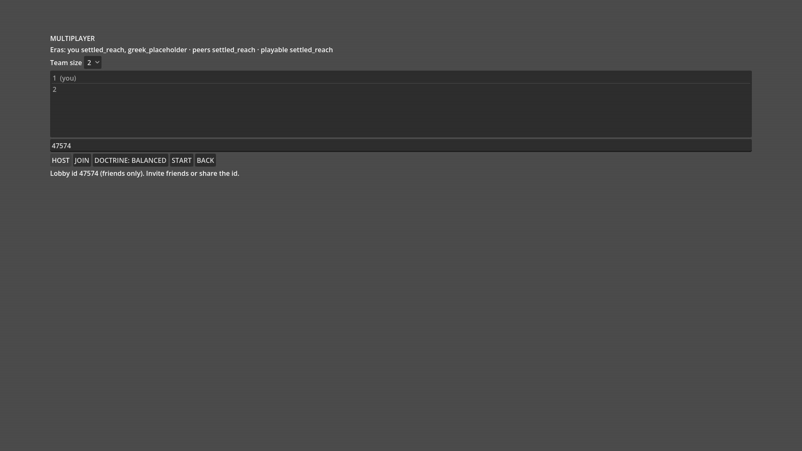

# Ouroboros Manifold

A multi-era real-time strategy game: a stochastic galaxy simulated in C, a Godot 4 client over a JSON pipe, deterministic to the byte across platforms. That is the product. The reason this repository is worth a look is how it is built: about 5,600 commits in two months, nearly all written by Claude agents, under a build harness that I designed, measured, broke, and rebuilt three times. Most of my engineering time went into the harness, not the game, and the harness is what this README is about.

| The galaxy between missions | The multiplayer lobby |
|---|---|
|  |  |

## The harness at a glance

**Roles, not models.** Work is split into tiers: an *Architect* (Fable) that writes specs, rulings and briefs and never writes code; a *Dispatcher* (Sonnet) that launches and lands work and decides nothing about rules or tests; *Engineers* that write tests, audits and clerk work; *Doers* that code against a written spec; and a local 30B model for mechanical cards overnight. Every spawn names its model, sub-agents never spawn sub-agents, and the human answers only two kinds of question: what a picture should look like, and what a rule means where nobody has recorded his words. Everything else the Architect decides and logs, and the human may veto.

**Tests are the spec.** Every story exists as failing tests before any code, in fenced paths builders cannot edit, each naming the story or rule it proves. Every detector ships with a positive control, so a check that cannot fail is itself a defect. A test is changed only when it is classed as a test-defect with a ledger row. Thresholds and tolerances belong to the human: narrowing one is allowed, loosening one needs him.

**Frozen contracts, one owner per file.** The C header and the pipe frames change only as their own documented piece. A table names the owner of every file, and two in-flight pieces never own the same one. New systems go in new files behind a frozen header; wiring them in is a separate, queued piece.

**A merge gate that is the only way to main.** Twenty-odd stages: build, lints that keep the C faithful to the bible's equations and the header's signatures, a reachability lint ("wired, not just tested"), ownership and fence checks, three test suites, a scripted playthrough of the real client under xvfb, story plays with screenshots, and an `-O0` versus `-O2` checksum trace that catches any non-determinism. A cheap pre-gate runs before every push so a lint reject never costs a full gate.

**Two build tools, chosen per piece.** A *Workflow* script (Claude Code's orchestration) for anything that ends in a frame, any single piece, anything that must stop for a human, and every landing. A *manager-mode cascade* (my own parallel TDD skill, in its own repo) for clusters of three or more file-disjoint units that share one spec, one contract and one umbrella test. Six questions in every spec decide which, because the two were measured against each other and neither wins everywhere.

**Token discipline as an engineering constraint.** Cost is context size times calls, and a cached re-read still costs a tenth of fresh input. So: many short-lived agents with small contexts ("width, not length"), run back to back while the cache is warm; builders push and stop, a fresh clerk lands; nobody polls from a large chat. Enforced, not just written: a hook blocks every tool call once a chat passes 400k tokens, the project compacts at 200k, shell output is compressed before it reaches the model, and the status line shows cost and context live.

**Drift checks on the process itself.** After every landing a script diffs the one status table, the ownership table and the review queue against git and fails on a mismatch. At every compaction a hook re-reads the chat's own transcript and prints, per method rule, how many turns broke it. A drift line is quoted to the human before any other work and is never argued away. Weekly, a fresh auditor that has not seen anyone's reasoning checks rulings against every epic they touch.

**A story is done when a human has seen it.** Green tests shipped grey squares once. Now every player-facing piece asserts a deterministic element inventory from the running client, attaches a screenshot to its landing, and waits in a review queue for one word from the human. A story moves to *Seen* only on his approval, and the gate flags a blank or near-uniform frame (warn-only until the rejection threshold is set).

**QA that plays like the user.** A desktop driver runs the real client at native resolution with real input and a live clock, and scripted story plays judge each story against its own words. API-driven QA at 720p once missed "nothing moves"; it does not run first-look QA any more.

**Memory and handoffs.** Chats restart often. Each role keeps continuation files and feedback rules in persistent memory, every decision is a logged row with its rule and context, and the journal is `git log`, never hand-written. A new Architect reads one file and continues.

## What we learned

Each of these is a scar, and the fix is in the repo. The incident records, with dates, commits and the owner's words, are in [`docs/northstar/lessons.md`](docs/northstar/lessons.md).

- **A harness that cannot fail will lie to you.** A build card was marked done overnight after a segfault, because an empty pytest run scored as zero failures, and it auto-merged. Now every detector has a positive control, every new test is proven red before the code exists, and a crashed run is a harness error, not a pass.
- **Context is the cost.** In the first three-day programme the two Architect sessions polled gates at 300k to 900k tokens of context and spent $1,130 of the programme's $1,487. Their judgement turns paid for themselves; their waiting turns did not. Waiting moved to a Sonnet Dispatcher, judgement comes from Fable by a one-page brief, and a hook now makes the limit physical.
- **A fork inherits everything.** One fork spawned late in a long session cost about 800k tokens. Fresh agents get a self-contained brief instead.
- **Spawn control is not optional.** One research brief grew a tree of fifteen agents, with model drift to the most expensive one on resume. Every brief now carries a no-spawn line and names its model.
- **Sonnet needs a role, not a plan.** Handed a design document, it turned it into a build list and did bookkeeping instead of running the game. Briefs are role-shaped, bounded and under a page.
- **One checkout per agent.** Shared checkouts leaked one agent's commit onto another's branch. Every agent works in its own worktree, made and reaped through one script with a disk cap, after the worktree count reached 558 and 258 GB.
- **Green is not seen.** With every test green, the owner played main and found 24-pixel squares on grey. Seven visible-game guards followed, from screenshots per piece to a two-column status (works in tests, seen by a player).
- **Measure the tools against each other.** Over one week, 32 Workflow runs produced 2 clean completions and 20 stops on spec or records gaps, at about $160 per landed piece; the one manager-mode cascade built 9 leaves in 90 minutes with no reverts, but admitted on the umbrella test alone. The answer was a hybrid with a written rule for choosing.
- **Ceremony has a cost curve.** The third retro asked whether the method had become the bottleneck: 348 test-defect rulings in five weeks, 2.24 test lines per game line, product commits falling from 397 to 18 a week. The verdict kept frozen contracts and fenced sim tests, and dropped tests-first for client pieces that are judged by eye.
- **Ambiguity is flagged, never guessed.** The first feature that shipped unverifiable was under-defined. Every open question is now a register row with two or three candidates, and an epic with an open flag is not built.

## By the numbers

| | |
|---|---|
| Commits since 2026-09-01 | about 5,600 |
| C simulation | about 40k lines (2,200 to 31,800 in one two-day push) |
| Godot client | about 84k lines of GDScript |
| Tests | 833 test files, about 155k lines; 2.24 test lines per game line |
| Method and design docs | about 66k lines of Markdown against 87k of game code |
| Three-day programme, 2026-10-07 | 98 of 118 pieces landed, 430 Sonnet agents, 847M tokens, $1,487 |
| Workflow week, 2026-10-14 | 32 runs, 2 clean, about $160 per landed piece |
| One manager-mode cascade | 9 leaves, 90 minutes, 0 reverts |
| Context-guard evidence | 638 of 1,456 Dispatcher calls above 400k tokens before the hook |

## Deep dive: where to look

**The rules the agents run under**
- [`CLAUDE.md`](CLAUDE.md): the short rule list every agent loads. Tiers, usage discipline, workflow pre-flight, the bible, architecture rules, tests, visible-game guards, git.
- [`docs/METHOD.md`](docs/METHOD.md): the ten-minute tour with a pointer to every source of truth.
- [`.claude/agents/`](.claude/agents/): the Architect (read-only), Engineer and Doer definitions, each pinned to a model.
- [`workflows_2026-10-07/rules.md`](docs/northstar/plans/workflows_2026-10-07/rules.md) and [`dispatcher.md`](docs/northstar/plans/workflows_2026-10-07/dispatcher.md): shared agent rules and the Dispatcher role.
- [`docs/northstar/agile.md`](docs/northstar/agile.md): Definition of Ready and the Prototype gate.

**Hooks and guards**
- [`.claude/hooks/context_guard.py`](.claude/hooks/context_guard.py): blocks every prompt and tool call past 400k tokens of context, letting only a handoff memory write through. Spec: [`2026-10-19-harness-enforcement-spec.md`](docs/northstar/plans/2026-10-19-harness-enforcement-spec.md).
- [`.claude/hooks/git-guard.sh`](.claude/hooks/git-guard.sh) and the deny list in [`.claude/settings.json`](.claude/settings.json): no force pushes, resets, rebases or amends from an agent.
- [`.claude/settings.json`](.claude/settings.json): the `autoCompactWindow`, and the compaction hook that runs the method check.

**The gate**
- [`scripts/specfactory/merge_gate.sh`](scripts/specfactory/merge_gate.sh) and [`pre_gate.sh`](scripts/specfactory/pre_gate.sh): the full gate and the cheap tier.
- [`reach_lint.py`](scripts/specfactory/reach_lint.py): behaviour must be reachable from the tick, the jump or a pipe handler, not only from tests.
- [`parent_patch_fence.py`](scripts/specfactory/parent_patch_fence.py): builders cannot touch tests.
- [`alg_constants.py`](scripts/specfactory/alg_constants.py) and [`sig_table.py`](scripts/specfactory/sig_table.py): the C stays faithful to [`docs/bible/algorithms.md`](docs/bible/algorithms.md) and the frozen header [`csrc/ouroboros_sim.h`](csrc/ouroboros_sim.h).
- [`checksum_trace.py`](scripts/specfactory/checksum_trace.py): the `-O0` versus `-O2` determinism check.
- [`owner_lint.py`](scripts/specfactory/owner_lint.py) over [`pieces.toml`](docs/northstar/plans/push/pieces.toml): one owner per file.

**Tests as the spec**
- [`tests/csim/`](tests/csim/): the C sim suite, named by story and rule. [`tests/transport/`](tests/transport/): pipe contract tests. [`tests/qa/desktop/`](tests/qa/desktop/): the desktop driver and the story plays.
- [`red_check.py`](scripts/specfactory/red_check.py) and [`green_check.py`](scripts/specfactory/green_check.py): prove a test fails before the code exists, then passes on the reference.
- [`control_liveness.py`](scripts/specfactory/control_liveness.py): every positive control still fires.
- [`spec_provenance.py`](scripts/specfactory/spec_provenance.py): every number in a spec traces to a source or a named draft.
- [`autoload/qa_daemon.gd`](autoload/qa_daemon.gd): the in-game daemon that answers `qa_state()` for the driver.

**The two build tools**
- [`scripts/specfactory/workflows/`](scripts/specfactory/workflows/): about seventy Workflow scripts, each a lane with tests-first, a ruler, gate agents and STOP rules.
- [`2026-10-21-tool-split-spec.md`](docs/northstar/plans/2026-10-21-tool-split-spec.md): the six questions that choose Workflow or cascade.
- [claude-manager-mode](https://github.com/Westopoli/claude-manager-mode): the cascade skill itself. Spec, contract and umbrella test locked first; a separate writer per shard writes failing tests; fresh auditors and a saboteur prove the tests go red against wrong code; leaves build in isolated worktrees; ten admission gates per leaf.
- [`retro_2026-10-21/workflows_vs_manager_mode.md`](docs/northstar/plans/retro_2026-10-21/workflows_vs_manager_mode.md): the measured comparison.

**Drift and method checks**
- [`status_check.py`](scripts/specfactory/status_check.py): twelve checks after every landing.
- [`method_check.py`](scripts/specfactory/method_check.py): the transcript check at compaction. Rules: [`method_check.md`](docs/northstar/plans/workflows_2026-10-07/method_check.md).
- [`method_metrics.py`](scripts/specfactory/method_metrics.py) with [`method_thresholds.toml`](scripts/specfactory/method_thresholds.toml): twenty-four measures of the method from git and the ledgers, run weekly.
- [`drift_audit.md`](docs/northstar/plans/workflows_2026-10-07/drift_audit.md): the weekly fresh-auditor procedure.

**Cost, worktrees, memory**
- [`retro_2026-10-10/tokens.md`](docs/northstar/plans/retro_2026-10-10/tokens.md), [`retro_2026-10-24/coordinator_tokens.md`](docs/northstar/plans/retro_2026-10-24/coordinator_tokens.md) and [`method_cost.md`](docs/northstar/plans/retro_2026-10-24/method_cost.md): where the money went, by model and by role.
- [`wt.py`](scripts/specfactory/wt.py): the only way to make, finish or reap a worktree; active-slot and disk caps.
- [`sdk_engineer.py`](scripts/specfactory/sdk_engineer.py) and [`batch_review.py`](scripts/specfactory/batch_review.py): clerk work and half-price batch reviews on API credit instead of the subscription ([`README_credits.md`](scripts/specfactory/README_credits.md)).
- [`scripts/journal.sh`](scripts/journal.sh): the journal is the git log.

**Records and retros**
- [`story_reviews/westley/decisions.md`](docs/northstar/story_reviews/westley/decisions.md): every decision with its rule and context.
- [`ambiguity_register.md`](docs/northstar/ambiguity_register.md): about five hundred open or answered questions, each with candidates.
- [`push_ledger_2026-09-22.md`](docs/northstar/plans/push_ledger_2026-09-22.md): what landed, why, and every test-defect ruling.
- The three retros: [2026-10-10](docs/northstar/plans/retro_2026-10-10/README.md) (the three-day programme and method rev 2), [2026-10-21](docs/northstar/plans/retro_2026-10-21/workflows_vs_manager_mode.md) (tools), [2026-10-24](docs/legacy/westley_hand_overs/method_retro_2026-10-24.md) (is the method the bottleneck).
- [`PLAN.md`](docs/northstar/PLAN.md) "The Factory": the failure modes the harness guards against, written after the first harness defect investigation ([`research/harness_defects_2026-09-17/`](docs/northstar/research/harness_defects_2026-09-17/)).
- [`2026-10-07-visible-game-programme.md`](docs/northstar/plans/2026-10-07-visible-game-programme.md): the seven guards and the lane table.
- [`docs/northstar/lessons.md`](docs/northstar/lessons.md): the incidents behind every rule, with evidence.

**The local-model side**
- [`card_lint.py`](scripts/specfactory/card_lint.py), [`gen_card.py`](scripts/specfactory/gen_card.py), [`dor_check.py`](scripts/specfactory/dor_check.py): cards for the local 30B, linted and checked against the Definition of Ready before they are queued. The queue and the overnight loop live in a separate project, Agora, which runs local models unattended and leaves Claude the judgement work.

**Not in this repo.** The cascade skill is its own repo above. Agent memory, the worktree workspace, gate locks and the overnight loop live on the build machine; the incidents in "What we learned" were copied out of that memory into [`docs/northstar/lessons.md`](docs/northstar/lessons.md).

### Open in the editor

Run `scripts/setup_editor.sh` once, and again after any pull that changes `csrc/` (it rebuilds a stale pipe, fills `addons/godotsteam/` and imports the project once). Then open `project.godot` in the Godot editor and press F5. The editor, the test gate and the beta export are all Godot 4.6.3. A stale pipe is refused at the galaxy with a message that says to run the script again. `scripts/setup_editor.sh --check` lists the steps and changes nothing. On a Mac, install Godot 4.6.3 from godotengine.org into `/Applications` and the Xcode command line tools (`xcode-select --install`) for `clang`; the one command is the same. `scripts/play_mac.sh` boots the game windowed and leaves it open; `--check` also verifies the main scene over the QA port, captures `proof.png` with `screencapture`, and refuses a console with errors.

### Watch a lab fight

A lab fight file (`L-####-s#.fight.json`, written by the arena runner) opens in the replay scene. On Linux:

```
OM_FIGHT=$PWD/<fight> scripts/play.sh --scene res://scenes/proto/fight_replay/fight_replay.tscn
```

On a Mac:

```
scripts/replay.sh <fight>
```

`scripts/replay.sh` finds Godot (`$GODOT`, `godot` on `PATH`, `~/.local/bin/godot.real`, the Godot app), imports the project once per checkout and opens the replay. `--shots <dir>` saves pictures there; `--dry-run` prints the two commands and runs nothing.

## Read next

- [`docs/METHOD.md`](docs/METHOD.md): how this repo is run
- [`docs/README.md`](docs/README.md): a map of `docs/`
- [`docs/bible/game_bible.md`](docs/bible/game_bible.md): what the game is
- [`docs/architecture.md`](docs/architecture.md): the pipe and the contracts
