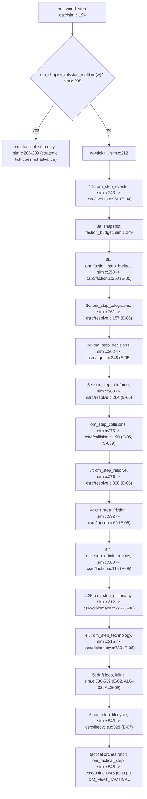
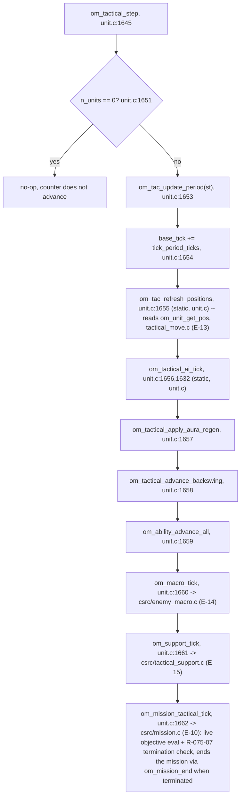

# Architecture — Cross-Stage Contracts

## MissionSetup.map_params

`MissionSetup.map_params` uses the `MapParams` TypedDict defined in `simulation/mission_contracts.py`.

```python
class MapParams(TypedDict, total=False):
    seed: int
    archetype: str
    region_id: str
    canvas_size: int
    generated: bool
```

### `seed` field lifecycle

- **Produced by:** `simulation/mission_generator.py` — generates `rng.randint(0, 2**31 - 1)` at mission creation time, stored in `map_params["seed"]`.
- **Consumed by:** `simulation/pipe_transport.py` — reads `setup.map_params.get("seed", current_tick)` when building `GeneratorInput` for the map generator.
- **Persisted by:** Stage 8's save/load system — `MissionSetup` is part of the tactical save blob; `map_params` round-trips through JSON transparently.
- **Fallback:** `current_tick` is used only for pre-Stage-11b saves that have empty `map_params`. This is temporary compatibility debt; once old saves are no longer supported, a missing seed should raise.

### Design authority

`docs/bible_history/bible_2_00_world.md:178` — *"…and a random seed (ensures reproducibility for replays and bug reports)."*
`docs/bible_history/bible_2_00_world.md:196` — *"the map is regenerated with a new random seed"* on fairness failure.

Added in Stage 11b (`stage_11b_map_variety_spec.md`).

## FairnessScore — metric skip semantics (Stage 11e)

`FairnessScore` in `simulation/fairness_evaluator.py` carries a `*_skipped` bool per metric (`path_balance_skipped`, `travel_time_skipped`, `vantage_skipped`, `hazard_skipped`).

When a layout has zero of a fairness-relevant node type on **both sides** (e.g., zero vantage nodes total), the corresponding metric is **skipped** — not counted toward the aggregate pass/fail. `is_acceptable()` passes when all non-skipped metrics fall within their tolerances.

This is a scope-narrowing fix per CLAUDE.md: balance of an absent node type is undefined, not "balanced." One-side-zero (e.g., player has 0 vantage, enemy has 3) is a real imbalance and still fails.

Added in Stage 11e (`stage_11e_fairness_reconciliation_spec.md`).

## Map Generation — Simple Picker (Stage 11e pivot)

`simulation/map_generator.py:generate_map()` uses a single-pass random picker:

1. Run archetype compatibility filter → candidate pool.
2. Pick one layout uniformly at random (seeded by `GeneratorInput.seed`).
3. Instantiate, assign reinforcement ownership, place gradients.
4. Evaluate fairness (score logged to `tuning_output/fairness_log/<date>.jsonl`, **not used for rejection**).
5. Return result.

No retry loop. `generation_metadata["fairness_retries"]` is always 0. The evaluator infrastructure (`FairnessScore`, `FairnessTargetProfile`, all four metrics) is preserved intact for the future redesign (`stage_11f_fairness_redesign_spec.md`).

## Objective Snapshot Extension (Stage 11d)

Each objective entry in the `objectives` array of a full snapshot now carries two additional fields:

### `is_primary` (bool)
Whether this is a primary objective. Always present.

### `location` (optional object)
Present only for objective types with a meaningful geographic center:
- `hold_zone`, `clear_zone` → `{"x": <zone_x>, "y": <zone_y>}`
- `escort_to_extraction` → `{"x": <extraction_x>, "y": <extraction_y>}`
- `eliminate_force` → centroid of living target unit positions; omitted if all targets are dead.
- `survive_duration`, `destroy_targets` → omitted (no location).

Shape when present: `{"x": float, "y": float}`

Renderer must tolerate missing `location`. Delta objective updates may carry `location` if it has changed since the last update; static-location objective types (`hold_zone`, `escort_to_extraction`) carry it only on full snapshots.

See also: `scenes/tactical/hud.gd` — consumes `objective.location` for marker rendering.

## World View Inspection Payloads (Stage 11g)

Stage 11g extends keyframe and chronicle-entry shapes to support per-region inspection panels, per-faction inspection panels, faction-color vivacity scaling, and clickable in-text mentions in the chronicle.

All extensions are **flag-gated** on the producer side. With the relevant flag off, payloads are bit-identical to pre-11g. Renderers must tolerate missing fields and degrade to current behavior.

### `regions_snapshot[]` per-region extension

`regions_snapshot` (in each keyframe, produced by `simulation/world_view/keyframe_selector.py`) gains four optional fields per entry. Existing fields (`region_id`, `owner_faction_id`, `significance`, `x`, `y`, `z`) are unchanged.

```python
{
    "region_id": "r_001",
    "owner_faction_id": "f_dominion",
    "significance": 0.84,
    "x": 12.4, "y": -3.1, "z": 7.8,

    # NEW (Stage 11g, gated on ENABLE_FACTION_PALETTE / inspection panels)
    "name": "Valen Reach",                    # Display name from theme_scifi
    "tier": "frontier",                       # "home" | "frontier" | "empty"
    "fields": {                               # 0..100 each, mirrors simulation Region fields
        "military": 42.7,
        "economy": 71.0,
        "tension": 18.4,
        "population": 53.2,
    },
}
```

- **Produced by:** `keyframe_selector.py::select_keyframes` — reads from `world.regions[rid]`. No engine modification.
- **Consumed by:** `scenes/shared/world_view/world_view_data.gd::set_region_metadata` and downstream `region_info_panel.gd`.
- **Fallback:** `region_info_panel.gd` and `faction_info_panel.gd` take the name for the id from `scenes/world/chronicle_names.gd` (A82); a `name` entry in this payload is not read. Missing `tier` → "frontier". Missing `fields` → panel shows "—" for each bar.

Composite axes (`stability`, `capacity`) are computed Godot-side from the four base fields and are **not transmitted**. This keeps the payload minimal and lets the formula evolve in one place.

### `factions_snapshot[]` (new top-level keyframe field)

Each keyframe gains an optional `factions_snapshot` array — one entry per living faction at that keyframe's tick.

```python
"factions_snapshot": [
    {
        "faction_id": "f_dominion",
        "name": "The Dominion",
        "archetype": "Conqueror",
        "tech_tier": 47,             # 0..100; docs/bible_history/bible_2_00_simulation.md:473
    },
    ...
]
```

- **Produced by:** `keyframe_selector.py` reading `world.factions[fid]`. Entries omit factions with zero owned regions at that tick (defeated factions appear in `ownership_history.previous_owners` instead).
- **Consumed by:** `WorldViewData.set_faction_metadata` → `faction_info_panel.gd`.
- **Aggregates** (military/economy/tension/population) are computed Godot-side as the mean of the faction's owned-region `fields`. Not transmitted.
- **Stability across keyframes:** `name`/`archetype`/`tech_tier` rarely change within a jump. The renderer caches per-jump and updates only on diff.

### chronicle entry mentions (A53, R-069-07; replaces the legacy Python `chronicle_entry.mentions[]` span design)

The mention contract is in the "chronicle frame" section above: every entry of the pipe's `chronicle` frame carries `text`, `mentions`, `expanded_text` and `expanded_mentions`. The sim (`csrc/chronicle.c`, accessors `om_chronicle_mention_count` / `om_chronicle_mention_get`) produces the spans while it fills the faction and region name slots; the pipe copies them; the client (`scenes/world/chronicle_entry.gd`, `chronicle_entry_expansion.gd`) wraps each span in a `[url=kind:id]` link and centres the galaxy on a click. The client finds no names by matching text. Wiring status: the sim accessors, the pipe fields and the client use land as three pieces in that order; until they land the pipe sends no mention fields.

### `ownership_history` (new field on `time_jump_start`)

`time_jump_lifecycle_messages::start_msg` gains an optional `ownership_history` field, produced by the new side-car `simulation/world_view/ownership_history.py`. Two parallel maps:

```python
"ownership_history": {
    "factions": {
        "f_dominion": {
            "region_count_history": [12, 11, 11, 9, 7],   # last 5 jumps, oldest first
            "status": "waning",                            # "rising" | "stable" | "waning" | "defeated"
        },
        ...
    },
    "regions": {
        "r_001": {
            "previous_owners": ["f_kestrel", "f_dominion"],   # most recent last; current owner not included
            "held_since_tick": 1820,
        },
        ...
    },
}
```

- **Produced by:** `ownership_history.py` — observes the keyframe sequence as it's built; reads `world.regions` and `world.factions` snapshots only. No engine modification.
- **Consumed by:** `region_info_panel.gd` (history one-liner), `faction_info_panel.gd` (status badge).
- **Fallback:** missing `ownership_history` → status badge defaults to "Stable", region panel shows "—" for previous-owners line.

### Producer/consumer summary

| Field | Producer file | Consumer file (Godot) | Flag |
|---|---|---|---|
| `regions_snapshot[].tier/fields` | `keyframe_selector.py` | `world_view_data.gd`, `region_info_panel.gd` | `ENABLE_INSPECTION_PANELS` |
| `factions_snapshot[]` | `keyframe_selector.py` | `world_view_data.gd`, `faction_info_panel.gd`, `faction_palette.gd` | `ENABLE_INSPECTION_PANELS` ‖ `ENABLE_FACTION_PALETTE` |
| chronicle frame `mentions[]` / `expanded_mentions[]` | `csrc/chronicle.c` → `csrc/pipe/om_pipe.c` | `chronicle_entry.gd`, `chronicle_entry_expansion.gd` | none (A53) |
| `time_jump_start.ownership_history` | `ownership_history.py` → `keyframe_message.py` | panels (history line, status badge) | `ENABLE_OWNERSHIP_HISTORY` |

### Design authority

- `docs/bible/epics/E-16-client-camera-hud-and-world-view.md` S-107 (faction data panel) and E-10 S-079 (briefing) — the region briefing card and enemy assessment card field lists were in `bible_monetization.md`, deleted 2026-05-31; the current design is the player-perception rules in those stories.
- `docs/bible_history/bible_2_00_world.md:466` — faction data panel with "name, total systems, aggregate stats."
- `docs/bible_history/bible_2_00_world.md:481` — chronicle text tinted in entry's primary subject's faction color.
- Faction color vivacity scaling, sim-pause-on-inspect, and clickable in-text mentions are stage-11g inventions; bible amendments are part of this stage's deliverables.

Added in Stage 11g (`stage_11g_world_view_inspection_spec.md`).

## Map Manifest — `cover_asteroids` field (Wave 2.5R)

`cover_asteroids` is emitted once at map manifest write (i.e., in the first full snapshot for a mission). It is **NOT** in the per-tick delta — asteroids are non-destructible in Phase 1 and static for the lifetime of the mission.

### Shape

```python
"cover_asteroids": [
    {
        "id":      a.asteroid_id,   # int — unique across the whole map
        "cluster": a.cluster_id,    # int — which spine-node cluster this belongs to
        "x":       a.x,             # float — world units
        "y":       a.y,             # float — world units
        "r":       a.radius_xy,     # float — footprint radius (world units)
        "h":       a.height,        # float — vertical extent; drives layer-block threshold
        "class":   a.scale_class,   # str  — "tiny" | "small" | "medium" | "huge"
    }
    for a in tactical_map.asteroid_field.asteroids
]
```

### Semantics

- Produced by `simulation/snapshot_serializer.py::serialize_cover_asteroids(tactical_map)`.
- Consumed by `scenes/tactical/terrain_renderer.gd::_scatter_cover_asteroids` at mission load.
- Layer-block rule: asteroid blocks layer `i` iff `asteroid.height >= LAYER_Z_FLOORS[i]` (see `config.LAYER_Z_FLOORS`).
- `delta()` never includes this field. Clients must not expect it in tick-delta payloads.

Added in Wave 2.5R (`cover_asteroid_los_spec.md`).

## C transport v1 (2026-09-22, the tick-delta rule: shapes first, then T1 builds them)

The C pipe server (`pipe/ouroboros_pipe`, source `csrc/pipe/om_pipe.c`, piece T1) speaks to Godot over stdio with the same framing the old Python pipe used, so `autoload/sim_bridge.gd`'s reader is reused: **4-byte big-endian length prefix, then UTF-8 JSON**, both directions (the C server reads commands from stdin with the same framing; the temp-file command channel is retired). Every message has `"type"`. The server carries **no names, no positions, no prose** (decision C5): the client layout pass owns positions and the offline library owns names and prose; the server sends indices, ids, enum ints and numbers only. Keys are stable; a client ignores keys it does not know; a removed key fails `tests/transport/test_pipe_shapes.py`.

Enums are sent as the header's integer values (`om_tier`, `om_archetype`, `om_stance`, `om_edge_type`, `om_feature`, `om_bug`); the client maps them through `EraThemeResolver` or a table, never by name.

### hello (server to client, once)
```json
{"type":"hello","abi":10,"layout_ok":true,"seed":1,"n_regions":60,"features":[1,2,3,6],"checksum_cadence":10,"player_faction":-1}
```
`abi` is `om_abi_version()` (10 since H-041; 9 since LAB-REV2-E0; 8 since VG-CONTRACT-E7; 7 since VG-K-e5; 6 since VG-K-e; 5 since VG-K0; 4 since PP-contract; 3 since HDR3); `layout_ok` is `om_abi_layout_check(sizeof rows)`; `features` lists the enabled `om_feature` ids. `player_faction` is always -1 at hello time (no world is configured yet; the real value is available via `om_player_faction(w)` after `set_seed`).

### snapshot (server to client, on request and after `load`)
```json
{"type":"snapshot","tick":10,"checksum":1234567890,
 "regions":[{"i":0,"owner":-1,"tier":1,"military":12.5,"economy":30.0,"tension":8.0,"population":20.0,"stability":61.2,"capacity":44.0}],
 "factions":[{"id":0,"archetype":2,"budget":100.0,"tech":1.5,"stance":[3,1,2]}],
 "edges":[{"a":0,"b":1,"t":2}],
 "telegraphs":[{"attacker":0,"target":7,"commit":40.0,"declared_tick":8}],
 "player_faction":0,"chapter":1,"commander":4,"lineage":2}
```
`chapter` (B6, R-055-06) is `om_chapter_get_number`: the opening jump belongs to chapter 1 and the number advances once at the end of each jump that follows a mission, played or refused. `commander` is `om_campaign_commander`, the character id the selector last picked (R-055-04), 0 only before the first selection; the selector seats the first one at the end of the opening jump (R-057-09), so after `set_seed` it is non-zero. `lineage` is `om_campaign_lineage`, the lineage id of that commander (uint, 0 before the first selection, non-zero after `set_seed`); it changes only when the selector rotates to a character of another lineage. `regions[i]` is by index; `owner` is `om_region_owner` (-1 unowned); the six numbers are the four fields and two composites, post-clamp, two decimals. `checksum` (here and on every tenth `delta`) is `om_world_get_state_checksum`, a uint64 written as a JSON number: a client whose JSON parser rounds integers through a double (Godot's `JSON.parse` does) must read the digits off the wire, as `autoload/c_bridge.gd` does; sending it as a string is a v2 shape question. `set_seed` generates the world (`om_world_new` then `om_world_generate`; a pinned `n_regions` below the feasible minimum makes generation fail and `set_seed` answers `error` instead of a frame), so the snapshot below reflects the generated owners, edges and tiers; the fixture is produced the same way, through `scripts/specfactory/snapshot_fixture.py --generate`. `factions[].stance[k]` is `om_faction_stance(id, k)` for every faction k. `edges` is the full undirected edge list once (`a < b`). `telegraphs` is `om_pending_telegraphs`. `player_faction` (T1-14, additive): `om_player_faction(w)` — faction index whose archetype is OM_ARCH_PLAYER, or -1 when none. After a successful `set_seed` worldgen assigns OM_ARCH_PLAYER to faction 0, so this is always 0 in a live session; -1 is included in the contract for defensive clients. The tactical frame's `visible` dict uses the same faction index as a string key (`"0"`) for the player's fog-of-war set.

### delta (server to client, every tick after a `step` or during `run_to`)
```json
{"type":"delta","tick":11,"checksum":0,
 "regions":[{"i":3,"owner":0,"military":11.0,"economy":30.4,"tension":7.5,"population":20.1,"stability":62.0,"capacity":44.2}],
 "events":[{"tick":11,"region":3,"template":5,"chain":-1,"source":0,"delta":[0,-2.0,3.0,0],"creates_faction":0}],
 "attacks":[{"attacker":0,"target":7,"band":2,"conquest":1,"d_military":-13.6,"d_economy":-5.4,"d_tension":10.9,"collision":0}],
 "collisions":[{"target":7,"factions":[0,1],"winner":0,"margin":0.741,"refund":6.2}],
 "revolts":[{"region":9,"faction":1,"roll":0.02}],
 "factions":[{"id":0,"budget":60.0,"tech":1.5}]}
```
Only regions whose stored values changed appear; `checksum` is the world checksum on cadence ticks, else 0; the lists come from `om_tick_events`, `om_tick_attacks`, `om_tick_collisions`, `om_tick_admin_rolls` and are empty arrays when nothing fired. A client that misses a delta requests a snapshot.

### command (client to server)
```json
{"type":"cmd","name":"step","n":1}
{"type":"cmd","name":"run_to","tick":500}
{"type":"cmd","name":"snapshot"}
{"type":"cmd","name":"set_seed","seed":7,"n_regions":60,"features":[1,2,3,6]}
{"type":"cmd","name":"set_feature","feature":4,"on":true}
{"type":"cmd","name":"inject","bug":6}
{"type":"cmd","name":"objective_complete","objective":0,"completion":1.0}
{"type":"cmd","name":"place_structure","kind":0,"owner":1,"x":0.0,"y":0.0}
{"type":"cmd","name":"save","path":"saves/slot1.omsave"}
{"type":"cmd","name":"load","path":"saves/slot1.omsave"}
{"type":"cmd","name":"quit"}
```
`set_seed` creates the world with `om_world_new(N, S)` (`N` = 0 means the count is drawn and lifted to the feasible minimum, Q-021-07; a pinned `N` below the feasible minimum makes generation fail), sets the listed features, then calls `om_world_generate(w)`. If `om_world_generated(w)` is 0, the server answers `{"type":"error","name":"set_seed","reason":"generation failed"}` — the one case where `set_seed` emits a frame. On success, `set_seed` also calls `om_mission_load_launch_library(w)` (csrc/mission.c; a dependency of handle_mission_start's R-080-03 fallback below, no observable effect otherwise) then, unless the request carries `"new_campaign": false`, `om_campaign_start(w, 1)` (csrc/generational.c): the R-056-04 opening jump, [20, 50] strategic ticks, before anything else can touch this world. `new_campaign` defaults to `true` (every raw `set_seed` and every production caller except one wants the jump); `autoload/c_bridge.gd`'s `load()` is the one caller that sends `false`, since the `load` command it sends right after completely overwrites tick/regions/chapter from the save file anyway — running the jump first would only waste time. After that, it is silent (no ack, no snapshot): `tests/transport/test_pipe_shapes.py` requires the first frame after `hello` to be the first `step` delta, so a client that wants the fresh world sends `snapshot`. Every other command is answered by `{"type":"ack","name":"...","tick":N}` or `{"type":"error","name":"...","reason":"..."}`; `run_to` streams deltas then one ack. `inject` exists only in the debug build (`error` otherwise). **TEST AND DEBUG VERB**: `objective_complete` sets objective `objective` (0-indexed) to `completion` (0..1, default 1.0) via `om_mission_set_objective_completion`; also debug-build only (`pipe/ouroboros_pipe_dbg`); used to drive a mission to TOTAL_SUCCESS in transport tests. **TEST AND DEBUG VERB**: `place_structure` places a production structure in the live tactical world and replies `{"type":"ok","structure":<id>}` where `id` is the zero-based structure slot index (0, 1, … up to 63 max). Gated: debug build only (`-DOM_DEBUG_INJECT`); in a non-debug pipe it answers `{"type":"error","name":"place_structure","reason":"debug build required"}` exactly like any other debug-only verb. Requires a world (`error` otherwise). `kind` is the unit type the structure produces: 0=RAIDER, 1=INTERCEPTOR, 2=VANGUARD, 3=WARDEN, 4=BOMBARD, 5=BASTION (builtin roster, same integers the ctypes fixtures use for `om_structure_init`'s `unit` arg; E-15 has one structure kind — there are no separate structure kinds, only the unit type it produces). `owner` is the E-05 faction id (-1 = neutral: no production; any other value is passed to `om_structure_set_owner` as-is). Note: on today's main the production driver guards `s->owner == 0` as neutral; end-to-end production of a player-owned structure (E-05 faction 0) only works once W-1d lands (changes neutral from 0 to -1 in the owner id space). Structure position is set via `om_structure_set_position` after `om_structure_init`; the `x`/`y` request fields are applied to the structure. Bad-arg errors: `{"type":"error","name":"place_structure","reason":"no world"}` if no world; `{"type":"error","name":"place_structure","reason":"missing kind"}` if `kind` absent; `{"type":"error","name":"place_structure","reason":"kind out of range"}` if kind < 0 or kind > 5; `{"type":"error","name":"place_structure","reason":"missing owner"}` if `owner` absent; `{"type":"error","name":"place_structure","reason":"structure limit"}` if all 64 slots are used. No frame exposes placed structures: the tactical frame lists units and map nodes only; the effect of a placed structure is observed through the units it produces after enough tactical steps. `save`/`load` use T2's `om_save_state_*`; `load` replies with the post-load `snapshot` or an `error` (see session commands).

### tactical frame (full frame on `snapshot`, every 20th step and on request; delta frame otherwise)
```json
{"type":"tactical","tick":120,"mission_over":false,"band":-1,"objectives":[{"i":0,"progress":0.0}],"map":{"canvas":16000,"nodes":[{"i":0,"kind":0,"x":8000.0,"y":9200.0}],"cover":[{"x":1.0,"y":2.0,"r":120.0,"h":40.0}],"obstacles":[{"x":1.0,"y":2.0,"r":200.0}]},
 "full":true,
 "units":[{"id":4,"faction":0,"type":1,"tier":0,"x":100.0,"y":200.0,"hp":80.0,"layer":1,"facing":1.57,"target":-1,"state":0}],
 "visible":{"0":[4,5,9]}}
{"type":"tactical","tick":121,"mission_over":false,"band":-1,"objectives":[{"i":0,"progress":0.25}],"full":false,
 "units_changed":[{"id":4,"faction":0,"type":1,"tier":0,"x":101.0,"y":200.0,"hp":80.0,"layer":1,"facing":1.57,"target":-1,"state":0}],
 "units_removed":[7],
 "visible":{"0":[4,5]}}
```

Unit object fields `tier` and `state` are filled (VG-K-a, supersedes the A30 reservation): `tier` is the unit's roster tier (Q-133-02, `om_faction_unit_tier` of its faction, fixed for the mission), `state` the OR of the bits in the "Visible-game tactical fields" section below. `tests/transport/test_pipe_tactical_tier_state_reserved.py` pins `state` present with no bits outside 1|2|4.

Delta frame (A7, 2026-10-01 ruling; E-13 pipe budget: one `tactical_step` round trip, request sent to frame parsed, under 100 ms at 5,000 units). Every `tactical` frame carries `full`. A full frame (`"full":true`) has `map` and the complete `units[]`; a delta frame (`"full":false`) has `units_changed[]` and `units_removed[]` instead, and no `map` and no `units`. Exactly one of `units` / `units_changed` is present.
- Full frames are written by `snapshot` (while a tactical map is loaded), by `mission_begin`, on every 20th `tactical_step` step counted from `mission_begin` (a call with `n > 1` whose steps cross a multiple of 20 writes a full frame), and when the request carries `"full":true` (below). Every other `tactical_step` writes a delta frame.
- `units_changed[]` is every unit, same object shape as in `units[]`, whose serialised fields differ from the last frame written, plus every unit spawned since it. `units_removed[]` is the ids of units that were in the last written frame and no longer exist (dead or despawned). Both are relative to the last frame written, not to the last step run.
- `visible` is present on every frame, full or delta, and holds only the player's faction (`player_faction`), the complete id list each time; other factions' keys are never written. It is not diffed.
- `tactical_step` with `n > 1` runs all `n` steps and writes one frame, for the last step; the delta is taken against the last frame written, so no change from the skipped steps is lost.
- `mission_over` and `band` ride every frame, as before.
- `objectives` (A6, 2026-10-01 ruling) rides every frame, full or delta: one `{"i":0,"progress":0.0}` per mission objective, in the mission frame's order, `i` the same index and `progress` the live completion (0.0 to 1.0, the same value as the mission frame's `objectives[].progress` and `om_mission_get_objectives`). It is never diffed: the whole array is written each frame. It lets the HUD show objective completion during play without a second request; the objective's `kind`, `node`, `radius` and `primary` stay in the mission frame.

Reconstruction. The client keeps a dictionary `id -> unit`. On a full frame it replaces the dictionary with `units[]` and keeps `map`. On a delta frame it deletes every id in `units_removed`, then inserts or overwrites every entry of `units_changed`. After any frame the dictionary equals the full state at that frame's `tick`; a client that lost a frame or doubts its state sends `tactical_step` with `"full":true`, and the next full frame resynchronises it.
Tactical positions are sim state (units move in the sim), so they are sent; strategic region positions are not. `visible[faction]` is built per unit from `om_player_can_see_unit` (`csrc/pipe/om_pipe.c:1126`), not from `om_visibility_compute`, which is a cache primer with no caller in play.

`mission_over` (B9-N, 2026-09-28) is `om_mission_has_ended(w)`: true once the sim itself has ended the current mission (R-075-07's termination check, run every tactical tick by `om_mission_tactical_tick`, `csrc/mission.c`, off the real objective completion and the real R-076-01 time limit -- not only in response to an explicit `mission_end` command). `band` is `om_mission_get_band(w)`, the `om_mission_band` enum int (same values the debrief frame's `band` carries) or `-1` (`OM_MISSION_BAND_UNKNOWN`) while the mission is still running. Both are `false`/`-1` on every tactical frame until the sim ends the mission, then stay fixed at their ending values (R-076-03: the result is decided once). The client routes to the debrief the same way its own End Mission control does (`scenes/tactical_c/tactical_view.gd`) the first time it sees `mission_over` true; sending an explicit `mission_end` afterward still works unchanged and answers the normal `debrief`/`snapshot` pair.

Live wiring gap (see `docs/bible/epics/E-10-missions.md` S-075): only the `hold_zone` and `eliminate_force` primary objective kinds are evaluated from real battlefield state today (enemy units inside the objective radius; live enemy HP against the HP recorded at spawn). `destroy_targets` and `escort_to_extraction` (Siege Breaking, Assault, Interception, Evacuation) stay at 0 completion for the whole mission -- no live mission marks a "designated target" subset distinct from the whole enemy force, and none places an extraction point -- so those four archetypes only ever reach `mission_over` via the time limit or the player's force being wiped, never via their own objective. `survive_duration` is never a live archetype's primary kind and is not evaluated either.

### chronicle frame, mission frame, debrief frame (on `snapshot` after a jump, mission start, mission end)
```json
{"type":"chronicle","jump":{"from_tick":100,"to_tick":150,"chapter_end_reason":0},"entries":[{"id":12,"start_tick":103,"end_tick":110,"category":3,"cluster_type":1,"refs":{"regions":[3],"factions":[1]},"fragment":417,"fragment_ids":[417,12,-1],"significance":0.8,"text":"The Iron Vale held.","mentions":[{"start":0,"len":13,"kind":"region","id":3}],"expanded_text":"The Iron Vale held, and the Dominion watched.","expanded_mentions":[{"start":4,"len":13,"kind":"region","id":3},{"start":28,"len":12,"kind":"faction","id":1}]}],"ownership":{"stride":2,"from_tick":100,"n_regions":4,"snapshots":[[0,0,1,-1],[0,0,1,-1],[0,1,1,-1]]},"keyframes":[103,120]}
{"type":"mission","archetype":2,"region":7,"deadline_ticks":900,"objectives":[{"i":0,"kind":1,"node":3,"primary":true,"radius":300.0,"progress":0.0}],"force":{"types":[2,2,1,0,0,0],"tiers":[2,2,1,0,0,0]},"briefing":{"situation":"...","objective":"...","assets":"..."},"parity":0.85,"commander_unit":0,"quiet_world":false}
{"type":"debrief","band":2,"achieved":0.8,"brought_home":0.6,"region_delta":{"military":-4.0,"economy":2.0,"tension":-3.0,"population":0.0},"commander_fate":2}
```
The `chronicle` frame (G-C3, A48 item 13) carries two sim-owned fields for the jump replay; the client derives neither. Both are optional: present when a completed jump holds a timeline, omitted when none does (see Wiring status). The example's snapshot list is abbreviated (a real 50-tick jump carries 26 snapshots):
- `ownership`: `{"stride":2,"from_tick":N,"n_regions":R,"snapshots":[[owner per region,...],...]}`. `stride` is `OM_OWNERSHIP_TIMELINE_STRIDE`, `from_tick` is `jump.from_tick` (the tick before the jump's first tick), `n_regions` is the world's region count and each snapshot has exactly that many entries, the faction id owning the region or -1 unowned. Snapshot `k` is the state at tick `from_tick + stride*k`, so snapshot 0 is the state before the jump and the list holds `jump_ticks/stride + 1` snapshots (`om_time_jump_report.n_snapshots`). For an even jump length the last snapshot is the state at `jump.to_tick`; for an odd length no final snapshot is added (the last one is one tick before `to_tick`) and the replay's last picture is the live world the client already holds after the jump (A59). The pipe reads them with `om_time_jump_ownership_snapshot_count` and `om_time_jump_get_ownership_snapshot(w,k,owners_out,cap)` (`csrc/generational.c`) after `om_time_jump_run`. At about 400 regions the field is about 40 KB of JSON.
- `keyframes`: `[tick,...]`, the ticks `om_chronicle_generate_map_keyframes` chose (R-069-05: a keyframe inside every entry's tick range, and one at every ownership change). The pipe calls that function after `om_time_jump_run` and lists the result through `om_chronicle_keyframe_count` and `om_chronicle_get_keyframe(w,i,&tick)` (`csrc/chronicle.c`), sorted ascending with no duplicates. Keyframes are per jump: the sim clears the list when a jump starts, so before the pipe calls `om_chronicle_generate_map_keyframes` after `om_time_jump_run` the count is 0. This is what wires `om_chronicle_generate_map_keyframes` into play.

Timelines are memory-only and are not saved. A `chronicle` frame is sent only after a jump, so `load` (which answers a `snapshot`) produces none: after a load there is no timeline and the client shows the scroll over the final state with no replay. Should a `chronicle` frame ever be written while `om_time_jump_ownership_snapshot_count` is 0, the pipe omits `ownership` and `keyframes` rather than sending empty ones. The next jump after a load builds a fresh timeline. The client issues that jump once, from Proceed on the debrief (`load_chronicle_live`); the bridge holds the frame, and the sequencer (`time_jump`) and its embedded scroll panel only read it (A69, A75): opening either scene sends no command, and with no frame held the scene shows the scroll empty, with no replay and the PROCEED and EXIT TO MAIN MENU controls. About 40 KB per jump at 400 regions is accepted; it is sent once per jump.

Wiring status: the fields and accessors are specified here and land with their implementation (generational.c, chronicle.c, then `write_chronicle` in `csrc/pipe/om_pipe.c`, then the client); until then a `chronicle` frame carries neither field.

The `mission` frame (A4, 2026-10-01 rulings) carries these fields, always all present:
- `archetype`, `region`, `deadline_ticks`: the chosen mission, from the mission accessors. No frame carries a name; the client derives the position's name from `objectives[0].node` and `region` with its existing derivation (`chronicle_names.gd`), and there is no `position_name` field.
- `objectives[]`: one `{i,kind,node,primary,radius,progress}` per objective. `i`, `kind`, `primary`, `progress` come from `om_mission_get_objectives`; `node` is `om_objective_get_node` (map-node index, -1 if none) and `radius` is `om_objective_get_radius` (map units, 0.0 if none).
- `force`: `types` is six counts, one per unit type in type-id order; `tiers` is six tiers, one per unit type in the same order. Both are tallied from `om_mission_get_force_count` / `om_mission_get_force_unit` over the player's spawned force. The worked example `[2,2,1,0,0,0]` is a correct frame.
- `briefing`: `{"situation":"...","objective":"...","assets":"..."}`, the three texts of `om_mission_assemble_briefing` (R-079-01); a part whose `has_situation`, `has_objective` or `has_assets` is 0 is the empty string. The client shows the three texts and no raw numbers (R-079-04).
- `parity`: number, the player's parity for this mission (`om_mission_get_player_parity`). Data for tests and QA only; the client never renders it (the Assets text already states parity in prose, R-079-01).
- `commander_unit` (B7, Q-077-02, R-077-05): uint32, the unit id the player assigned as commander (`om_mission_get_commander_unit`), 0 while none is assigned (a spawned unit id is never 0 in this frame, so 0 is the sentinel). Always present. It is 0 in the frame `mission_start` answers; the client assigns one with `assign_commander` before `mission_begin` (default the first unit of the roster) and may reassign it during play.
- `quiet_world`: boolean, see `mission_start` below.
- The `debrief` frame (B7) gains `commander_fate`: int, `om_debrief.commander_fate`, `0` killed (the assigned commander unit died, R-077-03), `1` wounded (alive below 30 percent HP, cosmetic and chronicle only), `2` survived. The client says "killed in action" for `0`. It is read from the unit assigned at the moment the mission ended; a mission that ended with no commander assigned reports `2`. A `mission_refuse` debrief omits the field (nothing was deployed).

Wiring status: the pipe sends `node`, `radius`, `force`, `briefing`, `parity` and `commander_unit` from the sim. `quiet_world` is always `false` until the A3 fallback lands. `commander_unit` is 0 until the B7 assign piece lands. `force.types` counts units per type over the six types, and `force.tiers` holds the highest unit tier per type, which is 0 today because the unit `tier` field is reserved and always 0 (A30, see the tactical frame).

`jump.chapter_end_reason` (B6, R-055-06, A14) is per jump and is `om_chapter_last_end_reason`: the reason of the chapter this jump ended, 0 `GEN_CHAPTER_END_NORMAL`, 1 `GEN_CHAPTER_END_COMMANDER_DEATH`, 2 `GEN_CHAPTER_END_FACTION_COLLAPSED` (`csrc/generational.c`; collapse wins when both hold). It is 0 when the jump ended no chapter: the opening jump and a retry jump, so a collapse jump reads 2 and the retry jump after it reads 0. When the collapse check fires, the sim reassigns the player faction (`om_player_faction_reassign_on_collapse`, R-062-02, A26: the previous-descendant then nemesis-descendant pools of R-058-01 to R-058-03, rolled as in any rotation, restricted to candidates whose own faction field still holds a region, with the 2 hops measured from the last mission's region (`om_mission_last_region`); an unrelated roll falls through previous, then nemesis, and the pick creates no character; the player joins the faction of the candidate drawn, and with both pools empty the surviving faction with the most regions is chosen, ties uniform from the seeded stream) right after the check and before the mission generator, so the generator runs the same jump and the snapshot's `player_faction` changes with it; the reassignment does not repeat on the next jump. When no faction survives (R-062-03) the jump stops after the check and takes `om_campaign_trigger_terminal_restart`: no generator, no selector, no chapter advance. Open item: the wire has no field telling the client the campaign ended; none is added in B6. The lineage chapter count (`om_lineage_chapter_count`, A17) is sim-side only and not on the wire.

`fragment_ids` are the entry's opening/detail/closing library indices into `library/chronicle/fragments.json` (`om_chronicle_entry.fragment_ids` via `om_chronicle_entry_get`; -1 means the slot is unused). `fragment` is `fragment_ids[0]` kept for the client until it switches to the array. When `om_chronicle_entry_get` returns 0 for a cluster (text pass did not run for it), `fragment_ids` is `[-1,-1,-1]` and `fragment` is -1. `refs.factions` carries the entry's faction ref: the region owner for an owned-region entry, `[]` only when the entry has no faction. `start_tick`/`end_tick` are the cluster's event window; entries whose cluster has no event ticks (`start_tick==end_tick==0` on `om_chronicle_cluster` — REGIONAL, LINEAGE, and CONSEQUENCE clusters are always pushed with 0/0) take the jump window (`from_tick`/`to_tick`) so they are placeable on the timeline. CHAIN clusters carry actual event ticks from `chron_build_chain_clusters`. `text` and `expanded_text` (A53) are the entry's `base_text` and `expanded_text` from `om_chronicle_entry_get`, the finished prose the sim assembled (UTF-8 in the JSON string, library text holds multi-byte characters such as the em dash); they cross the pipe so that mention offsets point at text the client actually has. `mentions` is for `text` and `expanded_mentions` for `expanded_text`: each `{"start":S,"len":L,"kind":"faction"|"region","id":N}` is a Unicode code point offset and length into that string as sent (not bytes), `kind` `"faction"` with a faction id or `"region"` with a region index, in text order, never overlapping, the span covering the name as it stands in the text (a name at the start of a sentence has its first letter upper-cased there), `[]` for an entry with no mention. They come from `om_chronicle_mention_count`/`om_chronicle_mention_get`, produced where the sim fills the name slots; nothing in the pipe or client searches text. A name the assembler later rewrote (synonym, anaphora) or truncated off the end is not a mention, and an unowned region's "an unclaimed people" is not a faction mention. For a cluster `om_chronicle_entry_get` rejects, all four fields are `""`/`[]`. Clicking a faction mention centres the galaxy on that faction's territory, a region mention on that system (R-069-07); the client side of the click is not part of this frame. Objective `kind` and `node` are E-10/E-17 enums and node indices.

### session commands (v1.1, 2026-09-24; T1-2 builds them test-first)
The frames above already say what a mission, a jump and a tactical stream look like; these are the commands that produce them. The pipe session is persistent: the client keeps the process open for the whole run and consumes `delta` frames as they stream (the one-shot set_seed/step/snapshot/quit script in `autoload/c_bridge.gd` is the v1 stopgap and goes with C2-4). The client requests the launch strategic feature set (`features` = every strategic `om_feature` id, defined once as `DEFAULT_FEATURES` beside `DEFAULT_N_REGIONS` in `c_bridge.gd`); with `[6]` alone nothing ever changes owner.
```json
{"type":"cmd","name":"mission_start","faction":0,"era_kind":0}
{"type":"cmd","name":"mission_begin"}
{"type":"cmd","name":"mission_refuse"}
{"type":"cmd","name":"assign_commander","unit_id":4}
{"type":"cmd","name":"mission_end"}
{"type":"cmd","name":"jump","ticks":50}
{"type":"cmd","name":"tactical_step","n":1}
{"type":"cmd","name":"tactical_step","n":1,"full":true}
{"type":"cmd","name":"command","verb":"move","units":[4,5],"x":100.0,"y":200.0}
{"type":"cmd","name":"command","verb":"attack_move","units":[4],"x":100.0,"y":200.0}
{"type":"cmd","name":"command","verb":"attack_target","units":[4],"target":9}
{"type":"cmd","name":"command","verb":"hold","units":[4]}
{"type":"cmd","name":"command","verb":"activate_ability","units":[4,5],"x":100.0,"y":200.0}
{"type":"cmd","name":"list_saves","dir":"saves"}
{"type":"cmd","name":"net_reset"}
{"type":"cmd","name":"net_submit","tick":12,"peer":0,"seq":0,"verb":0,"arg":0,"layer":0,"x":100.0,"y":200.0,"units":[4,5]}
{"type":"cmd","name":"net_step","n":10,"checksum":true}
{"type":"cmd","name":"net_checksum"}
{"type":"cmd","name":"net_log_dump"}
{"type":"cmd","name":"net_log_load","hex":"0a0b"}
{"type":"cmd","name":"net_state_get"}
{"type":"cmd","name":"net_state_put","hex":"0a0b","tactical_tick":100,"steps":100,"mission_archetype":0,"placed_structures":0}
{"type":"cmd","name":"net_state_diff","state":"0a0b"}
```
`mission_start` takes an optional integer `era_kind` (0 space, 1 ground; default 0 when absent, R-001-07) and calls `om_set_era_kind(w, era_kind)` before `om_mission_setup`; any other value answers `{"type":"error","name":"mission_start","reason":"bad era_kind"}` and changes nothing. It also takes an optional flat `movement_kinds` array `[type_id, kind, type_id, kind, ...]` (kind 0 flying, 1 walking; default empty; an odd length or a kind other than 0 or 1 answers `error` reason `bad movement_kinds`), applied with `om_roster_set_movement_kind` before `om_set_era_kind`. In a ground era the mission generates its terrain from the mission seed; when `om_terrain_generate` fails the pipe answers `{"type":"error","name":"mission_start","reason":"terrain generate failed"}` and starts no mission; a space mission clears any terrain a previous mission left (`om_terrain_clear`). Save format version is 12: `era_kind` and the movement-kind table are saved, and since K-e the lots, the density grid, the strongpoints, the doctrine and the wave log (section "Visible-game economy fields"). It calls `om_mission_start(w, faction)` and answers the `mission` frame (fields above). `quiet_world` (A3, R-072-08) is a boolean, always present: `false` when the mission came from the scored candidate pool, `true` only when the pool stayed empty through the R-072-07 retries (up to 5 further 20-tick jumps) and the mission is the fallback Defensive Stand set up through `om_mission_setup_fallback(w, region_idx, enemy_faction)` on the player's weakest region (lowest ALG-09 stability composite, ties to the lowest region index). Both picks come from core, `om_mission_fallback_region` and `om_mission_fallback_enemy` (`csrc/mission.c`), which the pipe and the in-jump mission generator share, so they cannot disagree. The enemy is the non-player faction nearest that region by connection hops (breadth-first over the region graph; ties to the highest total `OM_F_MILITARY` over the faction's regions, then the lowest faction id; a faction with no path to the region ties with the other unreachable ones and loses to any reachable one, A50); `mission.c` sets its power P to that faction's strongest region's military times 2000 (R-074-01), raised to one unit of the enemy's cheapest profile if it would otherwise field nothing, and the player's budget is P times parity (R-074-04). It is a simulation-health warning, not a client feature: a tuned galaxy always has an attack somewhere, so a consumer treats `true` as a defect signal, never as normal play. The field lives in the `mission` frame only: `om_trace_row` (the T1 trace) is one fixed-width row per tick and region, defined in `csrc/ouroboros_sim.h`, and carries no mission state; while the mission phase holds, `step` and `run_to` are refused with `error` (R-055-02: the strategic sim is stopped) and `tactical_step` drives `om_tactical_step` `n` times (default 1) and answers one `tactical` frame per call, for the last step only; `full` (boolean, default false, optional) forces that frame to be a full frame (A7: `snapshot` also answers a full tactical frame, but `full` saves the second round trip; `n` may be 0 to write a full frame with no step). `mission_start` leaves the mission in the recon phase (E-12 S-092: terrain visible, no enemy, no unit moves, clock stopped); `mission_begin` is the player's Begin: it calls `om_mission_begin` (recon ends only here, never on a timer), moves the phase to tactical and answers a `tactical` frame; `mission_begin` outside a recon-phase mission answers `error`. `mission_end` calls `om_mission_end`, answers the `debrief` frame (`om_mission_get_debrief`) and then a `snapshot`. It takes an optional number `retention`, tooling only and debug build only (`pipe/ouroboros_pipe_dbg`, `OM_DEBUG_INJECT`): a value outside 0 to 1, or not a number, answers `error` reason `bad retention`; in the release pipe any `retention` answers `error` reason `debug build required`; either error changes nothing and the mission stays running. Otherwise, before `om_mission_end`, the pipe sets every alive unit of the player faction to `retention` times its profile max HP (`om_unit_set_hp`), so the sim measures the retention itself and `brought_home` in the `debrief` frame reads it back (exact only while no player force unit has died: a dead unit stays dead and still counts as deployed power). Commander fate follows the HP (killed at 0, wounded below 30%, R-077-03), a tooling artefact of the HP write. The game client never sends the field; absent, `mission_end` is unchanged. `jump` calls `om_time_jump_run(w, ticks, &report)`; a nonzero return (a mission is running) answers `error`; success answers the `chronicle` frame (`om_chronicle_entry_count` entries, retained only) and then a `snapshot`. `command` maps `verb` onto `om_command_move`, `om_command_attack_move`, `om_command_attack_target`, `om_command_hold` and answers `ack`; an unknown unit id or verb answers `error`. Every `error` carries `name` and `reason`, and the client surfaces it (`last_error()`), never a silent empty frame.

`mission_refuse` (B3, R-078-05) is the briefing's Refuse control (R-079-02). It takes no fields: the refused mission is the one `mission_start` just selected. It is valid only while the mission is in the recon phase (before `mission_begin`); it calls `om_mission_resolve_refusal(w, region)` on the mission's region, so the band is refusal (`om_mission_band` value 5, the same integer the `debrief` frame's `band` carries), no force is deployed (no unit is ever spawned into the tactical world) and the region's tension rises by 8 percent of its deficit (`OM_MISSION_REFUSAL_TENSION_DEFICIT_PCT`, clamped to [0, 100]). It answers exactly what `mission_end` answers: a `debrief` frame, then a `snapshot`. In that `debrief`, `band` is 5, `achieved` and `brought_home` are 0.0, `region_delta.tension` is the applied tension change and every other `region_delta` field is 0.0, and `commander_fate` is absent (nothing was deployed, so no commander exists). The refusal ends the mission, so the phase returns to strategic: `step`, `run_to` and `jump` are accepted again and `mission_begin`, `mission_end` and `tactical_step` answer `error`. The next `jump` carries the refusal into the chronicle like any played mission (E-09 R-065-02 maps band refusal to outcome failure; the mission-consequence flag is set, R-078-06), and a refused mission counts as one that was resolved for the chapter advance (R-055-06). Errors, each `{"type":"error","name":"mission_refuse","reason":...}`: `"no world"`, `"no mission"` (no mission selected, or it already ended), `"already begun"` (phase past recon: a deployed mission cannot be refused; the player ends it with `mission_end`).

`command` with `"verb":"activate_ability"` (B3, R-096-05) maps onto `om_command_activate_ability(w, units, n, x, y)`: each listed unit whose ability is ready activates it, a Brace-type ability toggles, an unready or unknown unit is skipped without error. `units` is the selection (uint32 ids); `x` and `y` are the optional target point, 0.0 when absent exactly like the `move` verbs, and are ignored by abilities that take no target. It answers `ack` (name `command`) when at least one unit activated and `{"type":"error","name":"command","reason":"command failed"}` when none did (R-086-07: an all-rejected command reports rejection; the sim returns 1 in that case), and like every `command` verb it answers `error` with `reason` `"not begun"` while the mission is still in recon and `"no world"` with no world. It writes no frame beyond the ack: the unit's ability state is read from the next `tactical` frame.

`assign_commander` (B7, Q-077-02, R-077-05) makes the unit `unit_id` (uint32) the mission's commander: the sim stores it in mission state for the whole mission and reads commander fate from it at `mission_end` (`om_mission_eval_commander_fate`). It is valid from `mission_start` (the briefing roster, units already spawned with stable ids) until the mission ends, in recon and in play, and may be sent again to reassign. It answers `{"type":"ack","name":"assign_commander","tick":N}` and writes no other frame; the new id is visible as `commander_unit` in the next `mission` frame, and the debrief reports the fate of whichever unit held the role when the mission ended. Errors, each `{"type":"error","name":"assign_commander","reason":...}`: `"no world"`; `"mission not started"` (no mission selected); `"mission ended"`; `"missing unit_id"`; `"unit not in force"` (the id is not one of the player's spawned units); `"unit dead"` (the target is not alive); `"commander dead"` (the currently assigned unit already died, so its fate is fixed and reassignment is closed: reassigning is allowed only while the assigned unit lives). A failed command changes nothing. The setter behind it is `int om_mission_assign_commander(om_world *w, uint32_t unit_id)`: 0 on success, 1 when the unit does not exist or is not the player's, 2 when the assigned commander is already dead.

Lockstep verbs (lockstep spec 2026-10-05, lane pipe). Every request is a flat object; every one needs a world, and `net_submit` and `net_step` also a begun mission; they sit beside `command` and `tactical_step`, which are unchanged, and write no `tactical` frame unless `net_step` carries `"frame":true`. All answer `net_ack` or `error` with `name` and `reason`.
- `net_reset` calls `om_cmd_reset`: clears the net tick, the pending buffer and the log. Answers `{"type":"net_ack","name":"net_reset","tick":0}`.
- `net_submit` is one command per frame: `tick` (uint64, the net tick it applies on), `peer`, `seq`, `verb` (the `om_net_verb` integer 0 to 8), `arg`, `layer`, `x`, `y`, `units` (up to 70 ids). It calls `om_cmd_submit` and answers `{"type":"net_ack","name":"net_submit","tick":N,"code":C}`: `tick` is the current net tick and `code` the `om_cmd_submit` result (0 accepted; nonzero late, duplicate, malformed or full). A refused command is a `net_ack` with nonzero `code`, not an `error`.
- `net_step` runs `n` (default 1) `om_tactical_step` calls, keeping the pipe's tactical tick and step count as `tactical_step` does, and answers one `{"type":"net_ack","name":"net_step","tick":N}` (N the net tick after the last step). When N is a multiple of 10, or the request carries `"checksum":true`, the ack also carries `checksum` (the `om_world_checksum_full` word, uint64) and `sections` (the nine section words in order). Without `"frame":true` no `tactical` frame is written; with it the ack is followed by one `tactical` frame, full or delta by the `tactical_step` rule.
- `net_checksum` answers `{"type":"net_ack","name":"net_checksum","tick":N,"checksum":H,"sections":[...],"names":[...]}` for the world as it is now; `names` are the nine section names in order (`om_checksum_section_name`).
- `net_log_dump` answers `{"type":"net_log","name":"net_log_dump","hex":"..."}`: the `om_cmd_log_write` bytes as lowercase hex. `net_log_load` takes `hex` and feeds it to `om_cmd_log_feed`; it answers `net_ack` with `code` (0 accepted).
- `net_state_get` answers `{"type":"net_state","hex":"...","tactical_tick":T,"steps":S,"mission_archetype":A,"placed_structures":P}`: the `om_save_state_write` buffer as hex plus the pipe's own `g_tactical_tick`, `g_tac.steps`, `g_mission_archetype`, `g_n_placed_structures`. `net_state_put` takes the same five fields, calls `om_load_state_read`, restores the four pipe fields, rebuilds the diff baseline as `load` does and answers `{"type":"net_ack","name":"net_state_put","tick":N}`.
- `net_state_diff` takes `state` (the hex `net_state_get` returns), loads it into a scratch world and compares it with the live world by `om_checksum_first_diff`; the live world is not changed. It answers `{"type":"net_ack","name":"net_state_diff","equal":true|false,"section":<index or -1>,"section_name":"<name or empty>","unit":<unit id or 0>}`. A malformed state is an error as for the other net verbs (`"bad hex"`, `"corrupt"`, `"missing field"`).
- Errors, each `{"type":"error","name":<verb>,"reason":...}`: `"no world"`, `"not begun"` (recon phase), `"no mission"`, `"missing field"` (a required field absent), `"bad hex"` (odd length or a non-hex digit), `"corrupt"` (`net_state_put` rejected by the sim; the world is untouched).

Terrain verbs (E-17 S-186). Flat requests; each needs a world (`"no world"` otherwise). They write no `tactical` frame.
- `terrain_generate` takes `seed` (uint64) and `canvas` (world units, square: `canvas_w = canvas_h`), calls `om_terrain_generate`, and answers `{"type":"terrain_ack","name":"terrain_generate","code":C,"cells_w":W,"cells_h":H,"band_heights":[h0..h4]}`. `code` is the sim result (0 ok, nonzero refused, e.g. canvas 32000); on a nonzero code `cells_w`, `cells_h` are 0 and `band_heights` is `[]`. A refusal is a `terrain_ack`, not an `error`. A missing `seed` or `canvas` is `error` `"missing field"`.
- `terrain_dump` answers `{"type":"terrain","cells_w":W,"cells_h":H,"bands":"<hex>","walkable":"<hex>","slopes":[{"x0","y0","x1","y1","mx","my","length","lower_band","upper_band"}...]}`: `bands` is the `om_terrain_dump_bands` bytes (row-major, one byte per cell, values 1 to 5), `walkable` one byte (0 or 1) per cell from `om_terrain_walkable_at` at the cell centre, `slopes` every `om_terrain_slope_get` record. Without generated terrain it answers `error` `"no terrain"`. `terrain_dump` also carries `layer_floors_wu`, an array of 5 floats in wu (the `om_terrain_band_heights` values; entry k is the floor of engine layer k, band k+1), and `flyer_types`, the ascending list of unit type ids whose movement kind is FLYING (`om_unit_profile_movement_kind`; swimmers are not flyers). Both are written once per mission by `handle_terrain_dump`, identical in every `terrain_dump` of that mission, and absent only with the existing error `"no terrain"`.
- `space_field_dump` (K-d) answers `{"type":"space_field","cells_w":240,"cells_h":240,"layers":5,"masks":[<5 hex strings>],"polys":[[layer,kind,[x0,y0,x1,y1,...]]...]}`: each mask is one layer's 57600 cells (100 wu each, row-major `cy*240+cx`) packed 8 per byte, LSB first, 1 = blocked, 7200 bytes; `polys` are the plate polygons, `layer` 0 to 4, `kind` 0 plate, 1 mass, 2 rubble, coordinates in wu on the 24000 wu canvas. `om_mission_setup` generates the field with the mission seed `ws ^ region*0x9E3779B1 ^ archetype` (`era_kind` 0; `era_kind` 1 drops it) and `mission_start` only reports it; without one the verb answers `error` `"no space field"`. The bridge asks once after `mission_begin` in a space era and decodes it to `space_field()`. The field is not saved: it is a pure function of (seed, canvas), and the masks reach routing through the saved mapgen blocked bits. `om_space_field_generate_nodes(w, seed, canvas_w, canvas_h, density, node_xy, node_slots, n_nodes)` is the only generator call (the 5-argument `om_space_field_generate` wrapper was removed, TD-VG-D-10); `density` is the plate density 0..90 (clamped), 35.0 is the `field_map_space.gd` default. It takes the mission's clearing nodes (VG-D8, R-246-07): `node_xy` holds `n_nodes` x,y pairs in the order faction 0 anchor, faction 1 anchor, objective (at most `OM_SPACE_FIELD_MAX_NODES` 8), `node_slots[i]` is the army slot count the pocket at node i must hold (0 for the objective), the generator clears a 600 wu pocket at each node and grows an army pocket ring by ring until its open cells hold that many slots, and `n_nodes` below 3 falls back to the old diagonal nodes (what tests that want no nodes pass: null `node_xy`, null `node_slots`, 0). Until lane D lands, the generator body is placeholder plates and ignores density; D2, D3 and D4 replace it with the `field_map_space.gd` port, stage by stage, behind the internal `csrc/space_internal.h`. Debug builds accept inject id 1700 (`OM_BUG_SPACE_NO_CARVE`) before generate to skip the carve step.
- `om_space_field_generate_nodes(w, seed, canvas_w, canvas_h, density, node_xy, node_slots, n_nodes)` is the only generator (VG-D8, R-246-07): `node_xy` holds `n_nodes` x,y pairs in the order faction 0 anchor, faction 1 anchor, objective (at most `OM_SPACE_FIELD_MAX_NODES` 8), `node_slots[i]` is the army slot count the pocket at node i must hold (0 for the objective), the generator clears a 600 wu pocket at each node and grows an army pocket ring by ring until its open cells hold that many slots, and `n_nodes` below 3 falls back to the old diagonal nodes.
- `terrain_probe` takes `x`, `y` and optional `layer` (default 0) and answers `{"type":"terrain_probe","x":X,"y":Y,"height":H,"band":B,"walkable":0|1,"ground":G}` from `om_terrain_height_at`, `om_terrain_band_at`, `om_terrain_walkable_at`, `om_terrain_ground_at`; `error` `"no terrain"` when none is generated.
- Errors, each `{"type":"error","name":<verb>,"reason":...}`: `"no world"`, `"no terrain"`, `"missing field"`.

Save slots (T2g-2 rulings): `save` writes the state bytes to `path` and a sidecar `path + ".json"` with `{"tick","chapter","phase","seed","n_regions","format_version"}` so the client can list slots without parsing the binary (`format_version` is `OM_PIPE_SAVE_FORMAT_VERSION`, `csrc/pipe/pipe_internal.h`, 13, the same number as the sim's `OM_SAVE_FORMAT_VERSION`; the client's `CURRENT_SAVE_VERSION` in `scenes/load_game/load_game.gd` is 12 too); `list_saves` answers `{"type":"saves","slots":[{"path":"saves/slot1.omsave","tick":120,"chapter":2,"phase":0,"seed":1,"format_version":13}]}` from the sidecars in `dir`, slots sorted by slot name, ascending byte order; the slot directory is the client's `user://saves` path passed absolute; `load` needs a world whose region count equals the save's (the client sends `set_seed` with the sidecar's `seed` and `n_regions`, and `"new_campaign": false` so the R-056-04 opening jump does not run on a world this call is about to overwrite, first; a fresh pipe process has a 1-region world and refuses); it answers `error` with `reason` `"version mismatch"` or `"corrupt"` (until save.c distinguishes them, T2c-3, the pipe says `corrupt` for both) when `om_load_state_read` returns nonzero (R-111-03) and the world is left untouched, else the post-load `snapshot`; autosave (R-111-01) is client-side, a `save` sent after the `mission` frame, after the `debrief` frame and after the `chronicle` frame, never mid-mission (R-111-04). The sidecar `chapter` field is `om_chapter_get_number(w)` (HDR4, `csrc/generational.c`), the number the snapshot's `chapter` carries.

### Visible-game tactical fields (VG-K0, ABI 5; the field table every lane's tests are written against)

New C getters (K0 stubs return 0 or -1 until K-a): `om_tactical_event_count`, `om_tactical_event_get_at`, `om_structure_count`, `om_structure_get_at`, `om_objective_get_done`, `om_map_obstacle_count`, `om_map_get_obstacle_at`, `om_terrain_get_heights`. Sight and layer target reuse `om_fog_get_drawn_sensor_circle_radius` and `om_unit_get_target_layer`; abilities are read through the existing `om_tick_read_ability_events`, by the pipe only, once per call.

**Unit object** (per tick, full and delta): `{id,faction,type,tier,x,y,hp,layer,facing,target,state,acd?,tl?,ld?,sight?}`. `tier` int, 0 until a source exists. `state` int, always present (never omitted): value 1 fired during the most recent stepping call (n > 0); a call with n == 0 (a resync frame) repeats the previous stepping call's state bits and events unchanged, 2 braced (guard/hold, `om_unit_is_braced`), 4 in layer transit (`tl` set); OR-ed; 0 otherwise. `acd` int: the tick the ability is ready (omitted when ready and never used). `tl` int layer target, `ld` int done tick: present only during a transit. `sight` int wu: own faction only. Deltas carry a unit when any of these changed.

**`structures`** (full frame; deltas `structures_changed` with the changed fields and `structures_removed` ids): `{id,type,owner,x,y,hp,stage,cap,nst,next_type,period}`; `cap` 0..1000 capture progress; `nst` the next spawn tick; `period` ticks between spawns.

**`events`** (per tick, never diffed; accumulated over `n>1` with their tick; cap 512 per call; `events_dropped` int when the cap is hit): `[kind,a,b,tick]`, kinds `0 fire(a shooter, b target)`, `1 ability(a unit, b ability id)`, `2 kill(a unit, b killer or -1)`, `3 capture(a structure, b new owner)`. `mission_start {fog_filter:bool}` (default false, stored per mission, reset by each `mission_start`) filters the tactical frame to the local faction's view: a unit not visible per `om_player_can_see_unit` is not written in `units`/`units_changed`; a structure of another owner is written only while it lies inside a sight circle of the local faction's units (the `om_fog_get_drawn_sensor_circle_radius` circles that become `sight`); own units and structures always stay. A unit or structure that leaves sight alive is listed in `units_removed` / `structures_removed` and returns as a full object when seen again. An event is sent when `a` or `b` is a unit in this or the previous frame's list (kinds 0 and 2 test both; kind 1 tests `a`; kind 3 tests the structure `a`); an event with both ends hidden is not written. With the flag off every frame is byte-identical to before.

**`profiles`** (once per full frame): `[{type,max_hp,range,interval,sensor,ability,acd_max,aoe}]`.

**`objectives`** (per tick): `[{i,progress,done}]`, `done` 0 open, 1 complete, 2 failed.

**`map`** (full frames only, as today): `cover[{x,y,r,h,class}]` class 0 small (<150 wu) 1 medium (<400) 2 huge; `obstacles[{x,y,r}]`.

**Dumps** (once per mission): `terrain_dump` gains `heights` (hex LE int32 cm, `cells_w*cells_h`), `layer_floors_wu` and `flyer_types` (K-c6); `space_field_dump` (K-d, below) and `lots_dump` (K-e) shapes are written in their amendments.

**Verbs**: `command` gains `set_layer {units, layer}` and `ping {units, layer, x, y}`; `activate_ability` as today; `mission_start` gains `fog_filter` (K-h); `command` gains `place {units:[], x, y, building}` (K-e).

How the pipe fills these (VG-K-a, `csrc/pipe/om_pipe.c`, public header only). `state` bit 1 is set on a unit that fired in any step of the most recent stepping call (n > 0; a fire event names it as `a`); a call with n == 0 (a resync frame) repeats the previous stepping call's state bits and events unchanged; bit 2 from `om_unit_is_braced`; bit 4 and `tl` when `om_unit_get_target_layer` differs from the unit's layer, `ld` = the tick plus the unit's remaining transit (`om_unit_transition_progress`, `om_unit_profile_layer_transition_time` at 20 ticks per second), kept while the same transit lasts. `acd` = tick + `om_unit_ability_cooldown` while a cooldown runs; nothing is synthesised, omitted otherwise. `sight` = `om_fog_get_drawn_sensor_circle_radius` rounded, on units of the player's faction only. Fire, kill and capture events are read from `om_tactical_event_*` after every step of a `tactical_step` call and carry the pipe's own tick (`tick` of the frame for the last step); ability events come from `om_tick_read_ability_events` once per call, with `b` the unit type (the ability id). A call never writes more than 512 events; the rest only count in `events_dropped`. `events` is on every tactical frame (empty on the `mission_begin` and `snapshot` frames) and is never diffed. `structures` rows are the live (not destroyed) structures: `id` the support slot, `cap` = capture progress x 1000, `period` = `om_structure_production_interval_ticks` of the next unit type, `nst` = tick + the remainder of the production timer, `stage` 0; a delta lists only the changed fields of a changed structure beside its `id`, and `structures_removed` the ids that were in the last frame and are gone or destroyed. `profiles` has one row for each of the six unit types (`ability` = the type, whose ability id the ability events use; `acd_max` = that ability's `OM_ABILITY_*_COOLDOWN_TICKS`). `terrain_dump.heights` is `om_terrain_get_heights` as little-endian int32 hex. `terrain_dump.layer_floors_wu` is `om_terrain_band_heights` (5 doubles in wu) and `terrain_dump.flyer_types` the type ids with `om_unit_profile_movement_kind` == `OM_MOVE_FLYING` (K-c6). The frame scan for live units stops once every occupied unit slot has been seen (`om_unit_count`), so dead units, which keep their slot, no longer make each frame walk the whole slot range.

`command` with `"verb":"set_layer"` takes `units` and `layer` and maps onto `om_command_set_layer`; `"verb":"ping"` takes `units` (the first is the caster), `layer`, `x`, `y` and maps onto `om_command_ping` (Q-232-01/03: the client sends it from the command-card ability, key + click on the focus layer or key + layer number + click). Both answer `ack` on success and `{"type":"error","name":"command","reason":"command failed"}` on a refusal (unit gone, layer out of range, ping out of reach, on cooldown, or a ground-era mission), with `"not begun"` in recon.

### Visible-game economy fields (VG-K-e, ABI 9, save format 13; lane E1's frame)

K-e is the contract; E1b to E1h filled the bodies (in `csrc/economy_density.c`, `csrc/economy_lots.c`, `csrc/economy_doctrine.c`, `csrc/strongpoint.c`) (the getters answer the empty shape on a fresh world). `OM_ABI_VERSION` goes 5 to 6 at K-e, 6 to 7 at K-e5, 7 to 8 at E7 and 8 to 9 at LAB-REV2-E0; `OM_SAVE_FORMAT_VERSION` goes 7 to 8 at K-e, 8 to 9 at K-e3, 9 to 10 at K-e5, 10 to 11 at W2, 11 to 12 at E7 (ledger TD-VG-E-27) and 12 to 13 at LAB-REV2-E0 (`om_internal.h`); a version-12 or older save is refused (R-111-03, no migration). The save-pin tests and the sidecar constant move with each bump (ledger rows TD-VG-E-1, TD-VG-E-8, TD-VG-E-16, TD-VG-E-27 and TD-VG-E-28, and TD-VG-W-1 and TD-VG-W-2 for W2).

New C getters (`csrc/ouroboros_sim.h`, `docs/northstar/spec_factory/signatures.toml`). All take `const om_world *`; a null world or an index out of range answers 0 / nonzero as noted and writes nothing.
- `uint32_t om_lot_count(const om_world *w)`; `int om_lot_get_at(const om_world *w, uint32_t i, om_lot *out)` returns 0 and fills `out`, else 1. `om_lot` is `{uint32_t id; double x, y; int32_t stage; int32_t building; int32_t owner;}`: `x`, `y` wu (the centre of the 100 wu cell for a lot the lot step creates); `stage` 0 rubble, 1 staked, 2 scaffold, 3 small, 4 large, 5 reserved (Q-193-02's five states; "empty" is no lot; rubble per E1d; stage 5 is not produced in the beta); `building` the era-pack building id (R-168-05); `owner` a faction id or -1. Lots are listed in ascending `id`; a lot is removed only when a placed building claims its cell (E1r); deltas do not report removals, the next full frame does (it falls back to stage 0 otherwise). Lots have no fixed block and no appear timer: every 20 ticks (`DRAFT-lot-rise-ticks`) the lot step scans the cells by Chebyshev ring from the core (`core_cell`), ring 0 outward, row-major within a ring, and gives a new lot, at stage 1, to every buildable cell that has none and whose density has reached the first threshold (0.10). A cell is buildable when it is not water, is more than one cell from water, is not on a street lane (every fourth row and column of cells) and is not inside the 5 x 5 footprint of a lot with an owner. A lot's `id` is `next_lot_id` at creation, a counter that starts at 1, only rises, is saved, and is shared by the lot step and by `om_economy_place`, so no two lots share an id. A lot rises one stage per lot step toward its target stage, the number of density thresholds its cell has passed, and stays at 3 or below where the ground is steeper than the cliff limit (slope above 0.22); it never falls except to rubble. At `OM_LOT_CAP` (2048) no further lot is created.
- `double om_density_at(const om_world *w, double x, double y)`: the density field at a world point, dimensionless, 0.0 or more, 0.0 with no field or outside the canvas. The stage thresholds 0.10, 0.22, 0.38 and 0.58 (Q-193-02, a liberty) apply to this value. The field is the settlement-engine port of the approved mockup (`scenes/mockups/settlement/settlement_sim.gd`, Q-166-02, R-166-01, R-166-02): a ground mission has one density cell per terrain cell (`om_terrain_cells`, 100 wu cells, `density_side` cells per side, at most `OM_DENSITY_MAX_SIDE` 240), and the settlement grows from the core, the mission objective (`om_objective_get_center(w, 0)`, read once at mission init and saved as `core_cell`). Two grids per cell, both doubles: `P`, the reach (1 at the core, falling as it spreads), and `D`, the density that `om_density_at` returns. Every 60 ticks (3 s) the reach spreads from the growth frontier `active` (the cells whose `P` just improved, kept in order) to the 8 neighbours in the order NW, N, NE, W, E, SW, S, SE, in place, so a neighbour can pass it on in the same step. The reach a neighbour receives is `P` of the source times a factor: 0.99, times 0.99 more on a diagonal; across a water cell (height below 0 cm, the sim has no lake or river mask) 0.85 times that; otherwise multiplied by 1 minus half the height step between the two cells (in units of 900 wu, the step capped at 0.8), then by 1 minus 0.25 times the destination's slope, and by 0.99 more when the destination is more than 3 cells from water. A neighbour takes the reach only when it beats its own by more than 0.0005 and exceeds 0.02. Then each cell with `P` above 0 eases `D` toward `min(1, P * maturity * econ)` by 0.35 per step when below it, where `maturity` is 0.6 rising to 1 over 6000 ticks (300 s) and `econ` is `density_economy / OM_FIELD_MAX` clamped to [0, 1] (K-e3, Q-222-01 a, sampled once at mission init, so a region at economy 0 grows no town). `D` and `P` are truncated to Q16 at the end of every step so a save and load mid-growth continues as an uninterrupted run would. Space eras have no field; with no terrain or no objective node the mission has no settlement and every read is 0.0. The derived grids the growth reads (`elev_cm`, `water`, `wdist`, `slope_q`, `lane`, `lot_at`) are rebuilt by `om_density_rebuild_inputs` at init and at the end of load and are neither saved nor hashed. `csrc/economy_waves.c` places the battle-end wave at the middle of the map canvas read from `om_terrain_cells`, never from `density_side`.
- `uint32_t om_strongpoint_count(const om_world *w)`; `int om_strongpoint_get_at(const om_world *w, uint32_t i, om_strongpoint *out)` returns 0 and fills `out`, else 1. `om_strongpoint` is `{uint32_t id; double x, y; int32_t owner; int32_t state;}`: `owner` a faction id or -1; `state` 0 free, 1 held, 2 rubble (R-218-02, R-218-05). Ascending `id`.
- `int om_doctrine_get(const om_world *w)`: the side's current doctrine (R-179-01, Q-180-04 b), `0` boom, `1` fortify, `2` press, `3` balanced (the Q-179-01 a order); a fresh world answers 3.
- `uint32_t om_wave_get_since(const om_world *w, uint32_t tick, om_wave *out, uint32_t cap)`: the wave events (R-193-04) whose `tick` is `>= tick`, oldest first; writes at most `cap` rows to `out` (`out` may be null to only count) and returns the number that match. `om_wave` is `{uint32_t tick; int32_t kind; double x, y;}`; `kind` 0 shipment arrived, 1 expansion founded, 2 season turned, 3 capture, 4 battle end; `x`, `y` wu (0.0 when the wave has no place).
- `int om_economy_place(om_world *w, int32_t building, double x, double y)`: the player's placement (R-168-01, R-193-03); returns 0 accepted, nonzero refused. The K-e stub returns 0; E1e adds the refusals: unwalkable terrain, a placed building's footprint, the lot cap; natural lots under the footprint are cleared (E1r).
- `int om_terrain_set_heights(om_world *w, const int32_t *cm, uint32_t cells_w, uint32_t cells_h)` (K-e5; a test hook, listed in `scripts/specfactory/reach_allowlist.toml`; the only header change of K-e5): replaces the height grid of a generated ground mission with the given `cm` values (centimetres, row-major, `cells_w * cells_h` of them). It returns 0 and changes nothing when the dimensions differ from the mission terrain's or the world has no terrain. Otherwise it computes the five band floors as generation does (`lo` and `hi` over the cells above `TG_DRY_LEVEL_WU`, `step = (hi - lo) / TG_BAND_DIV`; when no cell is above the dry level it takes `lo` and `hi` as the minimum and maximum of all cells), bands the cells with the shared helper `ts_bands_from_floors(const int32_t *h, size_t n, const int32_t floors[5], uint8_t *band)` (which `ts_save_read` uses too, so a save round trip on synthetic terrain matches), runs `om_terrain_apply_ground` (walkable, slopes, walk masks and the mapgen blocked bits are rewritten, so blocked rects laid after generation are erased; obstacle discs and cover rows survive), bumps the move epoch, runs `om_density_rebuild_inputs(w)` and returns 1. The generator's dry-level rule is not enforced on the given heights; flat test terrains use heights above 6000 cm (the dry test is strict).

Saved state at format 13 (unchanged economy block since format 11; all hashed in `checksum_full.c`, in the same order as saved): the lot table, the density field, the strongpoint table, the doctrine, the wave log, the density economy, the lot hit ticks and the lot id counter. A fresh world saves them empty (no lots, no density field, no strongpoints, no waves, doctrine 3, `next_lot_id` 1). The economy block, in order: `uint32 n_lots`, then per lot `id`, `x`, `y`, `stage`, `building`, `owner`; `uint32 density_present`; only when `density_present` is 1: `uint32 density_side` (cells per side, at most `OM_DENSITY_MAX_SIDE` 240), `D[side*side]` doubles, `P[side*side]` doubles (both Q16-truncated), `uint32 n_active`, `uint32 active[n_active]` (the growth frontier in order), `uint32 core_cell`; then the strongpoints, the doctrine and the wave log as before; then `density_economy`, `lot_hit_tick[OM_LOT_CAP]` and `uint32 next_lot_id` (always written). Load refuses the save when `density_side > OM_DENSITY_MAX_SIDE`, `n_active > side * side`, any `active[k] >= side * side`, or `core_cell >= side * side`. After the terrain slot has loaded, `om_density_rebuild_inputs` runs (only when the load applies, not on the validate pass): it rebuilds the derived grids from the loaded terrain and the lot table, and clears the field (`density_present = 0`) when there is no terrain or its cell dimensions differ from `density_side`. The economy words hash into the factions section of the checksum; `OM_NET_SECTION_COUNT` stays 9 (K-e, liberty 2026-10-09).

**`lots_dump`** (verb, once per mission after `mission_begin`, the `terrain_dump` pattern) answers `{"type":"lots","lots":[[id,x,y,stage,building,owner],...]}` with the `om_lot` fields in that order, ascending `id`; an empty list when there are none; `error` `"no world"` with no world.

**`lots_changed`** (every delta tactical frame, always present, `[]` when nothing changed): the rows, in the `lots_dump` row form, of the lots whose `stage`, `building` or `owner` changed since the previous frame or that appeared since it; a lot removed by a placement (E1r) is not reported. Full frames carry `lots`, the complete list in the same row form, ascending `id` (`[]` when none); the client replaces its table from it.

**`strongpoints`** (every full tactical frame, always present): `[{id,x,y,owner,state}]`, the `om_strongpoint` fields. Deltas do not carry it.

**`economy`** (every tactical frame, full and delta, always present): `{"doctrine":<int>,"resources":{}}`; `doctrine` is `om_doctrine_get`; `resources` is an empty-object placeholder until E2 gives it fields. (The strategic `snapshot` and `delta` frames keep their per-region numeric `economy`; this is a different key on the `tactical` frame.)

**`command` `place`**: `{"type":"cmd","name":"command","verb":"place","units":[],"x":1200.0,"y":800.0,"building":3}` on the existing player command path (not the debug `place_structure` verb). `units` is empty or absent; `x`, `y` wu inside the canvas; `building` an integer `>= 0`. The handler checks the frame, calls `om_economy_place(w, building, x, y)` and answers `ack` (name `command`) on 0. It answers `{"type":"error","name":"command","reason":"command failed"}` when `building` or `x` or `y` is missing, `building` is negative, `units` is non-empty, or `om_economy_place` refuses, and, as for every `command` verb, `"not begun"` in recon and `"no world"` with no world. It writes no frame beyond the ack; the lot appears in the next frame's `lots_changed`.

### Visible-game economy entries (VG-K-e2, internal; lane E1 part a2)

K-e2 adds `csrc/economy_internal.h` and `csrc/economy.c`: the economy's entry points, internal only (never in `ouroboros_sim.h`; no ABI or save change). `om_economy_init(w)` runs once at the end of `om_mission_instantiate_map`, after the structures are placed; `om_economy_step(w, tick)` runs in `om_tactical_step` before the unit-less early return; `om_economy_on_structure_owner`, `om_economy_on_structure_damage`, `om_economy_on_area_hit` and `om_economy_on_mission_end` are called from the structure code, the area attack and `om_mission_end`. Each fans out to the per-file entries (`om_density_*`, `om_lots_*`, `om_waves_*`, `om_strongpoint_*`) declared in the same header; the header lists the call order. Behaviour that the entries change: in a ground era the structure count is capped at the slope count and each structure stands at a slope midpoint (R-218-01); a structure at 0 HP stays listed as rubble and can be refounded by the `place` command at its cell (R-218-05); the player starts with a fraction of the force set by the strongpoint share and the structures produce the rest up to `reinforce_cap` (R-218-06, until E-10 S-211; VG-CONTRACT-E7 below); `om_economy_place` lives in `csrc/economy_place.c`.

K-e3 (`VG-CONTRACT-E3`, lane E1 part a3, 2026-10-10) adds two saved, hashed fields to `om_economy_state` in `csrc/om_internal.h`: `double density_economy`, the region's economy sampled once by `om_density_init` and used as the density target's economy term for the whole mission (Q-222-01 a: economy and the mission clock only, so the region's live drift with population never reaches the field); and `uint32_t lot_hit_tick[OM_LOT_CAP]`, the tick of the last area hit that knocked each lot back (0 = never), which `om_waves_step` reads to raise a stage-0 lot again 200 ticks (10 s) after the hit. Both are written after the wave log in save section 8, so `OM_SAVE_FORMAT_VERSION` moves 8 to 9 (version-8 saves are refused, no migration, R-111-03) and the three save-pin tests re-pin once; `ck_economy` in `csrc/checksum_full.c` hashes both, and the K-e checksum pins re-record once under TD-VG-E-8. No public header change.


K-e4 (`VG-CONTRACT-E4`, lane E1 part b, 2026-10-10): the bridge gains `send_place(x, y, building) -> bool`, which sends the K-e `place` command frame (`verb "place"`, empty `units`, `x`, `y`, `building`) and resolves it from the next command answer into `signal place_result(accepted, x, y, building)` (an error frame named "command" while a place is pending means refused; the reason stays in `last_error()`), and `strongpoints() -> Array` beside `lots()`. The `building` integer is the position of the building in the era manifest's `buildings` list (liberty 2026-10-10). No pipe or header change. The view's `qa_state` gains top-level `settlement_lots`, `strongpoints` and `placement` once E1p lands.

K-e5 (`VG-CONTRACT-E5`, lane E1 part c, 2026-10-10) is the contract for the settlement port (`docs/northstar/plans/2026-10-07-visible-game-spec.md`, "Lane E1 part c"; See also that section). It adds to `om_economy_state` in `csrc/om_internal.h` the saved, hashed fields `uint32 density_side`, `P[]`, `uint32 n_active`, `active[]`, `uint32 core_cell` and `uint32 next_lot_id`, with `D[]`, `P[]` and `active[]` sized to `OM_DENSITY_MAX_SIDE` squared, and the derived, unsaved, unhashed grids `int32_t elev_cm[]`, `uint8_t water[]`, `uint8_t wdist[]`, `uint16_t slope_q[]`, `uint8_t lane[]` and `int32_t lot_at[]` (same size), which E1q fills through `om_density_rebuild_inputs(w)`, declared in `csrc/economy_internal.h`. `OM_LOT_CAP` is 2048 (`DRAFT-lot-cap`). `OM_SAVE_FORMAT_VERSION` moves 9 to 10 (the economy layout is in "Saved state at format 13" above, unchanged by W2; version-9 saves are refused, no migration, R-111-03), `OM_PIPE_SAVE_FORMAT_VERSION` moves 8 to 10 (K-e3 missed it; finding row `FINDING-pipe-save-version`), `CURRENT_SAVE_VERSION` in `scenes/load_game/load_game.gd` moves to 10, and `OM_ABI_VERSION` moves 6 to 7 for the one added symbol, `om_terrain_set_heights`. The tests pinned to format 9 or ABI 6 move under ledger row `TD-VG-E-16`; no stored golden moves (they hash `om_world_checksum`, regions and tick only; the economy block is hashed by `om_world_checksum_full` only). The K-e5 tree still runs the old growth until E1q lands: `OM_DENSITY_SIDE` 120 stays, marked legacy, so the old init sets `density_side` to 120, `n_active` to 0 and `core_cell` to 60 * 120 + 60, save and checksum loop over `density_side`, `next_lot_id` is written as 1 (the old code still numbers lots `n_lots + 1`), and `om_density_rebuild_inputs` is a no-op stub, so a load behaves as before and growth continues on the 120 grid. E1q rewrites the growth, switches both lot creators to the counter, fills the stub and deletes the legacy define. No pipe frame changes.

VG-W2 (lane W, 2026-10-12; `docs/northstar/plans/2026-10-07-visible-game-spec.md`, "W2, stored routes" with the rev 12b W1 ruling and rev 12c batch 2; See also that section) is the contract for stored walk routes, documented before the code. A walking unit stores its plan in its movement row (`om_move_unit`: `route_n`, `route_i`, `route_ends_at_goal`, and the points, up to `OM_MOVE_WALK_PTS` 512), so the walker plans once per order and replans only on one of four triggers: no valid plan at order time, a terrain epoch change, a new destination, or a layer change (below). Otherwise it walks the stored points: on arrival at point `i` it aims at point `i + 1` without replanning. Routes are byte-identical to the per-waypoint replan of before; W1's parity table and the tick-200 position table are the proof, and a layer change is the one case that replans on the new layer. Points live in `om_move_state`, not in the row: `uint16_t route_cx[OM_MOVE_MAX_UNITS][OM_MOVE_WALK_PTS]` and `route_cy[...]` (two lazy callocs of about 10.3 MB each (OM_MOVE_MAX_UNITS x 512 x 2 bytes)), each the planner's point converted in place to a terrain cell, `(uint16_t)floor(pt / OM_TERRAIN_CELL_WU)`, exact for cell centres. The stored points are planner points 1 to n - 1 (point 0 is the unit and is not stored); `route_i` starts at 1 and indexes the stored cells, so the walker's aim is cell `route_i`. Point k is rebuilt as `((cx + WR_HALF) * OM_TERRAIN_CELL_WU, (cy + WR_HALF) * OM_TERRAIN_CELL_WU)`, the expression of `csrc/walk_route.c:321-322`, except the last point when `route_ends_at_goal` is set, which is `clamp(plan_dest)` (`plan_dest_x`, `plan_dest_y`, the value the plan was made for, clamped as `walk_route.c:326` wrote it), not `(dest_x, dest_y)`. A plan is stored only if every cell is in range (0 to 279, `OM_TERRAIN_MAX_CELLS` 280) and every point rebuilds bit for bit by the expression above; otherwise `route_n` is 0 and the per-waypoint replan of today applies, also for a plan of more than `OM_MOVE_WALK_PTS` points.

Saved and hashed (the movement section of the save and of `checksum_full`'s hash gain the block, in the same order): `uint32_t plan_layer` after `plan_epoch`; then, at the end of the row after `transit_home`, `route_n`, `route_i` and `route_ends_at_goal` as words, then `route_n - 1` (cx, cy) pairs as words for slots 1 to `route_n - 1`. Each saved or hashed word is a 4-byte little-endian `uint32_t` (a route point is one u32 per cx and one per cy). The slot-0 pad pair is never written or hashed, and unused slots are never saved or hashed. The load refuses `route_n > OM_MOVE_WALK_PTS`, `route_i >= route_n` when `route_n` is above 0 (and `route_i != 0` when it is 0), `route_ends_at_goal > 1`, any cx or cy at or above `OM_TERRAIN_MAX_CELLS` (280, a fixed bound: the terrain slot is read after the movement slot), and a row whose `unit_id` word differs from its index. `om_move_touch` on a fresh row zeroes `route_n`, `route_i`, the flag and `plan_layer`. The fourth trigger: the walker's current layer differs from `plan_layer` (set beside `plan_epoch` when a plan is made), so the stored route is cleared and the walker replans, as on an epoch change, except a slope crossing made by the stored route itself, which updates `plan_layer` (no replan at the crossing) and drops the stored route (`om_move_walker_tick` in `csrc/tactical_move.c` updates `plan_layer` and calls `om_move_route_drop`): the replan on the walker's current layer comes at the next waypoint arrival, as the old walker did, so routes and seconds are byte-identical to the old tree; every other layer change (an order, a transfer, a load) replans at once (Architect 2026-10-14). `route_n` and `route_i` are cleared at every `plan_valid = 0` and `has_dest = 0` site, so a stale route is never saved or hashed as live.

One internal getter, `uint32_t om_move_route_get(const om_world *w, uint32_t unit_id, uint32_t *route_i, double *pts, uint32_t cap)`, declared once in `csrc/om_internal.h` beside `om_move_terrain_epoch`, body in `csrc/tactical_move.c`, with its internal row in `signatures.toml`: it returns `route_n` (0 without a row or a route), writes `route_i`, and fills `min(route_n, cap)` interleaved (x, y) pairs rebuilt by the expression above. It reads through `om_move_get`, never `om_move_touch`, so a call changes no checksum. No public header change, `OM_ABI_VERSION` stays 7 (W2 does not bump; E7 takes 8). Walkers' routes stay identical by construction, because a stored route skips the per-waypoint replans, each of which restarted Dijkstra from the unit's cell and could break equal-cost ties differently; the recorded goldens are the detector, and a difference is a stop, not a re-record, unless every differing walker's `seconds` is unchanged (ledger TD-VG-W-3, reported to Westley as a visible tie-break change). The save format goes 10 to 11 at W2 and 11 to 12 at E7 (ledger TD-VG-E-27); version-10 and older saves are refused (R-111-03, no migration). The pins move under TD-VG-W-1 (the version numbers) and TD-VG-W-2 (the movement-section checksum pins, re-recorded once more for `plan_layer` and the dropped slot-0 pad), and TD-VG-W-4 records that the W2 spec omitted a replan trigger (controls N1, a slope crossing of the stored route drops the route and the next waypoint arrival replans, and N2, an ordered layer change replans at once, in `tests/csim/test_VG_W_w2_routes.py`). Addendum: `uint32_t plan_layer` after `plan_epoch`, saved and hashed with it; a fourth trigger, the walker's current layer differs from `plan_layer`, clears the stored route and replans, except a slope crossing made by the stored route itself, which updates plan_layer (no replan at the crossing) and drops the stored route, so the walker replans on its current layer at the next waypoint arrival, as the old walker did (routes and seconds byte-identical to the old tree), while every other layer change (an order, a transfer, a load) replans at once (Architect 2026-10-14); route_n and route_i are cleared at every plan_valid = 0 and has_dest = 0 site; each saved or hashed word is a 4-byte little-endian u32; the last point is clamp(plan_dest); a plan is stored only if every cell is in 0..279 and every point rebuilds bit for bit, else route_n = 0; load refuses `unit_id != row index`, `cx` or `cy >= OM_TERRAIN_MAX_CELLS` (a fixed bound; the terrain slot is read after the movement slot); `route_n - 1` pairs. No pipe frame changes.

VG-E1R (lane E1 part e, 2026-10-12; `docs/northstar/plans/2026-10-07-visible-game-spec.md`, "Lane E1 part e", paragraph "E1r"; See also that section): `om_economy_place` clears instead of refusing (R-193-03, R-168-01). The natural lots (`owner` -1, `building` 0) whose cell lies inside the 5 x 5 footprint are removed by the internal `om_lots_remove_row` (`csrc/economy_lots.c`, declared in `csrc/economy_internal.h`, not in `ouroboros_sim.h`): the table and `lot_hit_tick` shift down one, `n_lots` falls, the vacated hit tick reads 0, and `lot_at` is rebuilt from the table; `D`, `P`, the active frontier and `next_lot_id` are untouched, so the ring around the footprint refills at the ordinary lot step while the footprint stays blocked. A natural lot in the ring never refuses; a placed building's footprint overlapping the new one still refuses (`DRAFT-place-on-placed`, Q-168-06 default (a)). The lot cap is tested after counting the cleared lots, before any change, and a refusal changes nothing. No pipe frame, header or save-format change.

VG-CONTRACT-E7 (lane E1 part e, 2026-10-12; `docs/northstar/plans/2026-10-07-visible-game-spec.md`, "Lane E1 part e", paragraph "E7, the starting force"; See also that section) is the contract for the player's starting force, documented before the code. It replaces the whole-force rule of R-218-06 (until S-211 the player starts with at least half of F; register row `Q-218-07`, a reading of Westley's 2026-10-11 words, Westley to confirm). Two public signatures change: `double om_mission_compute_starting_force(double F, double share)` and `double om_mission_compute_reinforcement_capacity(double F, double share)`; the capacity function's time argument is dropped (it was `(double, uint64_t time_limit_ticks)` at ABI 7, it is `(double F, double share)` at ABI 8). `share` is the player's share of the contested strongpoints at tick 0, `p / (p + e)` from `om_structure_assign_owners` (`mission.c`, `om_mission_place_structures`; the neutral count `n` is excluded); when `p + e == 0` the whole F is the start and the capacity is 0, because nothing could produce it (Architect 2026-10-19, under 5 percent). `start = F * frac(share)`, `share` clamped to [0, 1], `frac(share) = 0.2 + 1.2 * share` for `share <= START_KNEE` and `0.5 + 0.4 * (share - START_KNEE)` above it; `START_KNEE` is 0.25 (`DRAFT-e7-floor-knee`, register row `Q-218-07`; Westley owns the number); `capacity = F - start`. The player therefore starts with at least half of F, sliding down to a fifth only when they hold almost none of the contested strongpoints, and up to four fifths when they hold them all; the structures produce the rest (R-126-04, R-218-06). Wiring: `om_mission_instantiate_map` spawns the player's force after the structures are placed, `round(start)` units of the composed roster (`start_units = floor(start + 0.5)`; per unit type `n_t = floor(count_t * start_units / F_units + 0.5)`, the remainder, positive or negative, landing on the type with the largest `count_t`, lowest type index on ties, so the sum is `start_units` and the mix stays the roster's), and sets `reinforce_cap = F_units - start_units`; both are integer arithmetic in `mission.c` only, and the capacity signature stays double in, double out. The era scope is every era: the fraction and the cap apply in the space era as well as the ground era, because structures are placed in every era (`mission.c`, `om_mission_instantiate_map`); the goldens that move are `SPACE_GOLDEN` and `test_control_space_era_setup_unchanged`, the A99 table and its positive control, `PP_C_g3`, `test_baseline_hashes` o2, `test_PP_target_policy_per_side`, the `test_PP_portability` W7 probe and `tests/transport/test_pipe_vg_identity.py::test_new_pipe_views_equal_mains_without_the_new_keys` (the TD-VG-E-26 list; the identity test heals at landing with no re-record, the rest are listed known-red by E7 and re-recorded once by VG-E-startforce; the `test_VG_W_w1_planner` D_gen_id `save_sha256` literals are not on it, they are re-recorded now under TD-VG-E-27); F1, F2, F3 and the collision-mask goldens do not move (their scenes have F = 0). The production driver (`om_sup_structure_tick_production_driver`, `csrc/tactical_support.c`) spawns a unit for the player's faction only while `reinforce_spawned < reinforce_cap`, counting each spawn; the enemy's production is unchanged, its force is sized by `enemy_total` (R-074). `om_mission_state` gains `uint32_t reinforce_cap, reinforce_spawned`, saved in the mission slot and hashed in `om_mis_net_hash` after `player_units` (`reinforce_spawned` gates future spawns, so an unhashed divergence would be a silent desync). The cross-file bridge is two internal accessors declared in `csrc/om_internal.h`, with `signatures.toml` rows and `EXPECTED_MODULE` lines (`tests/specfactory/test_signatures_internal.py`): `uint32_t om_mission_reinforce_cap(const om_world *w)` and `void om_mission_reinforce_note_spawn(om_world *w)`. On a bare world with no mission set up `om_mission_reinforce_cap` returns `UINT32_MAX` (documented at the accessor), so production on a bare world is uncapped and the support-driver tests that run without a mission are unchanged. Payment is not part of E7: production stays unpaid by the holder's economy; lane E2 adds the payment (R-218-03; ledger row `FU-E7-production-paid`). One new public accessor, `int32_t om_mission_get_force_group(const om_world *w, uint32_t i)` (module `mission.c`), takes `i` as the i-th player unit in spawn order and returns its start group 1 to 3, 0 for none, including when `i` is out of range, the same shape as `om_mission_get_force_unit` (`mission.c:2973-2987`; spec E7 paragraph, `visible-game-spec.md`, "E7, the starting force"); the generated stub returns 0 for every `i` (so every unit reads as unassigned), declared by this piece in the same ABI bump, and stays a stub until VG-E-startforce implements it (the assignment of start groups is not described here). `OM_ABI_VERSION` moves 7 to 8 (two signature changes and one added symbol), `OM_SAVE_FORMAT_VERSION` moves 11 to 12 (`reinforce_cap`, `reinforce_spawned`; version-11 and older saves are refused, no migration, R-111-03), `OM_PIPE_SAVE_FORMAT_VERSION` and the sidecar `format_version` move to 12, and `CURRENT_SAVE_VERSION` in `scenes/load_game/load_game.gd` moves to 12. The tests pinned to ABI 7 or format 11 move under ledger rows `TD-VG-E-27` (save format) and `TD-VG-E-28` (the ke2 starting-force pins, the two-argument call in `test_VG_E_e1h.py` and `conftest.py`, and the ABI 8 pins). No pipe frame changes.

### Schemas and fixture
`docs/northstar/spec_factory/transport/{snapshot,delta,command}.schema.json` (JSON Schema, draft 2020-12, `additionalProperties: true`, required keys as above); `tests/transport/fixtures/snapshot_seed1_tick10.json` is produced through ctypes by `scripts/specfactory/snapshot_fixture.py --seed 1 --regions 80 --ticks 10 --generate` (80, not `set_seed`'s doc-example 60: 60 sits below `om_world_generate`'s feasibility floor for the default 15-faction generator on every seed, `csrc/worldgen.c`) and is the client pieces' stand-in until T1 attaches; `tests/transport/test_pipe_shapes.py` validates the fixture against the schema and, once `pipe/ouroboros_pipe` exists, drives it with a 10-step script and asserts the streamed checksum equals `om_world_get_state_checksum` through ctypes.

## Tick order

Two orchestrators exist: the strategic tick (`om_world_step`, runs once per
`step`/`run_to` pipe command while no mission is active) and the tactical tick
(`om_tactical_step`, runs once per `tactical_step` pipe command, and also once
at the end of every strategic tick when `OM_FEAT_TACTICAL` is on and a mission
is realtime). The live game drives tactical play through the pipe's
`tactical_step` verb (`om_tactical_step`); `om_world_step`'s `OM_FEAT_TACTICAL`
branch runs the tactical step inside the strategic tick and is used by tests
only.

### Strategic tick — `om_world_step`, `csrc/sim.c:194-552`



Every step is gated by an `om_world_feature(w, OM_FEAT_*)` check
(`csrc/ouroboros_sim.h:253-261` for the enum: `OM_FEAT_EVENTS=0` steps 1-2,
`OM_FEAT_FACTIONS=1` step 3, `OM_FEAT_FRICTION=2` step 4,
`OM_FEAT_ADMIN_REVOLTS=3` step 4.1, `OM_FEAT_DIPLOMACY=4` step 4.25,
`OM_FEAT_TECHNOLOGY=5` step 4.5, `OM_FEAT_DRIFT=6` step 5,
`OM_FEAT_LIFECYCLE=7` step 6, `OM_FEAT_TACTICAL=8` the tactical orchestrator).
The debug build (`OM_DEBUG_INJECT`) can additionally reorder several of these
steps as positive-control fault injections (`csrc/sim.c:227-360`); the order
diagrammed above is the non-injected (real play) order.

### Tactical tick — `om_tactical_step`, `csrc/unit.c:1645-1664`



`om_visibility_compute` (`csrc/fog.c:615`, E-12) is **not** in this call chain
and has no other caller anywhere in `csrc/`.

## Era manifest `kind` field (terrain stage 2)

`assets/eras/<id>/manifest.json` may carry `"kind": "space"` or `"kind": "ground"` (Q-146-04 a). `space` is the default and the model every era used before; `ground` makes the world play on the terrain (walkers, ground vision). It is a declared property of the era, not a mechanical key: `scripts/specfactory/pack_validate.py` accepts it as optional and `--diff-mechanical` does not compare it (R-146-02). `settled_reach` and `test_era` are `space`; `greek_placeholder` is `ground`. The sim reads it through `om_set_era_kind` / `om_era_kind`; no client code reads the manifest field yet (stage 3).

## QA daemon verbs and merge-gate stages (2026-10-09)

Test-only daemon verbs (`autoload/qa_daemon.gd`), beside the `qa_state` report; never used in play:
- `set_fog_filter <bool>`: test-only; turns the live mission load's fog filter off for a probe (R-089-03); never used in play.
- `project <x> <y>`: test-only; returns the pixel the open tactical view draws the world point at (`{x, y, on_screen}`); 2D formula or the ground rig's unproject; a point behind the ground camera comes back mirrored (no `behind_camera` flag yet).

Merge-gate stages (`scripts/specfactory/merge_gate.sh`):
- `gd_reach`: every `.gd` under `scenes/**` and `autoload/**` must be reachable from the main scene or an autoload (preload, load, `res://` literal, `class_name` use, `.tscn` `ext_resource`); a new unreachable file rejects, the baseline list warns, declared stubs in `scripts/specfactory/gd_reach_stubs.txt`.
- `lane_plays`: the story plays of each lane whose files (`scripts/specfactory/lane_plays.toml`) the diff touches run one file at a time under xvfb; red outside `scripts/specfactory/lane_plays_known_red.txt` rejects, a listed red that passes rejects as stale.
- The playthrough stage ignores `tests/qa/desktop/plays/**` (`lane_plays` owns them).
