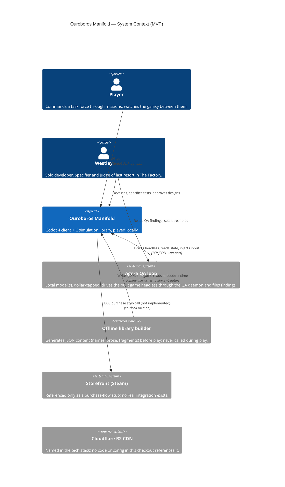

# Level 1 — System Context

## Elements

| Element | What it is | Source |
|---|---|---|
| Player | Plays the built Godot client. | `project.godot` `run/main_scene` → `scenes/privacy_modal/privacy_modal.tscn`, the boot entry point. |
| Westley | Solo developer; "Specifier" and "Judge of last resort" roles in The Factory. | `CLAUDE.md` (workflow section); `docs/northstar/PLAN.md:116-127` (Roles table). |
| Ouroboros Manifold (the system) | Godot 4 client talking to a C simulation library over a pipe process. | `project.godot`; `csrc/`; `docs/architecture.md:231-236` ("C transport v1"). |
| Agora QA loop | A local model drives the *real* running game (not a mockup) headless under Xvfb via `autoload/qa_daemon.gd`'s `--qa-port` TCP protocol, described end to end in `~/Projects/agora/projects/ouroboros/qa.toml` (read-only). The daemon itself ships in this repo: `autoload/qa_daemon.gd`, registered as the `QADaemon` autoload (`project.godot` `[autoload]`). | `~/Projects/agora/projects/ouroboros/qa.toml:1-16` (protocol notes, target description, known bugs); `~/Projects/agora/scripts/qa_explore.py:1-24` (module docstring: "a naive local model drives the real UI... `qa_oracle.classify` judges every browser event"); `autoload/qa_daemon.gd:1-56` (dev-only, inert unless `--qa-port`/`--qa-script`). |
| Offline library builder | `CLAUDE.md:9` names `claude-sonnet-4-20250514` as an offline, play-time-never-called content generator. The one concrete builder script found in this checkout, `scripts/library/emit_chronicle_fragments.py`, does **not** call any model API — it parses hardcoded string literals out of `csrc/chronicle.c`'s `CHRON_FRAGMENTS[]` array and emits `library/chronicle/fragments.json`. See `gaps.md` for the discrepancy between the documented builder and the one that exists. | `CLAUDE.md:9`; `scripts/library/emit_chronicle_fragments.py:1-13`; `library/chronicle/fragments.json` (its only output found in this checkout). |
| Storefront (Steam) | Referenced only in stub form: `open_steam_dlc_page()` and `initiate_purchase()` on the UI data-source layer. No purchase, entitlement, or storefront SDK integration exists. | `autoload/ui_data_bus.gd:2-4` ("Subscription model removed... `initiate_purchase()` now routes to the data source's `open_steam_dlc_page()` stub"); `autoload/mock_data_source.gd`, `autoload/sim_bridge_data_source.gd`, `scenes/era_library/era_detail.gd:364` (all reference `Steam` in this stub sense only). |
| Cloudflare R2 CDN | Named in the tech-stack line of `CLAUDE.md` as part of the intended stack. No other file in this checkout (code, `project.godot`, `scripts/`, `autoload/`) references R2, Cloudflare, or a CDN client. Status: **planned**, not built. | `CLAUDE.md:9` (only citation found). |

## Notes

- The "offline library builder" and "Agora QA loop" are two different external systems that are
  easy to conflate because both are "AI touching the game outside real play." The library builder
  (as documented) writes content before play starts and the game never calls a model API at runtime
  (`CLAUDE.md`'s "No runtime API calls during play" rule) — the one builder script found here upholds
  that rule by construction, since it does no API call at all. Agora's QA loop plays the *built*
  game live, through the daemon's TCP protocol, and never touches game code or content.
- GDExtension (a possible future direct-binding transport, replacing the pipe process) is named as
  a **planned** path, not built: `CLAUDE.md:9` ("C simulation library (pipe contract first,
  GDExtension later)"); `docs/northstar/research/c_rewrite.md:9` ("Phase 2 adds a thin GDExtension
  binding and deletes the pipe."). See `2-containers.md`.
- No multiplayer server, matchmaking service, or third-party auth provider is referenced anywhere
  in the checkout; `docs/bible/epics/E-19-multiplayer.md` exists as a bible epic but has no
  corresponding container. See `gaps.md`.
