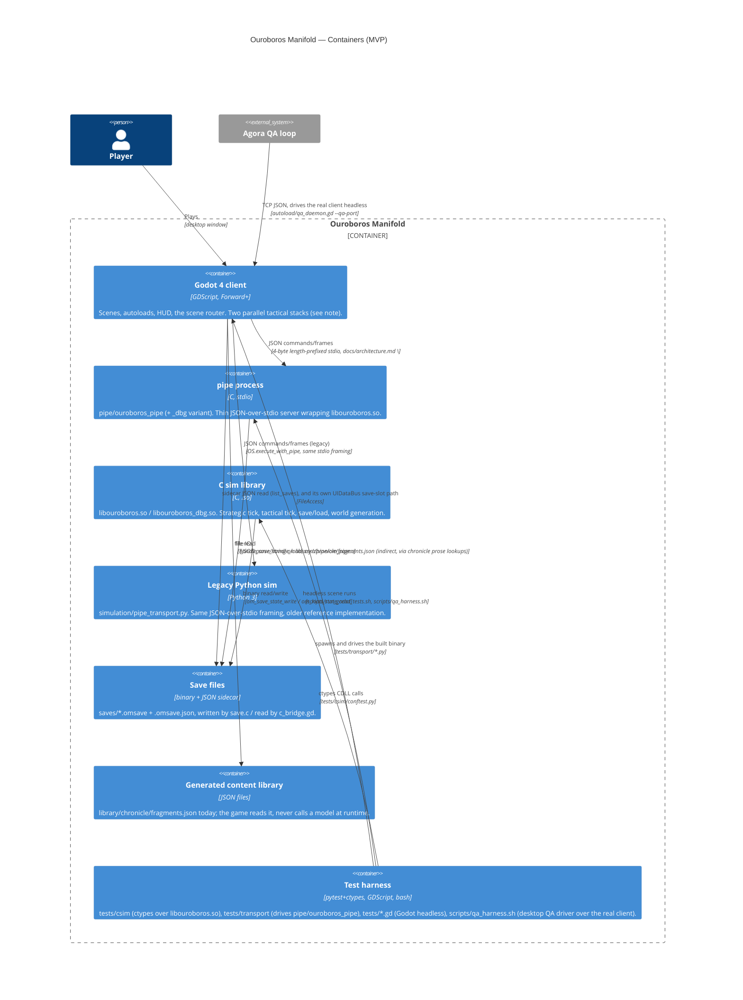

# Level 2 — Containers

## Containers

| Container | Technology | Responsibility | Source |
|---|---|---|---|
| Godot 4 client | GDScript, Forward+ renderer | UI, scenes, the scene router, two independent connections to simulation state (see note below). | `project.godot` (`config/features=PackedStringArray("4.7", "Forward Plus")`); `autoload/scene_router.gd`. |
| pipe process | C, `pipe/ouroboros_pipe` / `pipe/ouroboros_pipe_dbg` | Thin stdio JSON server: reads length-prefixed command frames, calls into `libouroboros.so`, writes length-prefixed response frames. The debug variant is built with `-DOM_DEBUG_INJECT`, enabling `inject`/`objective_complete`/`place_structure`. | `csrc/pipe/om_pipe.c:1-6` (framing), `Makefile:66-80` (`pipe/ouroboros_pipe` / `pipe/ouroboros_pipe_dbg` targets). |
| C sim library | C11, `libouroboros.so` / `libouroboros_dbg.so` | Strategic tick (`om_world_step`), tactical tick (`om_tactical_step`), world generation, save/load, every epic module under `csrc/`. Built with fixed determinism flags (`-fno-fast-math -ffp-contract=off -fexcess-precision=standard -msse2 -mfpmath=sse`). | `Makefile:1-45`; see `3-components-sim.md` for the module breakdown. |
| Legacy Python sim | Python 3, `simulation/pipe_transport.py` | The pre-C-rewrite reference sim, still spawned unconditionally at client boot by the `SimBridge` autoload (`USE_LIVE_SIM := true`). Only `scenes/tactical/` (unreached by the live scene-router flow) and a handful of autoloads (`TacticalBridge`, `UIDataBus` via `sim_bridge_data_source.gd`) consume it. | `autoload/sim_bridge.gd:1-3` (doc comment: "owns the Python sim child process"), `:29,58-61` (`SIM_SCRIPT_PATH := "simulation/pipe_transport.py"`, unconditional `_spawn_sim()` in `_ready()`). |
| Save files | Binary blob + JSON sidecar | `saves/<slot>.omsave` (from `om_save_state_write`, `csrc/save.c:672`) plus `<slot>.omsave.json` with `{"tick","chapter","phase","seed","n_regions","format_version"}` so the client can list slots without parsing the binary. | `docs/architecture.md:326` ("Save slots (T2g-2 rulings)... a sidecar `path + ".json"`"); `csrc/pipe/om_pipe.c` `handle_save`/`handle_load`/`handle_list_saves` (lines 1387, 1548, 1603). |
| Generated content library | JSON on disk, `library/` | `library/chronicle/fragments.json`, emitted offline by `scripts/library/emit_chronicle_fragments.py` from `csrc/chronicle.c`'s `CHRON_FRAGMENTS[]` array — a placeholder extractor today, not a model call. The game reads it (referenced in `docs/architecture.md:298` as the source of chronicle prose: "The client renders all prose from the library"). | `scripts/library/emit_chronicle_fragments.py:1-13`; `library/chronicle/fragments.json` (only file under `library/`). |
| Test harness | pytest+ctypes, GDScript test scripts, bash | Three tiers: `tests/csim/*.py` load `libouroboros.so` directly via ctypes (`tests/csim/conftest.py:1-12`); `tests/transport/*.py` spawn and drive the built `pipe/ouroboros_pipe` binary; `tests/*.gd` are headless Godot scripts run by `scripts/run_godot_tests.sh`; `scripts/qa_harness.sh` drives the real client (not a mockup) through the QA daemon under Xvfb for desktop-level checks. | `tests/csim/conftest.py:1-12`; `scripts/run_godot_tests.sh:1-9`; `scripts/qa_harness.sh:1-11`. |
| Agora (external) | Python, local Ollama models + dollar-capped escalation | Builds and QA-tests the game unattended; not part of this repo's runtime. Included here only for its two touch points: driving the pipe-based test suite indirectly via card acceptance tests, and driving the real client via the QA daemon TCP protocol. | `~/Projects/agora/projects/ouroboros/qa.toml` (read-only reference); `CLAUDE.md` North Star section. |

## Two simulation transports, not one

The client does not have a single path to "the simulation." Two independent transports exist and
both are live in the checked-out code:

1. **C transport** (`autoload/c_bridge.gd`, reached via `autoload/sim_session.gd`'s
   `SimSession.bridge()`, `const SimSession := preload("res://autoload/sim_session.gd")` in each
   consuming scene, e.g. `scenes/galaxy/galaxy_view.gd:16,97`). Owns one `pipe/ouroboros_pipe`
   subprocess for the whole run (`autoload/c_bridge.gd:19` doc comment; `docs/architecture.md:317`
   "persistent client session"). This is what the live scene-router flow (`main_menu` → `galaxy` →
   `mission_briefing` → `tactical_c` → `debrief` → `chronicle`) actually uses.
2. **Legacy Python transport** (`autoload/sim_bridge.gd`, the `SimBridge` project autoload). Spawns
   `simulation/pipe_transport.py` unconditionally on boot (`autoload/sim_bridge.gd:58-61`), and
   feeds `autoload/tactical_bridge.gd` (`TacticalBridge` autoload) and, through
   `autoload/sim_bridge_data_source.gd`, `autoload/ui_data_bus.gd` (`UIDataBus`). `UIDataBus` is
   read from `scenes/load_game/load_game.gd:106` (save-slot list), `scenes/era_library/*.gd`, and
   `scenes/settings/settings.gd` — scenes that **are** reached from the live flow. `TacticalBridge`
   is read almost entirely from `scenes/tactical/` (the legacy tactical scene, not reached from the
   live flow — see `3-components-client.md`), plus `autoload/bug_report_manager.gd` and
   `autoload/mission_metrics_recorder.gd`.

Both processes are candidates to be running simultaneously during ordinary play. See `gaps.md` for
the consequence (duplicated save-slot UI in `scenes/load_game/load_game.gd`).

## Planned: GDExtension path

`CLAUDE.md:9` and `docs/northstar/research/c_rewrite.md:9` ("Phase 2 adds a thin GDExtension
binding and deletes the pipe") both name a future direct-binding replacement for the pipe process.
No `.gdextension` file, no `godot-cpp` dependency, and no build target for it exists anywhere in
this checkout. Status: **planned**.
