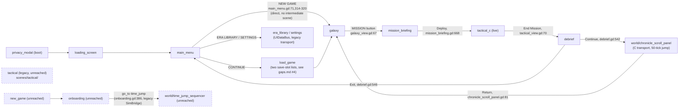

# Level 3 — Godot client components

## Autoloads

`project.godot`'s `[autoload]` section registers these, in load order:

| Autoload | Script | Role |
|---|---|---|
| `EraConfig` | `autoload/era_config.gd` | `ACTIVE_ERA_ID`, `LAYER_HEIGHT` constants (`era_config.gd:3-4`). |
| `EraThemeResolver` | `autoload/era_theme_resolver.gd` | Resolves era manifest data to scenes/materials (`_manifest`, `_scene_cache`, `era_theme_resolver.gd:3-4`). |
| `ThemeConstants` | `autoload/theme_constants.gd` | UI color/spacing constants; `IS_RELEASE_BUILD` gate for `print()`/debug output (`theme_constants.gd:3-4`). |
| `SceneRouter` | `autoload/scene_router.gd` | The `SCENES` dict and `go_to`/`go_back` scene-swap logic (`scene_router.gd:3-20,38-83`). |
| `UIDataBus` | `autoload/ui_data_bus.gd` | Save-slot listing, era list/detail, settings, purchase stub; delegates to a `_source` chosen by `SimBridge.USE_LIVE_SIM` (`ui_data_bus.gd:18-22`). |
| `ScanlineOverlay` | `autoload/scanline_overlay.gd` | Cosmetic CRT-scanline `CanvasLayer` (`scanline_overlay.gd:1-4`). |
| `InputSanitizer` | `autoload/input_sanitizer.gd` | Bounds-checks save names / key codes before they reach state (`input_sanitizer.gd:3-4`). |
| `TacticalBridge` | `autoload/tactical_bridge.gd` | Applies snapshots/deltas from `SimBridge.state_updated` (legacy Python transport) into flat interpolation arrays; re-publishes via signals (`tactical_bridge.gd:1-6`). |
| `WsInputSanitizer` | `autoload/ws_input_sanitizer.gd` | Validates commands before `SimBridge.send_command()` (`ws_input_sanitizer.gd:1-4`). |
| `SimBridge` | `autoload/sim_bridge.gd` | Owns the **legacy Python** sim subprocess (`simulation/pipe_transport.py`). `_ready()` unconditionally calls `_spawn_sim()` when `USE_LIVE_SIM` (`const`, `true`) — every boot (`sim_bridge.gd:29,58-61`). |
| `MissionMetricsRecorder` | `autoload/mission_metrics_recorder.gd` | Samples `TacticalBridge` state at `SAMPLE_INTERVAL` for post-mission metrics (`mission_metrics_recorder.gd:3`). |
| `BugReportManager` | `autoload/bug_report_manager.gd` | Ring-buffers recent `TacticalBridge` snapshots for bug reports (`bug_report_manager.gd:3-4`). |
| `Visibility` | `scripts/tactical/visibility.gd` | Client-side fog-of-war predicate, consumed by `scenes/tactical/`'s renderer/HUD/input router (the legacy tactical scene) — a **separate** fog implementation from `csrc/fog.c`. See `gaps.md`. | 
| `FactionPalette` | `autoload/faction_palette.gd` | Per-faction color table; `colors_changed` signal. |
| `FeatureFlags` | `autoload/feature_flags.gd` | Kill-switch flags, "mirrors `simulation/config.py` `ENABLE_*` constants for the sim side" (`feature_flags.gd:3-4`). |
| `InspectionState` | `scenes/world/world_view_inspection_state.gd` | Pause/inspection state shared by world-view panels (`world_view_inspection_state.gd:1-3`). |
| `DebugOverlay` | `autoload/debug_overlay.gd` | Off-by-default FPS/tick/unit overlay; "invariant I10 forbids any effect on sim or frame timing" (`debug_overlay.gd:1-3`). |
| `TutorialStateMachine` | `autoload/tutorial_state_machine.gd` | Tutorial beat sequencing (`tutorial_state_machine.gd:3-4`). |
| `QADaemon` | `autoload/qa_daemon.gd` | Dev-only QA hook (below). |

`autoload/sim_session.gd` (`SimSession`) is **not** in this list — it is a plain `RefCounted`
static holder, reached only via `const SimSession := preload("res://autoload/sim_session.gd")` in
each consuming scene (e.g. `scenes/galaxy/galaxy_view.gd:16`). `SimSession.bridge()` lazily
constructs one `autoload/c_bridge.gd` `RefCounted` instance for the whole process
(`sim_session.gd:14-20`) — this is the **new C transport**, distinct from the `SimBridge` autoload.

## Two simulation clients living side by side

- **`autoload/c_bridge.gd`** (via `SimSession`): owns the `pipe/ouroboros_pipe` subprocess
  (`OS.execute_with_pipe`, `c_bridge.gd:190-223` `open_session`), a reader `Thread` decoding
  length-prefixed frames into a queue, and per-flow helper methods: `load_mission_live`
  (`c_bridge.gd:468`), `begin_mission_live` (`:506`), `load_tactical_live` (`:520`),
  `tactical_step_n` (`:430`), `send_unit_command` (`:405`), `load_debrief_live` (`:478`),
  `load_chronicle_live` (`:491`, hardcodes a 50-tick jump), `list_saves`/`load` (save-slot IO).
  This is what `galaxy_view.gd`, `mission_briefing.gd`, `tactical_view.gd` (`scenes/tactical_c/`),
  `debrief.gd`, and `chronicle_scroll_panel.gd` (`scenes/world/`) all use.
- **`autoload/sim_bridge.gd`** (`SimBridge`, a real project autoload): owns the legacy
  `simulation/pipe_transport.py` subprocess, spawned unconditionally at boot
  (`sim_bridge.gd:58-61`). Two autoloads sit downstream of it: `TacticalBridge` (fed directly by
  `SimBridge.state_updated`, `tactical_bridge.gd` header) and, through
  `autoload/sim_bridge_data_source.gd` (selected because `UIDataBus._ready()` checks
  `SimBridge.USE_LIVE_SIM`, `ui_data_bus.gd:18-22`), `UIDataBus` itself. `autoload/mock_data_source.gd`
  is the alternative `_source` when `USE_LIVE_SIM` is false — dead code today, since that constant
  is hardcoded `true` (`sim_bridge.gd:29`).

`UIDataBus` is read from scenes that **are** in the live flow: `scenes/load_game/load_game.gd:106`
(`UIDataBus.get_save_slots()`), `scenes/era_library/era_library.gd:54,85,172` and
`era_detail.gd:9,16,364`, `scenes/settings/settings.gd:15,75`. `TacticalBridge` is read almost
entirely from `scenes/tactical/` (the legacy tactical scene — see below), plus
`autoload/bug_report_manager.gd`, `autoload/mission_metrics_recorder.gd`, and
`autoload/qa_daemon.gd:69-71` (`state()` reads `/root/TacticalBridge.current_tick` if the node
exists, falling back to its own `tick` counter otherwise).

## Scene groups and the live flow



`tactical`, `new_game`, `onboarding`, and `world/time_jump_sequencer` (all dashed) are registered in
`SceneRouter.SCENES` but none has a live `go_to()` call site reachable from `main_menu` — see
`gaps.md` items 5 and 9. `new_game`/`onboarding`/`time_jump_sequencer` are drawn as their own
disconnected chain because they only call each other (`new_game.gd:206` -> `onboarding.tscn`;
`onboarding.gd:386` -> `time_jump_sequencer.tscn`), never receiving a call from anything in the
reachable graph rooted at `main_menu`.

Boot: `project.godot` `run/main_scene` is `scenes/privacy_modal/privacy_modal.tscn`. On accept, it
calls `SceneRouter.go_to("loading_screen")` (`privacy_modal.gd:29-30`), and
`scenes/loading_screen/loading_screen.gd:29,46` forwards to `_target_scene` (main menu in the
ordinary boot path).

`autoload/scene_router.gd`'s `SCENES` dict (`scene_router.gd:3-20`) names 15 scenes. Cross-checking
every `SceneRouter.go_to(...)` call site against it gives the confirmed live path:

```
main_menu -> galaxy (main_menu.gd:71,314-320, NEW GAME button, direct)
main_menu -> load_game -> galaxy (CONTINUE, load_game.gd:294)
galaxy -> mission_briefing (galaxy_view.gd:67, MISSION button)
mission_briefing -> tactical_c (mission_briefing.gd:668, after a successful Deploy)
tactical_c -> debrief (tactical_view.gd:70, End Mission)
debrief -> chronicle (debrief.gd:542) or main_menu (debrief.gd:546)
chronicle -> galaxy (chronicle_scroll_panel.gd:81, Return)
```

Two `SCENES` entries exist for tactical play: `"tactical"` → `scenes/tactical/tactical.tscn`
(legacy) and `"tactical_c"` → `scenes/tactical_c/tactical_view.tscn` (new). Only `"tactical_c"` is
reached by any `go_to()` call site found in `scenes/`. `scenes/tactical/` uses `SimBridge`
directly (`scenes/tactical/tactical.gd:86-90`, `input_router.gd:335-336`); it is exercised only by
`tests/test_b3_tutorial_integration.gd` and `tests/test_qa_state_scenes.gd`, not by the live scene
graph. See `gaps.md`.

`scenes/new_game/new_game.gd:206` calls `go_to("onboarding", ...)`, and
`scenes/onboarding/onboarding.gd:386` calls `go_to("time_jump", forward_params)` — the only caller
of the `"time_jump"` `SCENES` entry (`scenes/world/time_jump_sequencer.tscn`). But
`main_menu.gd`'s `"NEW GAME"` button routes straight to `"galaxy"` (`main_menu.gd:71`), and no
`go_to("new_game"` call site exists anywhere in `scenes/` (confirmed by grep). So `new_game.tscn`,
`onboarding.tscn`, and `time_jump_sequencer.tscn` form a three-scene chain that only calls itself —
orphaned from the graph reachable out of `main_menu`, the same way `scenes/tactical/` is orphaned.
The legacy time-jump presentation this chain would show (driven by `SimBridge`'s
`time_jump_started`/`time_jump_keyframe`/`chronicle_entry`/`time_jump_ended` signals via
`UIDataBus`, `ui_data_bus.gd:5-8`) therefore never runs in the live game today. Every jump a player
can actually trigger goes through `chronicle_scroll_panel.gd`'s C-transport `load_chronicle_live`
path instead (above) — see `gaps.md`.

### Scene folders

| Folder | Main script(s) | Reached from live flow? |
|---|---|---|
| `privacy_modal/` | `privacy_modal.gd` | Yes — boot entry (`run/main_scene`). |
| `loading_screen/` | `loading_screen.gd` | Yes — transitional, forwards to `_target_scene`. |
| `main_menu/` | `main_menu.gd` | Yes — root of the live flow. |
| `new_game/` | `new_game.gd` | **No.** Main menu's NEW GAME button routes directly to `"galaxy"` (`main_menu.gd:71`), not `"new_game"`; no `go_to("new_game"` call site exists anywhere in `scenes/`. `new_game.gd` itself would create a save slot via `UIDataBus.create_save_slot` (`new_game.gd:205`) then `go_to("onboarding", ...)` (`:206`), but nothing calls in. |
| `onboarding/` | `onboarding.gd` | **No.** Reachable only from `new_game.gd:206`, which is itself unreached (row above). Also the sole caller of `go_to("time_jump")` (below), so that call never fires in the live game either. |
| `galaxy/` | `galaxy_view.gd` | Yes — opens the C-transport session (`SimSession.bridge()`, `:97`). |
| `mission_briefing/` | `mission_briefing.gd` | Yes. |
| `tactical_c/` | `tactical_view.gd` | Yes — the live tactical scene. |
| `tactical/` | `tactical.gd`, `hud.gd`, `terrain_renderer.gd`, `unit_renderer.gd`, `input_router.gd`, `visuals/*` | **No** — legacy, unreached by `go_to()`; uses `SimBridge`/`TacticalBridge`/`Visibility` directly. |
| `debrief/` | `debrief.gd` | Yes. |
| `world/` | `chronicle_scroll_panel.gd`, `time_jump_sequencer.gd`, `world_view_inspection_state.gd`, `chronicle_entry*.gd`, `*_info_panel.gd` | Split: `chronicle_scroll_panel.gd` is reached from `debrief.gd:542` — yes. `time_jump_sequencer.gd`'s only caller is `onboarding.gd:386`, which is itself unreached (see `onboarding/` row above) — no. |
| `load_game/` | `load_game.gd` | Yes, from main menu's CONTINUE; renders **both** `UIDataBus.get_save_slots()` cards and separate C-bridge `list_saves()` rows in the same list — see `gaps.md`. |
| `era_library/` | `era_library.gd`, `era_detail.gd` | Yes, from main menu's ERA LIBRARY. |
| `settings/` | `settings.gd` | Yes, from main menu's SETTINGS. |
| `error_screen/` | (routed to by `SimBridge`'s `_pending_error_screen`, `sim_bridge.gd:78-81`) | Reachable only if the legacy sim subprocess fails to start, given `SimBridge` is always spawned. |
| `tutorial/` | (driven by `TutorialStateMachine`) | Reached from the live flow's early scenes per `tutorial_state_machine.gd`; not traced step-by-step here. |
| `bug_report/` | fed by `BugReportManager` | Dev/player-facing bug report UI; overlay, not a `SCENES` entry. |
| `debug/` | `debug_ws_test.gd`, `test_*.gd`, `wave2_visual_check.gd` | No — dev-only scenes, not in `SCENES`. |
| `harness/` | `harness.gd` | No — the QA harness scene (`scripts/qa_harness.sh` target), not part of player-facing `SCENES`. |
| `mockups/` | (many) | No — design-review mockups (`docs/northstar/plans/push/pieces.toml`'s `MK-*` pieces), never in `SCENES`. |
| `shared/` | `world_view/` subtree | Shared components imported by other scenes (legacy `world_view` per Stage-era naming), not a routed scene itself. |

## QA daemon

`autoload/qa_daemon.gd` (`QADaemon`): a `Node` autoload, inert unless launched with
`--qa-port <port>` or `--qa-script <path>` (`qa_daemon.gd:40-56`). In `--qa-port` mode it opens a
`TCPServer` on `127.0.0.1` (`_start_server`, `:87-94`) and speaks newline-delimited JSON verbs
(`_dispatch`, `:183-212`): `state` (current scene path + `qa_state()` if the scene implements it,
`:58-74`), `tree` (visible `Control`s and `Node3D`s with click-centre `rect_px`, `:77-84,302-328`),
`seed`, `fixture`, `pause`, `step <n>` (calls the current scene's `qa_step(n)` if present, `:268-274`),
`inject <bug-id>` (checked only against a hardcoded `KNOWN_BUG_IDS` list, `:24,277-280` — it does
not actually inject anything into the sim), `plant <id>` (calls the current scene's `qa_plant(id)`,
`:293-299`), `screenshot`, `input <move|click|click_node|drag|wheel|key|key_down|key_up|wait_frames>`
(delegates to `scenes/mockups/_shared/qa_driver.gd`, preloaded at `:22`, only available in
`--qa-port` mode), and `qa_select` (calls the scene's `qa_set_selected`, `:283-290`).

Agora's QA profile (`~/Projects/agora/projects/ouroboros/qa.toml`, read-only reference) drives the
*real* client (not the harness scene) headless under Xvfb through this exact protocol, launching
Godot with no explicit scene argument (`launch_argv`, `qa.toml`) so it boots at
`privacy_modal` like a player would, and documents that the daemon has **no** `"goto"`/`"nav"`
verb — matching `qa_daemon.gd`'s `_dispatch` match statement above, which has no such case.
`scripts/qa_harness.sh` instead drives `scenes/harness/harness.tscn` (piece C7) under the same
Xvfb/`xdotool` pattern, for a narrower liveness/scan check distinct from Agora's full-client
sessions (`qa_harness.sh:1-11`).
