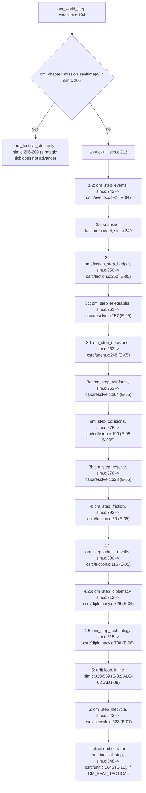
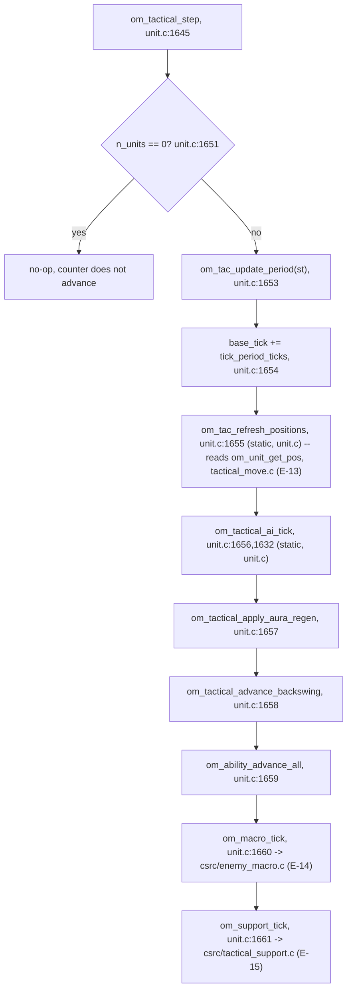

# Level 3 — C simulation library components

One component per `csrc/<module>.c`. Grouped by owning epic per
`docs/northstar/spec_factory/symbol_modules.toml` (`[modules]` table) and the
epic section banners in `csrc/ouroboros_sim.h`. Piece ids and their attach
status are from `docs/northstar/plans/push/pieces.toml`.

## The real tick order

Two orchestrators exist: the strategic tick (`om_world_step`, runs once per
`step`/`run_to` pipe command while no mission is active) and the tactical tick
(`om_tactical_step`, runs once per `tactical_step` pipe command, and also once
at the end of every strategic tick when `OM_FEAT_TACTICAL` is on and a mission
is realtime).

### Strategic tick — `om_world_step`, `csrc/sim.c:194-552`

Every step is gated by an `om_world_feature(w, OM_FEAT_*)` check
(`csrc/ouroboros_sim.h:253-261` for the enum: `OM_FEAT_EVENTS=0` steps 1-2,
`OM_FEAT_FACTIONS=1` step 3, `OM_FEAT_FRICTION=2` step 4,
`OM_FEAT_ADMIN_REVOLTS=3` step 4.1, `OM_FEAT_DIPLOMACY=4` step 4.25,
`OM_FEAT_TECHNOLOGY=5` step 4.5, `OM_FEAT_DRIFT=6` step 5,
`OM_FEAT_LIFECYCLE=7` step 6, `OM_FEAT_TACTICAL=8` the tactical orchestrator).
The debug build (`OM_DEBUG_INJECT`) can additionally reorder several of these
steps as positive-control fault injections (`csrc/sim.c:227-360`); the order
diagrammed above is the non-injected (real play) order.

### Tactical tick — `om_tactical_step`, `csrc/unit.c:1645-1663`

`om_visibility_compute` (`csrc/fog.c:615`, E-12) is **not** in this call chain
and has no other caller anywhere in `csrc/` — see the fog.c entry below and
`gaps.md`.

## Components by epic

### core (sim.c, region.c)

| Item | Detail |
|---|---|
| Purpose | `csrc/sim.c` owns `om_world_step`/`om_world_run` and the region-field drift math (ALG-02..ALG-09) inline (no separate E-02 module file — E-02 has no `csrc/<name>.c` of its own; its equations live directly in `om_world_step`'s step 5, `csrc/sim.c:330-539`). `csrc/region.c` owns region/world data accessors and the RNG. |
| Entry points | `om_world_step` (`sim.c:194`), `om_world_run` (`sim.c:554`), `om_region_drift` (`sim.c:562`), `om_world_new`/region accessors (`region.c`). `region.c` also carries a `__attribute__((weak))` fallback `om_world_step` (`region.c:321`, just increments tick) and a weak `om_world_generate` stub (`region.c:217`) — both are overridden by the strong definitions in `sim.c`/`worldgen.c` whenever those translation units link in, which they always do (`Makefile`'s `$(SRC) := $(wildcard csrc/*.c)` compiles every file every time). |
| Called by | Pipe: `handle_step`/`handle_run_to` (`csrc/pipe/om_pipe.c:1167-1208`) call `om_world_step`; `handle_jump` calls into it indirectly via `om_time_jump_run` (`generational.c:1786`, which loops `om_world_step` itself). |
| Status | built. |
| Piece | `core` (`pieces.toml`: `owns = ["csrc/sim.c","csrc/region.c","csrc/om_internal.h","csrc/ouroboros_sim.h","csrc/om_constants.h","Makefile"]`, wave 0, no attach status recorded — it is the pre-push baseline, not a push piece). |

### E-03 world generation — `worldgen.c`

| Item | Detail |
|---|---|
| Purpose | `csrc/ouroboros_sim.h:713-715` ("world generation and topology... turns `om_world_generate()` from the E-02 stub into a real generator"). |
| Entry points | `om_world_generate` (`worldgen.c:175`, strong override of `region.c:217`'s weak stub). |
| Called by | `handle_set_seed`, `csrc/pipe/om_pipe.c:1157`. |
| Status | built. |
| Piece | B4, `attached` (attach_sha `45c4441`). |

### E-04 events and chains — `events.c`

| Item | Detail |
|---|---|
| Purpose | `csrc/ouroboros_sim.h:536-538` ("events and chains... Tick steps 1 and 2: resolve the due queue, then evaluate fresh triggers on every inhabited region"). |
| Entry points | `om_step_events` (`events.c:931`), `om_event_fire_manual`, `om_event_queue_external`, `om_event_register_external`, `om_events_load_launch`, `om_tick_events`, `om_event_template_count` (declared `om_internal.h`/`ouroboros_sim.h`, owned per `symbol_modules.toml:52-62`). |
| Called by | `om_world_step` steps 1-2, `csrc/sim.c:243`. |
| Status | built. |
| Piece | B1, `attached` (attach_sha `4b2ae50`). |

### E-05 faction agents and conflict — `faction.c`, `agent.c`, `resolve.c`, `collision.c`, `friction.c`

| Item | Detail |
|---|---|
| Purpose | `csrc/ouroboros_sim.h:208-210` ("faction agents and conflict"). Split across five files: budget/archetype state (`faction.c`), the decision agent (`agent.c`), telegraph/reinforce/resolve of intents (`resolve.c`), grouped-target collision resolution for S-039 (`collision.c`), border friction and admin revolts (`friction.c`). |
| Entry points | `om_faction_step_budget` (`faction.c:250`), `om_region_neighbors` (`faction.c:78` — owned here despite the name, because every epic that reads adjacency calls it; `symbol_modules.toml:70-72`: "no single owning epic"); `om_step_decisions` (`agent.c:248`); `om_step_telegraphs` (`resolve.c:157`), `om_step_reinforce` (`resolve.c:264`), `om_step_resolve` (`resolve.c:328`); `om_step_collisions` (`collision.c:190`); `om_step_friction` (`friction.c:60`), `om_step_admin_revolts` (`friction.c:115`). |
| Called by | `om_world_step` steps 3a-3f (`sim.c:249-277`) and step 4/4.1 (`sim.c:292,300`). |
| Status | built. |
| Piece | faction.c/agent.c/resolve.c/friction.c ship under `core`'s freeze plus feature pieces; `collision.c` is B2 (`attached`, `35964fd`); `friction.c` is B3 (`attached`, `ee5ef97`). `faction.c`/`agent.c`/`resolve.c` are not separately listed as their own `[[piece]]` rows in `pieces.toml` (their story acceptance tests ride under B2/B3's and the `core` freeze) — unverified which piece's diff actually introduced `agent.c`/`resolve.c`'s bodies; flagged in `gaps.md`. |

### E-06 diplomacy and technology — `diplomacy.c`

| Item | Detail |
|---|---|
| Purpose | `csrc/ouroboros_sim.h:811-814` ("diplomacy and technology... `om_step_diplomacy` and `om_step_technology` are internal hooks that run at tick steps 4.25 and 4.5"). |
| Entry points | `om_step_diplomacy` (`diplomacy.c:726`), `om_step_technology` (`diplomacy.c:730`), `om_faction_stance`, `om_faction_tech` family (`symbol_modules.toml` doesn't list these individually but the module row `"diplomacy.c" = "E-06"` covers them). |
| Called by | `om_world_step` steps 4.25/4.5 (`sim.c:312,315`). |
| Status | built. |
| Piece | B5, `pending`; B5b (S-048, three tiers of technology), `pending`. Note: the tick-order wiring (the hooks themselves) is present and called regardless of B5's pending status — `pending` here describes the epic's own story acceptance tests, not whether the hook fires in the tick (it does). |

### E-07 civilizational lifecycle — `lifecycle.c`

| Item | Detail |
|---|---|
| Purpose | `csrc/ouroboros_sim.h:828-830` ("civilizational lifecycle... `om_step_lifecycle` runs at tick step 6, after drift"). |
| Entry points | `om_step_lifecycle` (`lifecycle.c:328`). |
| Called by | `om_world_step` step 6, `csrc/sim.c:543`. |
| Status | built. |
| Piece | B6, `attached` (attach_sha `2f918f1`). |

### E-08 generational — `generational.c`

| Item | Detail |
|---|---|
| Purpose | Characters, lineages, and the time jump between missions (`symbol_modules.toml:30-44`). |
| Entry points | `om_time_jump_run` (`generational.c:1867`), `om_character_create`, `om_lineage_create`, `om_lineage_record_history_region`, plus enumeration readers (`om_character_count`, `om_lineage_count`, etc.). |
| Called by | `handle_jump`, `csrc/pipe/om_pipe.c:1317`. `om_time_jump_run` itself loops `om_world_step` (`generational.c:1786`) and writes chronicle entries via `om_chronicle_add_*` (`generational.c:1820-1848`, defined in `chronicle.c`). |
| Status | built. |
| Piece | B7, `attached` (attach_sha `84bdfa5`); B7b (S-055, "one commander, one mission, then the world moves"), `pending`, depends on B7+B8+B10 all being attached (B8 is `pending`, so B7b cannot start yet per its `depends_on`). |

### E-09 chronicle — `chronicle.c`

| Item | Detail |
|---|---|
| Purpose | `csrc/ouroboros_sim.h:873-876` ("chronicle"). Turns tick-level events into the 5-10 entry chronicle the player reads after a jump. |
| Entry points | `om_chronicle_entry_count`, `om_chronicle_entry_get`, `om_chronicle_add_regional_event`, `om_chronicle_add_event`, `om_chronicle_add_lineage_event`, `om_chronicle_add_ownership_change_event`, `om_chronicle_add_chain_event`, `om_chronicle_add_cluster_direct`, `om_chronicle_add_consequence_event`, `om_chronicle_add_raw_entry`, `om_chronicle_add_mock_entry` (all defined `chronicle.c:1696-2198`). |
| Called by | `generational.c`'s time-jump body (lines 1820-1848, listed above); read back by `csrc/pipe/om_pipe.c`'s `write_chronicle` (used in `handle_jump`) via `om_chronicle_entry_get`/`om_chronicle_get_cluster` (per the pipe file-header comment, `om_pipe.c:40-44`). |
| Status | built (written and read in the real jump flow), though the pipe's own header comment notes fragment text can come back empty when "the cluster exists but the text pass never ran for it" (`om_pipe.c:42-43`) — see `gaps.md`. |
| Piece | B8, `pending`. |

### E-10 missions — `mission.c`

| Item | Detail |
|---|---|
| Purpose | `csrc/ouroboros_sim.h:884-886` ("missions"). Candidate selection, setup, objectives, time limit, region delta on end. |
| Entry points | `om_mission_start` (misleading name — see below), `om_mission_build_candidate_pool`, `om_mission_select`, `om_mission_candidates`, `om_mission_setup`, `om_mission_build_objectives`, `om_mission_begin`, `om_mission_end`, `om_mission_get_time_limit`, `om_mission_get_region_delta`, `om_player_faction`, `om_objective_get_center`/`om_objective_set_center`. All defined in `mission.c`; `om_map_add_cover` is also called from here (`mission.c:2047`) to place the objective's cover geometry, reaching into `tactical_mapgen.c`. |
| Called by | `handle_mission_start` (`om_pipe.c:1225-1255`) composes six calls in this order: `om_mission_start` (which the file-header comment clarifies "does not start anything... it only encodes the calling faction's tech tier into an opaque id", `om_pipe.c:20-22`) → `om_mission_build_candidate_pool` → `om_mission_select` → `om_mission_candidates` → `om_mission_setup` → `om_mission_build_objectives`. `handle_mission_begin` (`om_pipe.c:1263-1274`) calls `om_mission_begin`. `handle_mission_end` (`om_pipe.c:1276-1285`) calls `om_mission_end`. |
| Status | built, with named gaps: no accessor wires a force composition into a started mission (`"force":{"types":[],"tiers":[]}` is always empty, `om_pipe.c:28-30`); `om_objective_spec` has no node/radius field (`om_pipe.c:32-34`). |
| Piece | B9, `pending`. |

### E-11 units and combat — `unit.c`

| Item | Detail |
|---|---|
| Purpose | `csrc/ouroboros_sim.h:843-846` ("units and combat... the tactical orchestrator's wiring"). The tactical tick itself, unit spawn/combat/abilities, and the movement/AI read-side glue that ties in `tactical_move.c`. |
| Entry points | `om_tactical_step` (`unit.c:1645`), `om_tactical_tick`/`om_tactical_base_tick`/`om_tactical_run` (`unit.c:1900,2358,1792`), `om_unit_spawn`/`om_unit_spawn_combat`, `om_unit_attack`/`om_unit_deal_damage`, `om_command_attack_move`/`om_command_attack_target`/`om_command_activate_ability` (`unit.c:1683,1699,1666`), `om_unit_get_layer` (`unit.c:2338` — an accessor stub for the still-unbuilt E-01 layer system; see `gaps.md`). |
| Called by | `om_world_step`'s tactical orchestrator (`sim.c:548`), `handle_tactical_step` (`om_pipe.c:1287-1303`), `handle_command` (`om_pipe.c:1352-1379`, dispatches `move`/`attack_move`/`attack_target`; `hold` has no backing symbol and always errors, `om_pipe.c:1370-1375`). |
| Status | built. |
| Piece | B10, `attached` (attach_sha `617827a`); B10b (S-084/085/087), `pending`; B10c, `pending`. |

### E-12 fog and sensors — `fog.c`

| Item | Detail |
|---|---|
| Purpose | `csrc/ouroboros_sim.h:895-898` ("fog and sensors"). Layer- and vantage-aware visibility. |
| Entry points | `om_visibility_compute` (`fog.c:615`). |
| Called by | **Nothing in `csrc/` outside `fog.c` itself.** Confirmed by exhaustive grep (`grep -rn "om_visibility_compute" csrc/` returns only its own definition line). Not called from `om_tactical_step`, not called from any `handle_*` function in `csrc/pipe/om_pipe.c`. The pipe's own file-header comment corroborates this at the response-shape level: `"units"/"visible" are always empty` (`om_pipe.c:51`). |
| Status | **tested-unwired** — real production code, exercised by `tests/csim/test_E12_*.py` directly via ctypes, never reached by the tick or the pipe. |
| Piece | B11, `pending`. |

### E-13 movement and command — `tactical_move.c`

| Item | Detail |
|---|---|
| Purpose | `csrc/ouroboros_sim.h:906-909` ("movement and command"). Per-unit and group movement, position storage, teleport. |
| Entry points | `om_command_move`, `om_command_group_move` (`tactical_move.c:1522`), `om_unit_get_pos`, `om_unit_teleport`. |
| Called by | `om_tac_refresh_positions` (`unit.c:1655`, reads `om_unit_get_pos` every tactical tick); `handle_command`'s `move` verb (`om_pipe.c:1352-1360`, always issues a *group* move even for a single unit, per the comment at `om_pipe.c:1356-1359`); `om_command_attack_move`/`om_command_attack_target` (`unit.c:1683,1699`) each call `om_command_move` once per unit; `om_macro_tick` (`enemy_macro.c:724`) calls `om_command_group_move` for enemy AI moves. |
| Status | built. |
| Piece | B12, `attached` (attach_sha `d429d15`... — see `pieces.toml`; note the C2 client piece reused that attach sha in one listing, unverified whether B12's own sha differs); B12b (S-096), `pending`. |

### E-14 enemy macro behavior — `enemy_macro.c`

| Item | Detail |
|---|---|
| Purpose | `csrc/ouroboros_sim.h:921-924` ("enemy macro behavior"). Five behaviors, three moods, timers with noise. |
| Entry points | `om_macro_tick`. |
| Called by | `om_tactical_step`, `unit.c:1660`. |
| Status | built. |
| Piece | B13, `pending`. |

### E-15 reinforcement structures — `tactical_support.c`

| Item | Detail |
|---|---|
| Purpose | `csrc/ouroboros_sim.h:934-936` ("reinforcement structures"). Structures, non-combat units, what the enemy builds. |
| Entry points | `om_support_tick`, `om_structure_set_position`. |
| Called by | `om_tactical_step`, `unit.c:1661`; `om_structure_set_position` is called by the pipe's `place_structure` verb (`handle_place_structure`, `om_pipe.c:1504`, debug build only). |
| Status | built. |
| Piece | B14, `pending`. |

### E-16 saving — `save.c`

| Item | Detail |
|---|---|
| Purpose | `csrc/ouroboros_sim.h:945-948` ("save.c (S-111 saving)"). |
| Entry points | `om_save_state_size`, `om_save_state_write`, `om_load_state_read`. |
| Called by | `handle_save` (`om_pipe.c:1558-1560`) and `handle_load` (`om_pipe.c:1631`). |
| Status | built, with a documented ambiguity: `om_load_state_read` "returns one bool for both 'version mismatch' and 'corrupt'"; the pipe always reports "corrupt" for either (`om_pipe.c:57-58,1634-1640`). |
| Piece | T2c, `pending`. |

### E-17 map generation — `tactical_mapgen.c`

| Item | Detail |
|---|---|
| Purpose | `csrc/ouroboros_sim.h` (E-17 banner not captured in the section list read for this model; module row confirmed in `symbol_modules.toml:26` `"tactical_mapgen.c" = "E-17"`). Procedural tactical map layout: cover, obstacles, nodes. |
| Entry points | Real: `om_map_add_cover` (`:260`), `om_map_add_spine_node` (`:288`), `om_map_add_spawn_point` (`:292`), `om_map_add_obstacle` (`:306`), `om_map_cover_count`/`om_map_cover_at`, `om_map_clear`, `om_map_get_node_count`/`_pos`/`_type` (`:454-476`), `om_map_get_canvas_base_dimension` (`:434`). Still `/* STUB */`: `om_map_add_layer_restriction_zone` (`:271`), `om_map_get_active_seed` (`:428`), `om_map_get_compatible_layout_count`/`_layouts` (`:443,449`), `om_map_get_simulation_coupling` (`:491`). |
| Called by | `csrc/mission.c`'s `om_mission_instantiate_map` (`mission.c:2033-2051`, called from `om_mission_setup`, `mission.c:2065`) calls `om_map_add_spine_node`, `om_map_add_cover`, and `om_map_add_spawn_point` (x2) on every `mission_start` — three real nodes and one cover circle, not zero. `om_map_add_obstacle` is real but has no production caller found (`grep -rn "om_map_add_obstacle(" csrc/*.c`). `csrc/pipe/om_pipe.c`'s `write_tactical` reads the node/cover accessors back for the `"map"` field of the tactical frame (`om_pipe.c:979-1036`); it has no obstacle-enumerating accessor to call, so `"map.obstacles"` is hardcoded `[]` regardless of whether any obstacle was ever added. |
| Status | split, and different from the pipe's own file-header comment, which is stale here: the comment states "Every `om_map_get_*` node/canvas accessor and `om_tactical_step` itself are STUBs" (`om_pipe.c:45-49`), but `om_tactical_step` is real (see E-11) and the node/canvas accessors used by `write_tactical` are real too (list above). Only the layout-selection/seed/coupling accessors and the (uncalled) obstacle path are still stub or absent — see `gaps.md` items 2 and 7 for the corrected, function-by-function breakdown. |
| Piece | B15m, `pending` ("fixture functions only... not the full 1575-line/29-test E-17 generator (held)"). |

## Modules not covered above

`csrc/om_constants.h` and `csrc/om_internal.h` are headers, not components (constant
tables and the internal hook declarations shared across the modules above,
`om_internal.h:341-363` for the `om_step_*` hook prototypes). `csrc/ouroboros_sim.h`
is the public ABI header for every module in this file.
