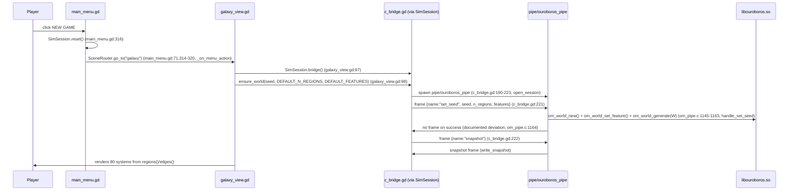
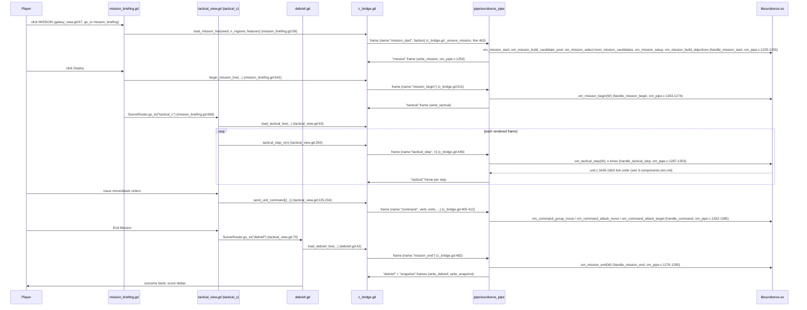
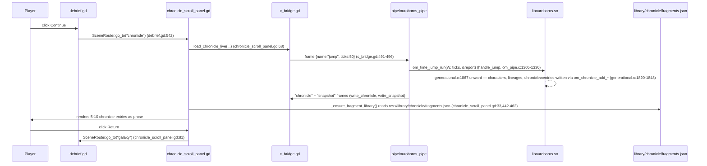

# Level 4 — Runtime flows

Three flows, each as a Mermaid sequence diagram. Every step names the pipe
command frame (`"name"` field, dispatched at `csrc/pipe/om_pipe.c:1699-1745` in
`main`) and the C handler function that serves it, plus the Godot call site that
sent it.

## Flow 1 — New game to galaxy

| Step | Source |
|---|---|
| NEW GAME click -> action "galaxy" | `scenes/main_menu/main_menu.gd:71` (`menu_data`, `{"label": "NEW GAME", "action": "galaxy"}`) |
| SimSession.reset() then go_to("galaxy") | `scenes/main_menu/main_menu.gd:314-320` (`_on_menu_action`, the `"galaxy"` match arm) |
| SimSession.bridge() / ensure_world | `scenes/galaxy/galaxy_view.gd:97-98` |
| open_session spawns the pipe | `autoload/c_bridge.gd:190-223` |
| set_seed frame | `autoload/c_bridge.gd:221`; handled by `handle_set_seed`, `csrc/pipe/om_pipe.c:1145-1165` |
| om_world_generate | `csrc/pipe/om_pipe.c:1157`, defined `csrc/worldgen.c:175` |
| snapshot frame | `autoload/c_bridge.gd:222`; the galaxy reads it via `regions()`/`edges()` (`autoload/c_bridge.gd:68,83`) |

Correction from an earlier pass of this model: `scenes/new_game/new_game.tscn` and
`scenes/onboarding/onboarding.tscn` are **not** on this path. `main_menu.gd`'s
`menu_data` array binds the `"NEW GAME"` label directly to `action: "galaxy"`
(`main_menu.gd:71`), and `_on_menu_action`'s `"galaxy"` match arm calls
`SimSession.reset()` then `SceneRouter.go_to("galaxy")` with no intermediate
scene (`main_menu.gd:314-320`). A repo-wide search
(`grep -rn 'go_to("new_game"' scenes/`) finds no caller at all for the
`"new_game"` `SCENES` entry, and `go_to("onboarding"` has exactly one caller,
`scenes/new_game/new_game.gd:206` — inside the very scene nothing routes to.
Both scenes, and everything reachable only through them (see `gaps.md`), are
orphaned from the live boot path. This matches Agora's QA profile
(`~/Projects/agora/projects/ouroboros/qa.toml`), whose main-menu screen
description names only the five menu buttons and does not mention an
era-select or difficulty step between NEW GAME and the galaxy.

## Flow 2 — Briefing to deploy to tactical play to debrief

| Step | Source |
|---|---|
| MISSION button | `scenes/galaxy/galaxy_view.gd:67` |
| load_mission_live / mission_start | `scenes/mission_briefing/mission_briefing.gd:58`; `autoload/c_bridge.gd:460-476`; `csrc/pipe/om_pipe.c:1225-1255` (`handle_mission_start`) |
| Deploy / mission_begin | `scenes/mission_briefing/mission_briefing.gd:642`; `autoload/c_bridge.gd:506-518`; `csrc/pipe/om_pipe.c:1263-1274` (`handle_mission_begin`) |
| go_to tactical_c | `scenes/mission_briefing/mission_briefing.gd:668` |
| load_tactical_live / tactical_step | `scenes/tactical_c/tactical_view.gd:63,250`; `autoload/c_bridge.gd:430-446,520-529`; `csrc/pipe/om_pipe.c:1287-1303` (`handle_tactical_step`), calling `om_tactical_step`, `csrc/unit.c:1645` |
| unit commands | `scenes/tactical_c/tactical_view.gd:225,234`; `autoload/c_bridge.gd:405-428` (`send_unit_command`); `csrc/pipe/om_pipe.c:1332-1385` (`handle_command`) |
| End Mission / go_to debrief | `scenes/tactical_c/tactical_view.gd:70` |
| load_debrief_live / mission_end | `scenes/debrief/debrief.gd:42`; `autoload/c_bridge.gd:478-489`; `csrc/pipe/om_pipe.c:1276-1285` (`handle_mission_end`), calling `om_mission_end` |

Known break in this flow: Agora's QA profile documents **QA-001** — "the
tactical view renders completely blank (flat grey) after Deploy... The frame IS
loaded (daemon state tick > 0) but nothing renders on screen"
(`~/Projects/agora/projects/ouroboros/qa.toml`, target description). The pipe
protocol steps above are traced from code and are not evidence the flow renders
correctly end to end; see `gaps.md`.

## Flow 3 — Time jump to chronicle

| Step | Source |
|---|---|
| Continue / go_to chronicle | `scenes/debrief/debrief.gd:542` |
| load_chronicle_live / jump | `scenes/world/chronicle_scroll_panel.gd:68`; `autoload/c_bridge.gd:491-503` (hardcoded `"ticks": 50`, line 496); `csrc/pipe/om_pipe.c:1305-1330` (`handle_jump`), calling `om_time_jump_run`, `csrc/generational.c:1867` |
| chronicle entries written | `csrc/generational.c:1820-1848` (`om_chronicle_add_ownership_change_event`, `om_chronicle_add_event`, `om_chronicle_add_regional_event`, `om_chronicle_add_lineage_event`), defined in `csrc/chronicle.c` |
| fragment text lookup | `scenes/world/chronicle_scroll_panel.gd:33` (`FRAGMENTS_LIBRARY_PATH`), `:442-462` (`_ensure_fragment_library`) |
| Return / go_to galaxy | `scenes/world/chronicle_scroll_panel.gd:81` |

Known break in this flow: Agora's QA profile documents **QA-003** — "the list is
empty after a multi-tick game" (`~/Projects/agora/projects/ouroboros/qa.toml`,
screen description for `chronicle_scroll_panel`). The jump length is hardcoded
to 50 ticks by the client (`autoload/c_bridge.gd:496`), not chosen by the player
or derived from elapsed time; see `gaps.md`.

## What these flows do not cover

- `scenes/world/time_jump_sequencer.gd` exists and drives the legacy
  `SimBridge`/Python pipe with its own `time_jump_started`/`time_jump_keyframe`/
  `chronicle_entry` signal sequence. Its only caller is
  `scenes/onboarding/onboarding.gd:386`, and `onboarding.tscn` is itself
  unreached from the live boot path (see the correction under Flow 1 and
  `gaps.md`) — so this whole presentation is orphaned, not merely a second path
  used for one jump.
- Save/load (the `save`/`load`/`list_saves` pipe commands) and the settings,
  era-library, and onboarding scenes are not traced as flows here; they are
  covered structurally in `3-components-client.md`.
