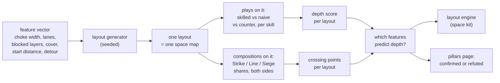
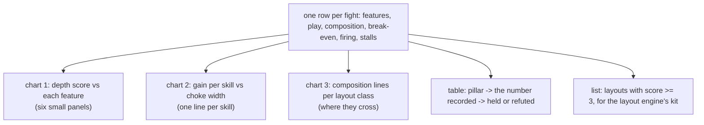

# The space lab's layout search (spec, D2)

Decision: Westley, 2026-10-06, "yes on B": run the space lab on guided-random layouts now, record which induce strategic depth, and find where the composition lines cross, while the ground lab waits for the sim's ground. Builds on space lab stage 1 (on main `047c8aed`: the space label, timeline orders, recorded features, the draft plays) and the fixed terrain sampler. Not audited; not approved; no run until Westley says so.

## The idea in one picture



Hundreds of layouts, each a small set of fights. The product is a chart per feature and a table per pillar, not a single number.

## 1. A layout is a feature vector

The sampler already draws walls, lanes, blocks and cover discs from a seed (`scripts/skilllab/maps.py`) and records a `Features` row per fight (stage 1). The search adds control over the draws: each feature is set, not rolled.

```
      start A ──────── corridor ──────── start B          start distance d
                 │ gap w │                                 choke width w (0 = no wall)
      ═══════════╡       ╞═══════════      wall            lanes n (0, 1, 2 parallel)
            ╭─ detour ───╮                                 detour ratio r = around / through
      ░░░ blocked on layers 0..k ░░░                       blocked-layer top k (asteroid height)
         · · · cover discs · · ·                           cover density c
                     ◎ objective                           objective at the corridor's middle
```

| Feature | Values in the first search (drafts) | What it stands for |
|---|---|---|
| choke width `w` | none, 2, 4, 8 unit bodies (bodies = 2R; R from the size setting) | how many can fire at once through it |
| flank detour ratio `r` | none, 1.5, 3 | the price of going around |
| lanes `n` | 0, 1, 2 | parallel routes |
| blocked-layer top `k` | 0 (ground only), 2, 4 (all) | whether the choke can be flown over |
| cover density `c` | 0, 0.1, 0.3 of the corridor | sight and fire blocked in places |
| start distance `d` | 1,400, 2,800 wu | time to arrange before contact |

A full grid is 4 × 3 × 3 × 3 × 3 × 2 = 648 layouts; the first search samples 200 of them with a Latin-hypercube draw (seeded), so every feature value appears in every mix.

## 2. What is measured on each layout

**Depth per skill.** For every skill with a registered play on space (S1 choke, S2 concave / spread / screen, S3 types by reach, S4 bait, S5 vulnerable-away, and their counters), three fights at 3 seeds:

```
                  skilled play   naive play (blob)   counter play
   break-even        B_s             B_n                B_c
   depth gain   =  B_s - B_n           (units the skill is worth here)
   counter works =  B_c < B_s          (the play can be answered)
```

**Depth score of the layout** (proposal; the pass marks are Westley's, Q-162-05):

```
   score = number of skills whose gain >= G  and  whose counter works
   G = 2 units (draft)
```

A layout scores 0 to 5. A high score means several skills pay and none is unanswerable.

**Crossing points.** Composition is a share of the three categories; both sides 16 units; the enemy side's mix fixed, the player's mix swept:

```
   break-even
   16 |                  ___ Line-heavy
      |   Siege-heavy __/
   12 |   __________/\__
      |  /           \  Strike-heavy
    8 |_/_____________\_______________
        no choke   2 bodies   8 bodies     choke width
```

Where two lines cross is a point at which composition choice stops being dominant; the search records, per layout, which pairs cross and at which feature values. A layout with no crossings has a best composition for everyone.

**Cost per cell:** one break-even scan is 11 to 14 s (3 seeds). Per layout: 7 plays × 3 (skilled, naive, counter) + 3 compositions × 1 ≈ 24 scans ≈ 5 minutes of one worker. 200 layouts ≈ 17 worker-hours ≈ 3 hours on 6 workers, within the 6 GB scope.

## 3. The outputs



Charts in the lab's own page style (inline SVG, light and dark), one `summary.json` for the pillars table.

## 4. What must exist first

| Need | State | Who |
|---|---|---|
| Objective scene: both forces start `d` apart and converge on an objective; today's plays start at contact distance | not built; a new `scenes.py` entry plus a `Setup` start distance | Doer, one unit |
| Flank detour generator (a wall with a gap plus a detour path of known ratio) | not built; the sampler draws random rectangles | Doer, one unit |
| Composition by category share (the lab mixes by type name; the three-category wrapper is small) | small addition | Doer |
| Fight end on "never engaged" and the mop-up line-of-sight rule (Q-LAB-01, briefs B1, B2) | in flight today | Sonnet chat |
| Depth score and the pillars table | new module `scripts/skilllab/depth.py` | Doer, one unit |
| Pass marks `G`, the score rule, the sweep values | drafts above | Westley, after the first chart |
| Unit size as a setting (D1) for the bodies axis | spec written; after stage 2 lands | Doer |

## 5. Pre-flight (to do before the run is launched)

Check by reading or running, not from memory: the objective scene works with the mop-up rule; the sampler's draws are deterministic per feature vector (byte-identical rows at 1 and 3 workers, as the ping search proved); the registered plays build on the new scene (seven plays, three counters); the Latin-hypercube draw is seeded with no `random` state leaking; the cost per layout measured on 3 layouts before sizing the batch; the memory scope at 6 workers.

## 6. Open (register rows on approval)

- Q-LS-01: the depth score rule and `G` (Westley).
- Q-LS-02: whether the enemy mix is fixed per layout or swept too (a 3 × 3 grid triples the cost).
- Q-LS-03: whether the "likely places" ping policy joins the search once chokes exist (the ping search found that "ahead" is a weak naive baseline).
