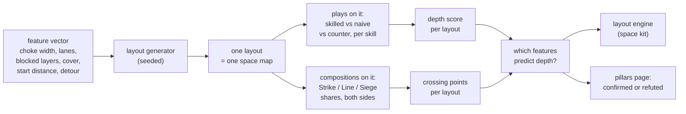
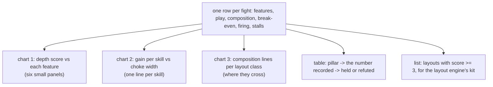

# The space lab's layout search (spec, D2, rev 2)

Decision: Westley, 2026-10-06, "yes on B": run the space lab on guided-random layouts now, record which induce strategic depth, and find where the composition lines cross, while the ground lab waits for the sim's ground. Builds on space lab stage 1 (on main `047c8aed`: the space label, timeline orders, recorded features, the draft plays) and the fixed terrain sampler. Rev 2 (2026-10-06 evening) folds a fresh Sonnet audit; Westley the same evening: "go on all, we're pushing for our 2 week deadline" (the build go for the pieces and the first run).

## The idea in one picture



Hundreds of layouts, each a small set of fights. The product is a chart per feature and a table per pillar, not a single number.

## What the audit changed (2026-10-06)

| Finding (file:line, `scripts/skilllab/`) | Decision |
|---|---|
| The space plays are fixed 16 v 16 `Setup`s built by `fn()` (`plays_space.py:92-95`), not `build(enemy_heads, swap)` functions; nothing scans them, so no break-even exists for them today | Piece P3: a `BuildFn` wrapper per registered play that varies the enemy headcount and takes the layout's map; the skilled side stays at 16 |
| Counters are registered for S1, S2 (spread line) and S4 only (`plays_space.py:171-204`, `skills.py:75-82`); none for S3, S5, concave, screen | The score counts "counter works" only where a counter exists; S3 and S5 score on gain alone and the page marks them "no counter registered" (a lab draft; counters for S3/S5 are a later play-writing unit) |
| No category notion in the lab (`Side.mix` is unit-name shares, `asym.py:36,80-100`); the sim has `om_composition_ratio` and a category per type (`ouroboros_sim.h:1155-1159, 1998`) but which builtin type is Strike, Line or Siege is undecided and Q-081-01 is open | Compositions move to run 2. Run 1 measures depth per skill only. The category-to-type table is a Westley decision before run 2 |
| Features: `choke_width_wu/_bodies` (bodies = gap / 30, body hardcoded 15 wu until D1), `lane_count` 0 or 1 only, `blocked_layer_ranges` from random `lo, hi`, no detour ratio, no objective; kinds are exclusive (one wall OR lane OR cover per map) (`maps.py:52-129, 168-169`) | Piece P1: a feature-controlled generator `layout_map(features, seed)` beside `sample_map`, lanes 0/1/2, `k` as `layer_hi` with `lo = 0`, a detour path of known ratio around the wall, cover density; `Features` gains `detour_ratio`, `blocked_layer_top`; `rows.py` columns follow |
| `start_distance` is computed from `Frame` (`DEFAULT_FRAME` ±445, `maps.py:22`) and the scenes place sides at sensor radius + 1 (`asym.py:131`, `plays.py:49`); no objective field in `Setup` (`contract.py:81-97`) | Piece P2: `Setup` gains `start_distance` and `objective`; the objective scene converges both groups on it; mop-up (`mopup.py:36-38`) already returns `None` with no enemy seen, so no re-order problem |
| Stalemate = 400 ticks with no hp change anywhere (`fight.py:263,271-277`); at `d` = 2,800 the approach alone may exceed it and score "undecided" | Provisional (Westley's veto, it changes a window's start, not its length): the quiet counter starts at first damage; before first contact the only ends are the cap and a wipe. If he prefers, (b) raise `stalemate_ticks` instead |
| Cost: 7 skilled + 1 shared naive + 3 counters = 11 scans per layout in run 1; a scan is 17 cells × 2 swaps × 3 seeds = 102 fights (`scan.py:33,69`) | 200 layouts × 11 × 102 = 224k fights; at 55 fights/s (12 workers) about 68 min; with bisection (B10) about 20 min |
| No `random` outside seeded `Random(seed)`; no numpy | The Latin-hypercube draw is hand-written on `Random(seed)` in `depth.py` |
| `summary.py` is cell-shaped; `report.py` has the CSS vars, dark mode and SVG helpers | `depth.py` writes its own `depth_summary.json` and uses `report.py`'s helpers for the pages |
| `SL-harness` (glob) and `SPACELAB-1` (explicit) both list `plays_space.py` and `test_plays_space.py` | PP-ledger: SPACELAB-1 landed; its rows retire; LAB-SEARCH rows per piece below |
| B1 (mop-up LOS) and B2 (cap 12,000) unmerged | Both land through the gate before the pieces merge; a wall layout without `can_shoot` stalls on the first blocked pair |

## 1. A layout is a feature vector

The sampler already draws walls, lanes, blocks and cover discs from a seed (`scripts/skilllab/maps.py`) and records a `Features` row per fight (stage 1). The search adds control over the draws: each feature is set, not rolled.

```
      start A ──────── corridor ──────── start B          start distance d
                 │ gap w │                                 choke width w (0 = no wall)
      ═══════════╡       ╞═══════════      wall            lanes n (0, 1, 2 parallel)
            ╭─ detour ───╮                                 detour ratio r = around / through
      ░░░ blocked on layers 0..k ░░░                       blocked-layer top k (asteroid height)
         · · · cover discs · · ·                           cover density c
                     ◎ objective                           objective at the corridor's middle
```

| Feature | Values in the first search (drafts) | What it stands for |
|---|---|---|
| choke width `w` | none, 2, 4, 8 unit bodies (bodies = 2R; R from the size setting) | how many can fire at once through it |
| flank detour ratio `r` | none, 1.5, 3 | the price of going around |
| lanes `n` | 0, 1, 2 | parallel routes |
| blocked-layer top `k` | 0 (ground only), 2, 4 (all) | whether the choke can be flown over |
| cover density `c` | 0, 0.1, 0.3 of the corridor | sight and fire blocked in places |
| start distance `d` | 1,400, 2,800 wu | time to arrange before contact |

A full grid is 4 × 3 × 3 × 3 × 3 × 2 = 648 layouts; the first search samples 200 of them with a Latin-hypercube draw (seeded), so every feature value appears in every mix.

## 2. What is measured on each layout

**Depth per skill.** For every skill with a registered play on space (S1 choke, S2 concave / spread / screen, S3 types by reach, S4 bait, S5 vulnerable-away, and their counters), three fights at 3 seeds:

```
                  skilled play   naive play (blob)   counter play
   break-even        B_s             B_n                B_c
   depth gain   =  B_s - B_n           (units the skill is worth here)
   counter works =  B_c < B_s          (the play can be answered)
```

**Depth score of the layout** (proposal; the pass marks are Westley's, Q-162-05):

```
   score = number of skills whose gain >= G  and  whose counter works
   G = 2 units (draft)
```

A layout scores 0 to 5. A high score means several skills pay and none is unanswerable.

**Crossing points.** Composition is a share of the three categories; both sides 16 units; the enemy side's mix fixed, the player's mix swept:

```
   break-even
   16 |                  ___ Line-heavy
      |   Siege-heavy __/
   12 |   __________/\__
      |  /           \  Strike-heavy
    8 |_/_____________\_______________
        no choke   2 bodies   8 bodies     choke width
```

Where two lines cross is a point at which composition choice stops being dominant; the search records, per layout, which pairs cross and at which feature values. A layout with no crossings has a best composition for everyone.

**Cost per cell:** one break-even scan is 11 to 14 s (3 seeds) on the linear sweep. Per layout: 7 plays × 3 (skilled, naive, counter) + 3 compositions × 1 ≈ 24 scans ≈ 5 minutes of one worker; 200 layouts ≈ 17 worker-hours. Measured levers (`docs/northstar/research/layer_dynamics/throughput_2026-10-06.md`): 12 workers scale 6.6× (about 2.6 h wall); bracketed bisection (B10) cuts the fights 3.4× (about 45 min); batched hp reads (B11) cut the per-fight Python (about 30 min). Memory is not a constraint (32 MB per worker).

## 3. The outputs



Charts in the lab's own page style (inline SVG, light and dark), one `summary.json` for the pillars table.

## 4. Pieces (run 1)

| Piece | Files (owner row LAB-SEARCH-*) | What | Tests first (different agent) |
|---|---|---|---|
| P1 layout generator | `maps.py`, `rows.py` | `layout_map(features, seed)`: wall with gap `w` bodies, lanes 0/1/2, blocked layers 0..k, detour of ratio `r`, cover `c`; `Features` gains `detour_ratio`, `blocked_layer_top` | `tests/skilllab/test_layout_map.py`: every feature value round-trips through `Features`; same seed and features give byte-identical maps; the detour path's length over the through path is within 5% of `r` |
| P2 objective scene | `contract.py` (`Setup` fields), `scenes.py`, `asym.py`, `plays.py`, `fight.py` (quiet counter from first damage) | `start_distance`, `objective`; both groups attack-move to the objective; stalemate window starts at first damage | `tests/skilllab/test_objective_scene.py`: sides start `d` apart; a fight at `d` = 2,800 on open ground does not end "stalemate" before contact; the existing contact-distance plays are byte-identical (rows recorded before and after) |
| P3 scannable space plays | `plays_space.py`, `skills.py` | `BuildFn` per registered play taking `(map, enemy_heads, swap)`; counters where registered; "no counter" flagged | `tests/skilllab/test_plays_space_scan.py`: each of the 10 plays builds at 8 and 24 enemy heads; the 16 v 16 build equals today's `fn()` |
| P4 depth | `depth.py` (new), `batches.py` entry `layout_search`, `tests/skilllab/test_depth.py` | seeded LHS over the grid; per layout 11 scans; `gain`, `counter_works`, score (`None` break-even = no gain, flagged); `depth_summary.json`; pages (chart 1, chart 2, the pillars table) | the score of a hand-built fixture equals the rule; LHS at seed 7 is byte-identical twice; the pillars table has one row per pillar in `map_design/README.md` |
| B9, B10, B11 | deferred (pre-flight 2026-10-06): B9 saves 11 s per worker process once per run (workers persist across a batch), B11 needs a new public symbol (`om_unit_get_hp_all`, a contract piece) and B10 returns sparse cells that `batches.py:536`, `report.py:63-94` and the summary consume as dense. Run 1 at 68 min needs none of them; B10 is revisited if runs repeat | | |

Order: tests first (four writers); P1, P2, P3 in parallel (disjoint files); P4 after P1 to P3; clerk merges onto main (after B1 and B2 have landed), gate, a 3-layout smoke run, then the 200-layout run at 12 workers. Owner rows: one piece LAB-SEARCH with explicit rows (`maps.py`, `rows.py`, `contract.py`, `scenes.py`, `asym.py`, `plays.py`, `fight.py`, `plays_space.py`, `skills.py`, `depth.py`, `batches.py`, the four test files), the way SPACELAB-1 sat beside the `SL-harness` glob. Baseline (pre-flight): `tests/skilllab` 2045 passed, 1 failed (`ground/test_highground_real.py::test_control_3_h0_a_longer_climb_never_raises_the_break_even`), 2 skipped; one 32v32 fight 0.27 s.

Run 2 (after Westley's category table and D1): compositions by category share and the body-size axis.

## 5. Pre-flight (to do before the run is launched)

Check by reading or running, not from memory: the objective scene works with the mop-up rule; the sampler's draws are deterministic per feature vector (byte-identical rows at 1 and 3 workers, as the ping search proved); the registered plays build on the new scene (seven plays, three counters); the Latin-hypercube draw is seeded with no `random` state leaking; the cost per layout measured on 3 layouts before sizing the batch; the memory scope at 6 workers.

## 6. Open (register rows on approval)

- Q-LS-01: the depth score rule and `G` (Westley).
- Q-LS-02: whether the enemy mix is fixed per layout or swept too (a 3 × 3 grid triples the cost).
- Q-LS-03: whether the "likely places" ping policy joins the search once chokes exist (the ping search found that "ahead" is a weak naive baseline).

## Rev 3 (2026-10-07, go given by Westley's correction): placed formations, decided by survivors

Origin: Westley, 2026-10-07, on the lab's stalemates: "why can't we position the units ourselves instead of making them walk ... hypothetically we're placing units in specific patterns to detect strategic depth, not letting them just do their thing. A skilled player ... will micro them into specific formations." His correction the same day: placement replaces the walking, not the start-distance feature. The tests for it are red on purpose (`tests/skilllab/test_decided_by_survivors.py`).

**Rule 1, placed.** Both formations are placed already in shape at the layout's `start_distance` (1,400 or 2,800 wu; the six-feature grid of 648 stays), with the layout's choke midpoint between them (the middle of the gap between the wall blocks; with no wall, the layout's centre). `scenes.placed_scene(layout, play, start_distance)` places the two first anchors `start_distance` apart. Nothing walks to a formation, and the approach cannot time out because (Rule 2) nothing ends the fight before first damage except the cap or a wipe.

**Rule 2, decided by survivors.** Setup gains `decided_by_survivors` (default False). When set:
- Before first damage the only ends are the cap and a wipe.
- After first damage, once no living unit can see a living enemy, a blind count starts at that first blind tick; any tick on which some unit sees an enemy resets it. At 400 blind ticks (tick = first blind tick + 400) the fight ends with outcome `decided`.
- `FightResult.winner` (new; None for every other outcome) is read from the remaining hp sums: `side0` or `side1` for the larger, `draw` when they differ by at most 5% of the larger. A genuine standoff, where nobody sees or hits anybody, therefore scores as a draw, not as "undecided".
- Scoring: `scan.cell_result` treats `decided` like a wipe, won only when side 0 is the winner in every fight and the mean margin clears the bar; a `draw` winner is not a win.

**What it replaces** (with the flag set; the old paths stay for the ground lab and the existing plays, byte-identical):

| Old | Where | Replaced by |
|---|---|---|
| Walking to contact (formations marching to meet at `start_distance`) | `asym.py:131`, `plays.py:49` scenes | formations placed in shape at `start_distance` apart; the `start_distance` feature stays |
| `mopup` (re-order at the seen enemy) and its fallback `enemy_anchor` (`mopup.py:18`, `fight.py:233-252`) | the stalemate-window row of "What the audit changed" | nothing: nobody re-orders; sight ends the fight, not a march |
| `quiet_from_first_damage` and the 400-tick no-hp-change stalemate window (`fight.py:263,271-277`) | same row | the blind count above; `stalemate_ticks` is not read |
| `Setup.start_distance` / `Setup.objective` and `scenes.objective_scene` (P2) | contract.py, scenes.py | left in place for now; removal is a later cleanup, not part of this piece |

**New outcome label `decided`** joins `side0`, `side1`, `draw`, `stalemate`, `cap`; with the flag set `stalemate` never occurs, and `cap` remains for fights where sight never lapses.

**Cost change.** None to the grid: six features, 4 x 3 x 3 x 3 x 3 x 2 = 648 layouts; the search still samples 200 with the seeded Latin-hypercube draw. Scans are unchanged at 11 per layout (7 skilled, 1 shared naive, 3 counters), so 200 x 11 x 102 = 224k fights stay the upper bound; fights should get shorter (no approach walk, no 400-tick quiet wait), not longer.

**Two numbers for Westley** (both are draft; changing either later is a threshold change, so they are his):
1. 400 ticks of no sight before the fight is decided (the old stalemate window's number, reused).
2. 5% as the draw band on remaining hp.

Build impact, for the builder's piece card: `contract.py` (`Setup.decided_by_survivors`, `FightResult.winner`), `fight.py` (the blind count and the winner), `scan.py` (`cell_result`), `scenes.py` (`placed_scene(layout, play, start_distance)`); `depth.py` keeps its six features, so the existing depth tests stand.


## Rev 4 (2026-10-07, Westley "a, that sounds good, that accounts for the whole situation"): feature-relative placement, roles, a hold condition

Supersedes Rev 3's Rule 1 (translated formations) and completes Rule 2. The placement is the skill: each play says where its formation stands relative to the layout's features, which side defends and which attacks, and how a denial play wins.

**Rule 1, placement by feature.** Every play declares anchors in layout terms, resolved by `scenes.placed_scene(layout, play, start_distance)` against the layout's `Features` (choke cells, lane mouths, cover discs, the blocked-layer top): the defender's formation is placed already in shape at its anchor; the attacker (the other side) is placed in its own shape `start_distance` from the choke on its side and is the only side that approaches (attack-move toward the defender's anchor); the defender holds (guard) unless its timeline says otherwise. Nothing walks to a formation.

| Play | Role | Defender anchor (in shape) | Attacker |
|---|---|---|---|
| s1_hold_choke | defender | at the choke mouth on the defender's side, facing the choke | blob from `start_distance` |
| s1_outrange | defender | one weapon reach beyond the choke exit, facing it | blob |
| s2_concave | defender | concave around the choke exit | blob |
| s2_spread_line | defender | a line across the choke exit at one reach | blob |
| s2_screen | defender | screen at the exit, main body behind | blob |
| s3_types_by_reach | defender | long-reach types behind the nearest cover to the exit, short-reach in front | blob |
| s4_bait | defender | bait group at the lane mouth, ambush behind cover beside it; timeline unchanged | blob (chases the bait) |
| s5_vulnerable_away | defender | vulnerable types on the far side of the choke from the attacker | blob |
| s2_mass_one_end (counter) | attacker | the skilled line as above | mass at one end of the line |
| s4_do_not_chase (counter) | attacker | the bait play as above | holds at `start_distance`, never chases |
| s1_outrange (counter use) | attacker | the hold-choke play | stands off at reach |
| naive | attacker | the defender is the naive blob at the choke mouth | blob from `start_distance` |

Where a layout has no choke (choke width none), "the choke" is the midpoint of the corridor; where it has no lane, the bait mouth is the choke mouth; where it has no cover, "behind cover" is "behind the formation". Every anchor cell must be walkable on the play's layer (the mask test); if a formation does not fit, the scene shifts it along the corridor axis until it does and records the shift in the row.

**Rule 2, outcomes.** As Rev 3 (decided by survivors after 400 blind ticks following first damage; draw within 5%), plus the hold condition: after `hold_ticks` from first damage, if at least half the defender's living units stand within 300 wu of the defender's anchor and no living attacker does, the fight ends `held` and the defender wins. `hold_ticks` = 1,200 (60 s; draft, Westley's number). Before first damage: cap or wipe only. Outcome labels: `side0`, `side1`, `draw`, `decided`, `held`, `cap`.

**Naive baseline (restored from README §11, Westley 2026-10-02: "a blob if they're mediocre players, or a spread out line if they're skilled players"):** run 1 scans both naive baselines, the blob and the spread line, placed like a defender at the choke mouth; gain is reported against each (12 scans per layout, not 11).

**What `start_distance` measures now:** the time the attacker needs to reach a placed defence; the feature stays (six features, 648 grid, 200 sampled).

**Build impact:** `plays_space.py` gains an `anchors` declaration per play (role, defender anchor kind, attacker kind) used only by `placed_scene`; `scenes.placed_scene` resolves anchors against `Features` and the map; `fight.py` the `held` end; `scan.cell_result` treats `held` like a wipe for the defender; `depth.py` unchanged apart from the labels. Tests: the anchor table above (one case per play per layout kind: with and without choke, lane, cover), the shift rule, `held`, the existing-scenes hash.
