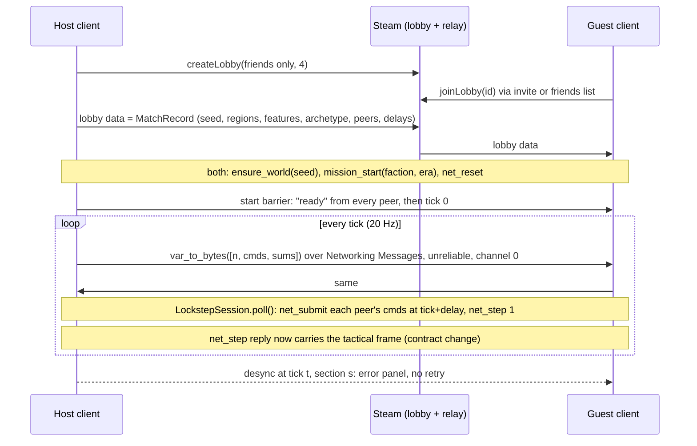

# Steam P2P multiplayer: wiring the client (spec, draft 1)

Written 2026-10-06 evening from the Sonnet pre-flight scout on main `1470e10e`. Goal (Westley, 2026-10-06): a Steam beta with multiplayer in about two weeks; private beta by Dev Comp key first, the public track started at once (Q-STEAM-01 a). Research: `docs/research/topics/steam_p2p_and_beta_submission.md`. Backend on main: pipe verbs `net_*` (`csrc/pipe/om_pipe.c:2612-2634`), `autoload/net/*.gd` (unregistered), `tests/net` (14 pass, 224 s), `tests/test_lockstep_session.gd` (PASS). This spec is contract-level (a pipe frame changes), so a second Fable chat audits it after the Sonnet auditor. Not approved; not launched.

## The match, in one picture

## Found by the pre-flight (what the research doc had wrong)

| Finding | Evidence | Decision |
|---|---|---|
| `net_step` writes no `tactical` frame; the view draws from `tactical_step` frames only | `architecture.md:352`, `om_pipe.c:2217-2231`, `c_bridge.gd:470-484` | Contract: `net_step` emits the same `tactical` frame as `tactical_step` after the step (one frame per `net_step` call); `architecture.md` first |
| `project.godot:17` pins features `"4.7"`; the installed binary is 4.6.3 (`godot.real --version`) | | GodotSteam 4.19.1 (Godot 4.6.3) as researched; the pin is Westley's to confirm (T-note: a 4.7 editor would rewrite the project) |
| The session is proven on a FakeSim and the loopback only; `tests/net` proves a Python port of the rule through real pipes, not the GDScript session | `lockstep_session.gd:150-159`, `tests/net/README.md` | Piece W2 builds the pipe-backed sim adapter and a Godot test runs the GDScript session over it with the loopback transport |
| `bytes_to_var` on remote packets | `lockstep_session.gd:93-105` | `bytes_to_var` (no objects) is already the call; the transport also rejects any packet whose decoded value is not an Array of length 3 with int, Array, Array; a test plants a bad packet |
| Every order passes `tactical_view.send_command` (`:359`) to `send_unit_command` (`c_bridge.gd:415`) to the immediate `command` verb; the view's `_process` releases ticks by time accumulation (`:43-85`, `:438`) | | In a match the view hands orders to `NetMatch.command()` and stops stepping; `NetMatch` owns the tick |
| `c_bridge.gd`, `scene_router.gd`, `scenes/main_menu/**` are co-owned by several pieces | `pieces.toml:361,415,429,443,457,514,515,539` | PP-ledger assigns NET-wire-* rows before the card; the stage 3 era toggle (C1) and the MULTIPLAYER row land through one menu piece, sequenced |
| `NET-backend` row still `pending` though the code is on main | `pieces.toml:1245-1263` | PP-ledger marks it landed with the commit |

## Interfaces fixed here

1. **Transport** (`autoload/net/transport.gd:1-16` as-is): `attach(id)`, `send(from, to, bytes)`, `poll(id) -> Array of {from, data}`. `SteamTransport` keeps a table `peer_id (small int, lobby member order) -> SteamID`; sends with `Steam.sendMessageToUser(identity, bytes, UNRELIABLE_NO_DELAY, channel 0)`; `poll` drains `receiveMessagesOnChannel(0, 32)` after `Steam.run_callbacks()`. Unreliable fits the session's repeat-5 scheme (`lockstep_session.gd:42`). Wall clock: `stall_ticks 1000` and `drop_ticks 2000` at 20 Hz are 50 s and 100 s; set `stall_ticks 20` (1 s) and `drop_ticks 1200` (60 s) in the MatchRecord (the 2026-10-05 settings).
2. **Sim adapter** `PipeSim` (new, `autoload/net/pipe_sim.gd`): `submit(cmd)` is `net_submit` through `_request` (`c_bridge.gd:388-412`) and returns the ack `code`; `step()` is `net_step {n:1, checksum: every 10th}` and returns `{tick, sections}` plus stores the tactical frame for the view. A nonzero `code` is surfaced to the player as a refused order (the same path as today's refusals).
3. **Verb wrappers** in `c_bridge.gd` (one piece, NET-wire-bridge): `net_reset`, `net_submit`, `net_step`, `net_checksum`; the log and state verbs stay unwrapped (late join and resync are not in the beta).
4. **MatchRecord** (a Dictionary, host-authored, carried as lobby data): `seed, n_regions, features, archetype, era_kind, movement_kinds, peers: [{peer_id, steam_id, faction}], input_delay 3, repeat 5, stall_ticks 20, drop_ticks 1200, version (git hash)`. Peers with a different `version` refuse to start. The host calls `ensure_world` and `mission_start` on itself and every guest does the same with the record; then `net_reset`; then each peer sends `ready` (a reliable lobby chat message); the host sends `go` with tick 0 when all are ready.
5. **Order mapping**: move 0, attack_move 1, attack_target 2 (`c_bridge.gd:422` to `OM_NET_VERB`), `units` are sim ids (identical on both peers by construction); other verbs are not reachable from the client today and stay so. Single player keeps `send_unit_command` untouched; `tactical_view.send_command` branches on `NetMatch.active()`.
6. **The pump**: new autoload `NetMatch` (`autoload/net/net_match.gd`, registered in `project.godot`): holds the session, the transport and the `PipeSim`; `_process` calls `Steam.run_callbacks()` and, on a 50 ms accumulator, `session.poll()`; exposes `active()`, `command(cmd)`, `state()` (`running | stalled(peer) | desync(tick, section) | ended`). Autoloads `SteamInit` (`autoload/steam/steam_init.gd`: `steamInitEx(app_id)`, `initRelayNetworkAccess()`, a `steam_ready` flag; app id 480 Spacewar until Westley's app id exists) before it.
7. **Desync screen**: `scenes/shared/error_panel.gd` gains `show_error(reason, retry := true)`; a desync shows "Desync at tick N, section NAME" with the main-menu button only. A stall shows a "waiting for PEER (s)" line in the tactical HUD; a drop ends the match with the same panel.
8. **Export and Steam files**: `addons/godotsteam/` (GDExtension 4.19.1, binaries for Linux and macOS, owner NET-wire-ext), `export_presets.cfg` (Linux x86_64, macOS; owner NET-wire-export), `steam_appid.txt` for editor runs (gitignored? no: committed with 480 until the real id).

## Pieces

| Piece | Files (owner row to add) | Tests (red first, different agent) |
|---|---|---|
| W-contract | `docs/architecture.md` (PP-contract), `csrc/pipe/om_pipe.c` (T1): `net_step` emits the tactical frame | transport test: `net_step` answers a `tactical` frame with units, byte-equal to a `tactical_step` on the same world |
| W1 SteamTransport | `autoload/net/steam_transport.gd` (new) | Godot: with a fake `Steam` singleton object, `send` and `poll` round-trip; a non-Array packet is dropped and counted |
| W2 PipeSim + bridge wrappers | `autoload/net/pipe_sim.gd` (new), `autoload/c_bridge.gd` (NET-wire-bridge) | Godot: the GDScript session over two `PipeSim`s on two real pipes with the loopback transport reaches tick 200 with equal checksums; a `net_submit` refusal code reaches the caller |
| W3 NetMatch + SteamInit | `autoload/net/net_match.gd`, `autoload/steam/steam_init.gd` (new), `project.godot` (G-projectgodot) | Godot: `NetMatch` with loopback and fake sims advances ticks at 20 Hz, reports stalled and desync states |
| W4 Lobby | `scenes/lobby/lobby.gd`, `lobby.tscn` (new, NET-wire-lobby), `autoload/scene_router.gd` (M3), `scenes/main_menu/main_menu.gd` (C1, after the era toggle): MULTIPLAYER row (`main_menu.gd:70-76`), host or join, member list, the MatchRecord barrier | Godot: with a fake lobby, a host record reaches the guest; mismatched `version` refuses; `ready` from all peers releases `go` |
| W5 Tactical hookup | `scenes/tactical_c/tactical_view.gd` (C5): `send_command` branches to `NetMatch`; `_process` skips its own stepping when a match is active; frames from `PipeSim`; stall line; desync panel | Godot: in match mode the view issues no `tactical_step`, an order reaches `NetMatch.command`; a desync state shows the panel without retry; single-player path byte-identical (existing tests unchanged) |
| W6 Export | `addons/godotsteam/**`, `export_presets.cfg`, `steam_appid.txt` | `godot --headless --export-release Linux` builds in CI-less form on this box; the Mac export is a Westley step |
| Clerk | merge `push/net-wire-land`, gate, a two-process loopback match playthrough on this box | |

Order: W-contract, gate; W1, W2, W3, W6 in parallel; W4 after W3; W5 after W2 and W3; clerk. First real-Steam test: Westley's two accounts on Spacewar 480, Linux and Mac, by hand (T17).

## Settings (provisional)

| Setting | Value | Owner |
|---|---|---|
| Tick rate | 20 Hz (50 ms), the session's existing rate | backend |
| input_delay / repeat | 3 ticks / 5 | Westley 2026-10-05 |
| stall / drop | 1 s / 60 s | planner, provisional |
| Lobby | friends-only, max 4 | E-19 R-141-01 |
| App id | 480 until the real one | T17 |

## Not in this piece

Late join and resync (`net_log_*`, `net_state_*` stay unwrapped); the economy seat; spectators; more than one human faction; invites outside the Steam overlay; dedicated servers.

## Open (register rows on approval)

- Q-NET-01: the `"4.7"` feature pin against the 4.6.3 binary: which Godot does the beta ship on (Westley).
- Q-NET-02: whether a stalled peer's units keep their last orders or halt (the sim does whatever it did; the question is whether to show a pause).
- Q-NET-03: whether `net_step` should emit tactical frames every call or every k-th call for bandwidth (local pipe, so no network cost; frames are for the view only).

## Pre-flight before launch

Check by reading or running: GodotSteam 4.19.1 loads under the 4.6.3 binary headless (`Steam` singleton present, `steamInitEx(480)` returns a code without the client running, no crash); `_request` timeouts against `net_step` at 20 Hz (the pipe's reply latency measured); the loopback two-process match from `tests/net/driver.py` reused for W2's Godot test; owner rows added; stage 3's menu change sequenced with W4.

## Estimate

Contract 1 + gate 1 + 6 pieces × 2 + clerk 1 = 15 agents; about 1.0 to 1.4M tokens; wall clock about 3 to 4 hours. The real-Steam test is by hand.
