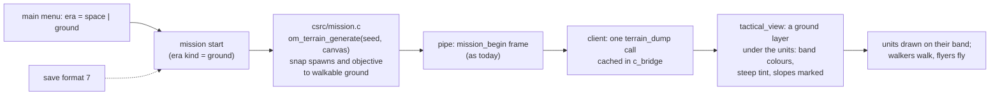
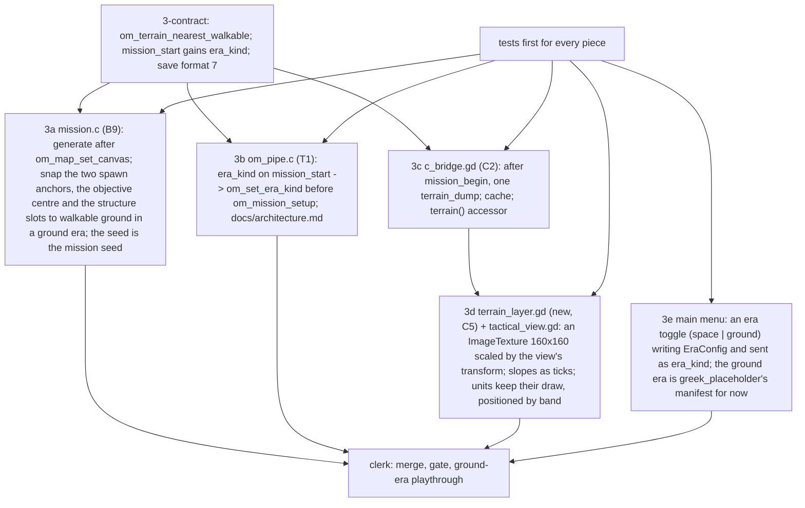

# Ground substrate, stage 3: missions on generated ground, seen by the player (spec, draft 1)

Written 2026-10-06 from the stage-3 pre-flight scout. Rests on stage 1 (on main) and stage 2 (landing tonight). Goal set by Westley the same day: playtesters on a Steam beta in two weeks must see ground eras; so stage 3 is the smallest honest path from "the sim has ground" to "a player plays a mission on it". Not audited; not approved.

## The path, in one picture

What the player sees: the walkers mockup's top-down look (bands as a colour ramp, steep ground tinted, slope midlines as ticks) under the existing unit drawing and camera. The approved 3D land mockup is NOT ported in stage 3: the tactical view is 2D (`Node2D`, `Polygon2D` units, no `_draw`), and a 3D swap needs a new camera, picking, box-select, the height array in the frame and a port of the mockup's mesh. That is its own stage after the beta (Q-STAGE3-01).

## Pieces

| Piece | Files (owner) | What | Tests (red first) |
|---|---|---|---|
| 3-contract | header, `signatures.toml`, `om_internal.h`, `save.c`, pins (PP-contract, T2c, T2g) | `int om_terrain_nearest_walkable(const om_world *w, double x, double y, double *ox, double *oy)` (ring search, lowest index on a tie; -1 when none; identity when no terrain); `mission_start` request gains `era_kind` (0 or 1, default 0); `OM_SAVE_FORMAT_VERSION` 7 with the six pins (pipe, `load_game.gd`, three version tests, ledger `TD-SAVE-7`) as the 5→6 commit `c4c0373b` did; `docs/architecture.md` | nearest-walkable on seed 11: a steep point snaps to the nearest walkable cell; a walkable point is unchanged; version tests pin 7; a version-6 save is refused cleanly |
| 3a | `csrc/mission.c` (B9) | In `om_mission_instantiate_map` after `om_map_set_canvas`: when `om_era_kind(w) == 1`, `om_terrain_generate(w, mission seed, canvas, canvas)`; the two spawn anchors, the objective node and cover centre, and each structure slot pass through `om_terrain_nearest_walkable`; the spawn grid steps over cells that are not walkable on the force's band (one line in `om_mission_spawn_force`, or rely on stage 2's spawn placement and refuse-and-retry at the next grid slot). Space era: byte-identical (no generate call) | every archetype at 20 seeds in a ground era: every unit spawns (none refused), the objective is reachable from both spawns by `om_walk_route` (count > 0 and ends in the objective cell); the space-era mission frames are byte-identical to main's for 3 seeds |
| 3b | `csrc/pipe/om_pipe.c` (T1), `docs/architecture.md` | `era_kind` field; `om_set_era_kind` before `om_mission_setup`; nothing else; `terrain_dump` unchanged. Check the pipe's read buffer against a 160×160 dump (about 100 KB of hex): if the buffer is smaller, `terrain_dump` gains a `part` argument (bands, walkable, slopes) and the client calls it three times | a transport test: `mission_start` with `era_kind 1` then `terrain_dump` answers 160×160 bands with every band present; `era_kind 0` answers the no-terrain error; a dump of a 24,000 canvas fits the pipe |
| 3c | `autoload/c_bridge.gd` (C2) | After `mission_begin` returns, when the era kind is 1: one `terrain_dump` (or three parts), decoded to a `PackedByteArray` of bands, walkable and a slope array; `terrain() -> Dictionary` (empty when space); never re-requested on deltas | `tests/test_c_bridge_terrain.gd`: with a fake pipe answering a dump, `terrain()` holds 160×160 bands; a space-era session leaves it empty; a second frame does not re-request |
| 3d | `scenes/tactical_c/terrain_layer.gd` (new; owner row), `tactical_view.gd` (C5) | A `Node2D` child drawn first: an `ImageTexture` 160×160 built once from the bands (the walkers mockup's ramp, `scenes/mockups/walkers/walkers_mockup.gd` colours), steep cells tinted, scaled by the view's `_world_scale` and camera; slope midlines drawn as ticks in `_draw`; `LAYER_HEIGHT` unused; units unchanged (their `layer` field already comes in the frame). Space era: nothing drawn, byte-identical screen | `tests/test_tactical_terrain_layer.gd`: with a fake terrain the layer builds a 160×160 texture, the colour at a band-5 cell is the ramp's top, a steep cell is tinted, a slope tick exists; with no terrain nothing is added; a desktop playthrough in the ground era (`tests/qa/desktop`, a second run of the spine with the era toggle) reaches `tactical_view` and the QA state names the ground layer |
| 3e | `scenes/main_menu/*` or the options page (C-owner per `pieces.toml`), `autoload/era_config.gd` | An "Era" choice: space (settled_reach) or ground (greek_placeholder, the placeholder land era), persisted in settings, read into `EraConfig.ACTIVE_ERA_ID` and the manifest's `kind`, sent as `era_kind` on `mission_start` [Q-STAGE3-02: where the choice lives] | the Godot test for the menu: the toggle changes `EraConfig` and the next `mission_start` carries `era_kind 1` |

Order: contract, gate; 3a, 3b, 3c, 3e in parallel (disjoint files); 3d after 3c; clerk.

## Settings (provisional)

| Setting | Value | Owner |
|---|---|---|
| Ground-era canvas for the beta | the archetype's (8k, 16k, 24k) | archetypes |
| Band ramp and steep tint | the walkers mockup's | approved look |
| Slope tick length | 60 wu | draft |

## Not in stage 3

The 3D ground (Q-STAGE3-01); the Sand Table and the camera options (T3, T4); buildings on the terrain (E-22, T11); the layout engine (the terrain is generated without a layout: chokes are whatever the field gives; the lab's layout search decides what a layout must provide).

## Open (register rows on approval)

- Q-STAGE3-01: when the 3D ground replaces the 2D band layer: after the beta, as its own stage, with the height array added to the frame.
- Q-STAGE3-02: where the playtester picks the era: (a) a main-menu toggle (this spec); (b) the campaign alternates eras per chapter; (c) two builds on two beta branches.
- Q-STAGE3-03: whether the space era's missions also gain a generated field (the space landscape mockup is approved but its generator is not in the sim: Q-166-02).

## Pre-flight before launch

Check by reading or running: the pipe's read buffer against the dump size; `om_tactical_reset` against the terrain state (does a second mission clear it); the mission seed's availability at instantiate time; the desktop QA driver's ability to toggle the era (a settings file or a command-line flag); the owners of the menu scene; stage 2 landed and its walk mask available to `om_walk_route` in the tests.

## Estimate

Contract 1 + gate 1 + 5 pieces × 2 + clerk 1 = 13 agents clean; about 0.8 to 1.1M tokens; wall clock about 3 hours with the parallel shape (the gate and the ground playthrough are the long poles).
