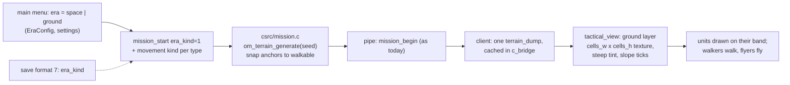
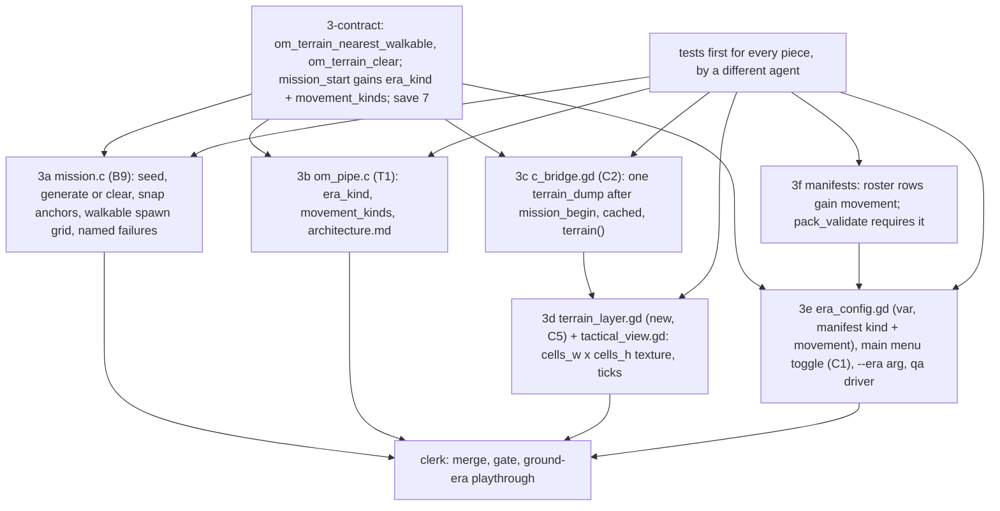

# Ground substrate, stage 3: missions on generated ground, seen by the player (spec, rev 3)

Written 2026-10-06 from the stage-3 pre-flight scout; rev 2 folds a fresh Sonnet audit the same evening (seven blocking findings, listed under "What the audit changed"). Rests on stage 1 (on main) and stage 2 (`push/terrain2-land`, landing). Goal set by Westley the same day: playtesters on a Steam beta in two weeks must see ground eras; stage 3 is the smallest honest path from "the sim has ground" to "a player plays a mission on it". Rulings: era choice is a main-menu toggle (Q-STAGE3-02 a). Not approved; not launched.

## The path, in one picture

What the player sees: the walkers mockup's top-down look (bands as a colour ramp, steep ground tinted, slope midlines as ticks) under the existing unit drawing and camera. The approved 3D land mockup is NOT ported in stage 3: `tactical_view.gd` is a `Node2D` (`:1`), units are `Polygon2D` placed in screen pixels (`:658`, `:666`), there is no `_draw`; the ground layer computes its own screen rectangle from `_world_scale` and `_camera` (`:64-68`). The 3D swap is its own stage after the beta (Q-STAGE3-01).

## What the audit changed (2026-10-06)

| Finding (file:line) | Decision |
|---|---|
| Nothing sets a type's movement kind: `om_unit_profile_movement_kind` returns flying unless `om_roster_set_movement_kind` was called (`tactical_move.c:3183-3195` on stage 2); no verb, mission code or manifest reader calls it | New piece 3f: the era manifest's roster rows carry `"movement": "walking" or "flying"` (the era-pack direction); the client reads them and the `mission_start` request carries `movement_kinds` (a list of `[type_id, kind]`), which the pipe applies with `om_roster_set_movement_kind` before `om_mission_setup`. Pre-flight item: where roster type ids come from on the client |
| No mission seed: `om_mission_state` has none, `om_map_get_active_seed` is a stub returning 0 (`tactical_mapgen.c:516`) | Terrain seed = `om_world_seed(w)` mixed with the region id and the archetype index (`seed ^ (region * 0x9E3779B1) ^ archetype`, integer, in `mission.c`); Architect small decision, revisit if two missions of a campaign look alike |
| Terrain persists across missions: `om_tactical_reset` (`unit.c:2392`) and `om_map_clear` (`tactical_mapgen.c:832`) leave `terrain_state`; freed only by the next generate or world free (`region.c:213`) | Contract piece adds `void om_terrain_clear(om_world *w)` (body in `csrc/terrain.c`, TERRAIN-1 owner joins the contract piece); 3a calls it when `era_kind` is 0; the 3b "no terrain" test runs a ground mission then a space one on the same world |
| `EraConfig.ACTIVE_ERA_ID` is a `const` (`era_config.gd:3`; readers `era_theme_resolver.gd:12`, `sim_bridge.gd:289`, `chronicle_scroll_panel.gd:68`, `time_jump_sequencer.gd:57,178`); no client code reads the manifest `kind` (`architecture.md:441`) | 3e makes it a `var` set once at startup from settings (readers unchanged), reads the manifest's `kind` and roster `movement`; owner row for `autoload/era_config.gd` (new, C-era) |
| No QA era selector (`daemon_client.py:154` has `--seed` only; `qa_driver.gd:21-28`) | 3e adds the user arg `--era=<id>` read by `EraConfig` before settings; the desktop driver passes it; owner rows for `qa_driver.gd` and `tests/qa/desktop/*` named in the card |
| Save 7's purpose unstated; `era_kind` lives in fog state (`fog.c:193`, stage 2) and is not saved, so a loaded ground mission reverts to space; the 5→6 commit `c4c0373b` touched 10 files (`om_internal.h`, `ouroboros_sim.h`, `om_pipe.c`, `load_game.gd`, `test_E16_B5_save_version.py`, `test_E16_C2_save_version.py`, `test_load_game_wrong_version.gd`, `tests/csim/conftest.py`, `signatures.toml`, the ledger) | Save 7 stays, purpose: `era_kind` and the movement-kind table are saved (fog section and roster section); the pin list is those 10 files, ledger row `TD-SAVE-7` |
| Texture fixed at 160×160; canvases give 80, 160, 240 cells (`tactical_mapgen.c:128-130`), max 280 (`om_internal.h:364`); dump is hex, 4 bytes per cell plus up to 4096 slope rows: 102 KB, 230 KB, 314 KB; no pipe buffer cap (`om_pipe.c:88-93` is requests only; replies through the realloc `jbuf` `:118-140`; client reads in chunks `c_bridge.gd:584,600`) | Texture sized from `cells_w × cells_h`; the `part` argument and the buffer pre-flight are dropped; the cache holds up to 280² |
| Generate fails with -1 (canvas above `TG_MAX_CANVAS_WU` or no dry cell) and calls `om_map_set_canvas` itself (`terrain.c:707`) | 3a: on -1 the mission refuses to start with a named error through the pipe (no silent flat mission); the archetype canvases (8k, 16k, 24k) are all within the cap |
| `om_unit_spawn_internal` returns 0 for a walker on an unwalkable cell (`unit.c:898`) | 3a's spawn grid pre-checks `om_terrain_walk_mask` and steps to the next grid slot; a force that cannot place every unit fails the mission start with a named error |
| Main menu double-claimed (`pieces.toml` lines 515 "core" and 534 C1) | PP-ledger resolves to C1 before the card is cut |

## What the pre-flight changed (2026-10-06 night)

| Finding (file:line) | Decision |
|---|---|
| No name-to-id table exists: manifests key units by name (`vanguard, warden, bombard, bastion, raider, interceptor`), sim ids are `OM_UT_*` at `csrc/unit.c:69-76` (`raider 0, interceptor 1, vanguard 2, warden 3, bombard 4, bastion 5`); the client registers no custom types | 3f writes the table into the manifest reader (`autoload/era_config.gd`: `const TYPE_IDS = {raider 0, ...}`) and the manifest row gains `movement`; the wire form is flat `movement_kinds: [t, k, t, k, ...]` parsed with the existing `get_int_array` (`om_pipe.c:264`), applied once before `om_set_era_kind` (`:1513`), which precedes both `om_mission_setup` paths |
| `UIDataBus.save_settings` (`ui_data_bus.gd:129-148`) and `_load_settings` (`:83-107`) rebuild from fixed key lists; an unknown key is dropped | 3e edits `autoload/ui_data_bus.gd` (G-uidatabus, one piece-row handover) in both branches of `_load_settings`, `save_settings`, section `[game] era_id` |
| `daemon_client.py:148-156` builds a fixed command; user args use the space form (`c_bridge.gd:100-103` `--seed <n>`) | 3e: `--era <id>` (space form); `daemon_client.py` gains `extra_args` |
| `scenes/main_menu/**` owned by C8 (`:515`) and C1 (`:539`); `c_bridge.gd` has six owners | PP-ledger: the menu toggle lands under C1 (C8's row drops the glob); 3c takes C2's `c_bridge.gd` row; new rows for `era_config.gd` (C-era), 3d/3e/3f files |
| The walkers mockup lives only on `origin/push/proto-walkers` | 3d reads its constants from that branch: `BAND_COLOURS` (0.40,0.72,0.42) (0.72,0.80,0.38) (0.90,0.68,0.30) (0.72,0.48,0.30) (0.92,0.90,0.88); `STEEP_COLOUR` (0.85,0.10,0.85) lerped 0.5 on unwalkable land; `WATER_COLOUR` unused (the sim has no water) |
| `om_terrain_generate` is called from `handle_terrain_generate` only (`:2287-2298`); `write_error(name, reason)` (`:360`) is the error pattern | 3a/3b: the generate call joins `handle_mission_start`; -1 answers `write_error("mission_start", "terrain generate failed")` |
| Save pins on this base: `om_internal.h:36`, `om_pipe.c:68`, `load_game.gd:5`, `test_E16_B5_save_version.py:13` (and `:97` 7→8), `test_E16_C2_save_version.py:14`, `test_load_game_wrong_version.gd:14`, comment copies `checksum_full.c:34`, `terrain.c:34`; stale prose `architecture.md:368` (`format_version 4`) | The contract piece's pin list is these; the stale prose is fixed in the same change |
| Stage 2 base = `push/t2-erakind` + `push/t2-corner-td` (contains colmask, wp); nothing on main yet | Launch after the stage 2 clerk lands them |

## Pieces

| Piece | Files (owner) | What | Tests (red first) |
|---|---|---|---|
| 3-contract | `ouroboros_sim.h`, `signatures.toml`, `om_internal.h`, `csrc/terrain.c` (TERRAIN-1), `save.c` (T2c), the 10 save-7 pins, `docs/architecture.md` (PP-contract) | `int om_terrain_nearest_walkable(const om_world *w, double x, double y, double *ox, double *oy)` (ring search, lowest index on a tie; -1 when none; identity when no terrain); `void om_terrain_clear(om_world *w)`; `mission_start` gains `era_kind` (0 or 1, default 0) and `movement_kinds` (list of `[type_id, 0 or 1]`, default empty); `OM_SAVE_FORMAT_VERSION` 7 saving `era_kind` and the movement-kind table | nearest-walkable on seed 11: a steep point snaps to the nearest walkable cell, a walkable point is unchanged; clear then `om_terrain_present` is 0; version tests pin 7; a version-6 save is refused cleanly; a saved ground mission loads with `om_era_kind` 1 and the same kinds |
| 3a | `csrc/mission.c` (B9) | In `om_mission_instantiate_map` (`:2388`, after the canvas call `:2400`): ground era: `om_terrain_generate(w, seed, canvas, canvas)` with the seed above, -1 fails the start with a named error; space era: `om_terrain_clear`. Spawn anchors, the objective node and cover centre, and each structure slot pass through `om_terrain_nearest_walkable`; the spawn grid steps over cells not walkable for the force's kinds | every archetype at 20 seeds in a ground era: every unit spawns, the objective is reachable from both spawns by `om_walk_route`; two campaign missions differ in terrain; a ground then a space mission on one world leaves no terrain; the space-era frames are byte-identical to main's for 3 seeds |
| 3b | `csrc/pipe/om_pipe.c` (T1), `docs/architecture.md` | `era_kind` and `movement_kinds` parsed in `handle_mission_start` (`:1436`); `om_set_era_kind` and `om_roster_set_movement_kind` before `om_mission_setup`; the -1 generate failure answered as an error frame | transport: `mission_start` with `era_kind 1` then `terrain_dump` answers `cells_w × cells_h` bands with every band present; a ground then a space mission answers the no-terrain error; a walking type's unit does not spawn on steep ground |
| 3c | `autoload/c_bridge.gd` (C2) | After `mission_begin`, in a ground era: one `terrain_dump`, decoded to bands, walkable and slopes; `terrain() -> Dictionary` (empty in space); never re-requested on deltas; `mission_start` sends `era_kind` and `movement_kinds` from `EraConfig` | `tests/test_c_bridge_terrain.gd` (owner row): a fake pipe answering a 240² dump fills `terrain()`; space leaves it empty; a second frame does not re-request; the request carries the kinds |
| 3d | `scenes/tactical_c/terrain_layer.gd` (new, under the C5 glob), `tactical_view.gd` (C5) | A `Node2D` child drawn first: an `ImageTexture` `cells_w × cells_h` from the bands (the walkers mockup's ramp and steep tint, `scenes/mockups/walkers/walkers_mockup.gd`), its screen rectangle from `_world_scale` and `_camera` each frame; slope midlines as ticks in its own `_draw`; units unchanged. Space: nothing added, screen byte-identical | `tests/test_tactical_terrain_layer.gd` (owner row): a fake 80² and 240² terrain each give a texture of that size; a band-5 cell is the ramp's top; a steep cell is tinted; a slope tick exists; no terrain adds nothing; desktop playthrough in the ground era (`--era=greek_placeholder`) reaches `tactical_view` and the QA state names the ground layer |
| 3e | `autoload/era_config.gd` (new row C-era), `scenes/main_menu/**` (C1), `scenes/mockups/_shared/qa_driver.gd`, `tests/qa/desktop/daemon_client.py` (rows in the card) | `ACTIVE_ERA_ID` becomes a `var` set at startup: `--era=<id>` user arg, else the saved setting, else `settled_reach`; `EraConfig.kind()` and `EraConfig.movement_kinds()` read from the manifest; an "Era" toggle on the main menu (space: settled_reach, ground: greek_placeholder) persisted through `UIDataBus` settings | Godot: the toggle changes the setting and the next `mission_start` carries `era_kind 1`; `--era` overrides the setting; every existing reader of `ACTIVE_ERA_ID` still passes |
| 3f | `assets/eras/*/manifest.json` (rows 471, 880), `scripts/specfactory/pack_validate.py` | Each roster row gains `"movement"`; `settled_reach` all flying; `greek_placeholder` walking except the placeholder scout (flying, R-201-01); the validator requires the field | `pack_validate` rejects a roster row without `movement`; both manifests pass |

Order: contract, gate; 3a, 3b, 3f in parallel; 3c and 3e after the contract; 3d after 3c; clerk.

## Settings (provisional)

| Setting | Value | Owner |
|---|---|---|
| Ground-era canvas for the beta | the archetype's (8k, 16k, 24k) | archetypes |
| Band ramp and steep tint | the walkers mockup's | approved look |
| Slope tick length | 60 wu (cells are 100 wu; draft) | draft |
| Terrain seed mix | `world_seed ^ (region * 0x9E3779B1) ^ archetype` | Architect, small |

## Not in stage 3

The 3D ground (Q-STAGE3-01); the Sand Table and the camera options (T3, T4); buildings on the terrain (E-22, T11); the layout engine (the terrain is generated without a layout; the lab's layout search decides what a layout must provide); per-unit body sizes (D1).

## Open (register rows)

- Q-STAGE3-01 (closed 2026-10-07): every battle scene in the beta is 3D, 2D is for UI screens only; the 3D ground is the visible game programme lane C.
- Q-STAGE3-02 (closed, a): the main-menu toggle.
- Q-STAGE3-03 (open): whether space missions also gain a generated field.

## Pre-flight before launch

Check by reading or running: stage 2 landed on main (`om_walk_route`, `om_roster_set_movement_kind`, `om_era_kind`); where the client gets roster type ids for `movement_kinds` (the manifest's roster rows against the sim's type table); the main-menu double claim resolved in `pieces.toml`; `UIDataBus.get_settings` writable for a new key; the desktop driver passes user args through to Godot; the 10 save-7 pins still match `c4c0373b`'s shape.

## Estimate

Contract 1 + gate 1 + 6 pieces × 2 + clerk 1 = 15 agents clean; about 1.0 to 1.3M tokens; wall clock about 3 hours (the gate and the ground playthrough are the long poles).
