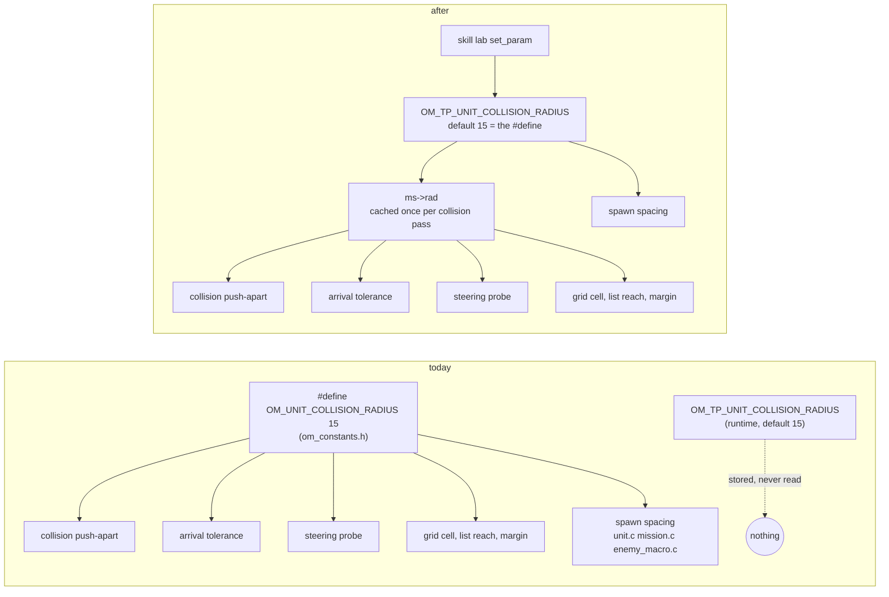
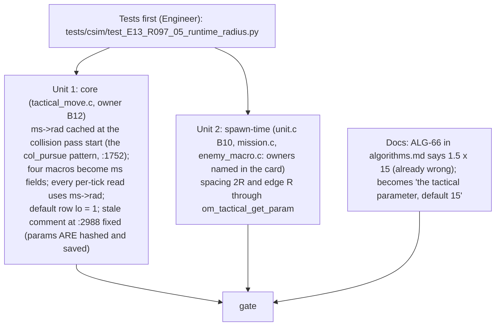
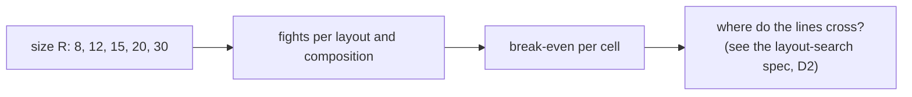

# Unit size as a runtime setting (spec, D1)

Decision: Westley, 2026-10-06 (Q-LAB-02 a): the engine reads the runtime collision radius so the skill lab can sweep unit size; per-type sizes follow with the era rosters ("we're probably going to vary sizes throughout eras, so we'll want to find lines crossing with unit sizes included"). Pre-flight scout 2026-10-06: 20 read sites, none a compile-time dimension; one Doer unit for the core, a second for the spawn-time sites. Runs after terrain stage 2 lands (both edit `csrc/tactical_move.c`).

## What changes, in one picture

At the default (15) every number is bit-identical, so no recorded hash moves. The lab sets the parameter per fight and the engine follows.

## Where the radius is read today (pre-flight)

| Site (`csrc/tactical_move.c` unless noted) | What it sizes | Class |
|---|---|---|
| :95 `OM_MOVE_GRID_BASE_CELL = 4R` | the spatial grid's starting cell (already a runtime double; doubles until the cell count fits) | macro → `ms` field |
| :96 `GRID_MARGIN = 3R`, :110 `LIST_REACH = 4R`, :111 `COLLISION_SLACK = R` | neighbour search reach | macro → `ms` fields |
| :1327-1329 | navmesh cell inset | plain read |
| :1434, :1821 | steering probe `2R` | plain read |
| :1513, :1524, :1553, :1604, :1667 | the push-apart, target `2R` (R-097-05) | plain read |
| :1977 | cell clamp `R .. cell-R` | plain read |
| :2021, :2035, :2229 | arrival tolerance × R | plain read |
| :363 | the parameter's default row `{REAL, R, 0, 200}` | stays; it is the one place the `#define` survives |
| `unit.c:2478`, `mission.c:2350,2395`, `enemy_macro.c:964-965` | spawn spacing `2R`, edge `R` | plain read through `om_tactical_get_param` |

No array, bitset, enum or static table is built from R. The grid widens its scan by the cell displacement, so a larger R only makes cells bigger. Limits: R must be above 0 (R = 0 divides by zero in the grid loop at :636): the default row's low bound becomes 1. Safe sweep range for the lab: 4 to 60 (lab draft).

## Pieces

**Tests (red before, green after):**
1. With the parameter at 10, 15, 30: two units pushed together settle at exactly `2R` apart (R-097-05); the settle distance changes with the parameter (red today: it stays 30).
2. Arrival tolerance scales: a unit stops within `tolerance × R` of its goal for R = 10 and 30.
3. The spawn grid spacing is `2R` for a 16-unit spawn at R = 10 and 30 (unit 2).
4. Determinism guard: the default (15) gives a fight byte-identical to main's (hash a 600-tick trace against a recorded value taken from main at the start of the piece: this is a new golden, recorded once).
5. R = 1 and R = 60 run 600 ticks without a stall or a crash (the limits).
6. The lab: `batches.py`'s body cells (20, 30, 40, 60 = R 10 to 30) now give different results per body at the same range (the finding of 2026-10-06 reversed).

**Tests that pin the old constant** (test writer updates with one ledger row `TD-SIZE-runtime`): `test_PP_collision_settle.py:30`, `test_core_collision_reference.py:33`, `test_core_arrival_hold.py:20`, `test_core_macro_group_orders.py:55`, `test_E13_S099_speed_is_position.py`, `test_E14_S120_B1_2*.py:19`, `scale/test_scale_E13_dense_moving.py:52`, `tests/transport/test_pipe_units_unstuck.py:5` (each reads 15 or 30 as a literal: read the parameter's default instead); `test_PP_attack_move_no_sight_pursuit.py:27` parses the `#define` from the header (keep the `#define` as the default's source so it still passes); `test_PP_grid_margin_exact.py:32` patches the source text `(0.1 * OM_UNIT_COLLISION_RADIUS)` at :96 (it must patch the new `ms` field expression instead).

**Checks:** csim failing ids equal main's; the recorded-hash tests unchanged (default 15); transport; the O0/O2 trace; lints.

## What the lab does with it

Per-type sizes (a Bastion bigger than a Raider) are not in this piece; they arrive with the era roster rows (E-11 R-082-07 would gain a `body` stat) and reuse the same `ms->rad` read, per unit instead of per world.

## Open

- Q-SIZE-01: whether the collision neighbour list's `4R` reach holds at R = 60 with the grid cell at `4R` (one targeted test in the piece; if it fails, the reach becomes `max(4R, cell)`).
