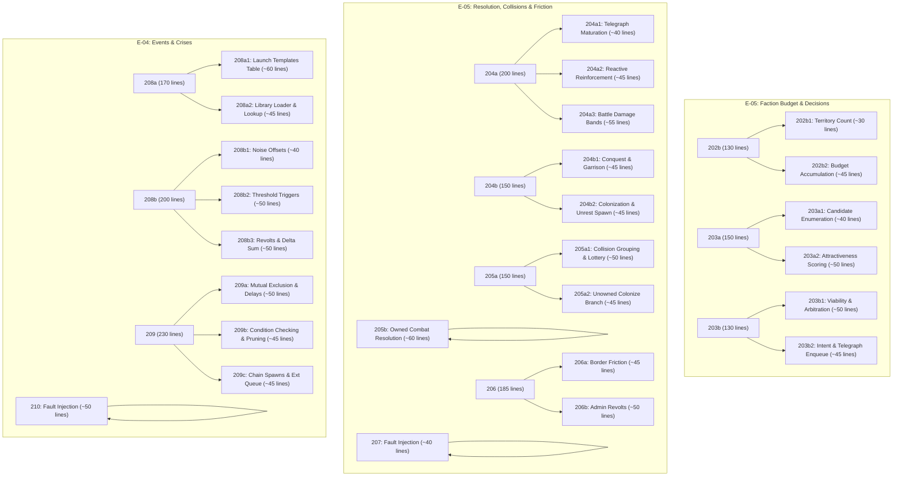

# Plan: Complete Decomposition of Agora Backlog under the 30B Sizing Contract

## [Goal Description]

Following the successful benchmark of cards `202a1`–`202a4` (which demonstrated a **100% Candidate 1 pass rate** on local `qwen3-coder:30b` with **$0.00 DeepSeek spend**), we must restructure the remaining 12 monolithic cards across Epics **E-05** (Faction Agents & Conflict) and **E-04** (Events & Crises) in `~/Projects/agora/queue/` and `~/Projects/agora/queue/parked/`.

The legacy cards in the backlog average 150–230 expected lines, bundle 3–5 distinct mathematical algorithms, declare multi-file `allowed_files` (which breaks Agora's `snippet_file` diff fence), and include broken E-02 regression test suites that cause permanent candidate rejection.

This plan establishes:
- **Stage 1**: Detailed architectural audit and census of all remaining backlog cards.
- **Stage 2**: Comprehensive decomposition mapping each legacy card into focused micro-cards conforming to **The 30B Sizing Contract** (3–5 symbols, 1 algorithm, 40–80 lines, single-file scope, focused tests).
- **Stage 3**: Concrete implementation roadmap (prerequisite parent scaffolding, card authoring, test isolation, and `RELEASE_CHAIN` sequencing) to be executed **only after user approval**.

---

## User Review Required

> [!IMPORTANT]
> **1. Strict Approval Gate**:
> Per your instructions, **no code changes or queue modifications will be executed autonomously**. This document contains the full proposal for your review. Execution of Stage 3 will begin only after your explicit go-ahead.

> [!WARNING]
> **2. The Agora Single-File Diff Fence (`build.py` line 756)**:
> Agora's build harness strictly enforces:
> ```python
> if changed != [snippet_file]:
>     raise DiffFenceViolation(...)
> ```
> Legacy cards like `202b`, `204a`, `205a`, and `206` listed `allowed_files: "csrc/faction.c,csrc/sim.c"`. The worker model *cannot* modify multiple files. Therefore, all multi-file orchestration hooks (e.g., caller dispatch lines in `csrc/sim.c` for tick steps 3b, 3c, 3e, 3f, 4, 4.1) must be landed on `main` as parent scaffolding before worker cards run.

> [!CAUTION]
> **3. Acceptance Test Isolation & The `fail_first` Gate**:
> Agora's harness (`agora/scripts/burn_checks.py:fail_first`) tests the pristine worktree before generating candidates. **Every check in `acceptance:` must fail pre-change**.
> If two cards share the same test, once Card 1 merges to `main`, that test passes pre-change for Card 2, causing the harness to immediately reject Card 2 with `SPEC-INVALID: ... passed pre-change`.
> **The Two-Part Resolution**:
> 1. **Disjoint Partitioning of Northstar Story Tests**: The 58 Stage 5 story tests are partitioned so that no two micro-cards ever share an acceptance check. Each card gets its own unique subset of rule tests.
> 2. **Targeted Micro-Card Fixture Test Authoring**: For micro-cards implementing intermediate symbols or helper functions (e.g. `om_faction_territory`, `om_rng_force`, `om_region_set_owner`), targeted unit tests are authored in `tests/csim/test_E05_fixtures_*.py` and committed to `main` beforehand. Each test specifically exercises the new symbol, fails against the initial stub (`baseline_failed >= 1`), and turns green when the worker implements it.

---

## Resolved Architectural Decisions

> [!NOTE]
> - **Q1: Sequence order of E-05 vs. E-04 (Resolved)**:
>   Finish Epic E-05 completely before starting E-04. E-05 is already 4 cards in (`202a1`–`202a4` merged on `main`), delivers the core agent simulation required for MVP, and produces external chain spawns (Conquest Unrest ALG-22, Admin Separatist ALG-29) consumed by E-04.
> - **Q2: Prerequisite Scaffolding Commit (Resolved)**:
>   Commit all caller dispatch hooks (`csrc/sim.c` steps 3b, 3c, 3e, 3f, 4, 4.1) and struct record buffers (`csrc/om_internal.h`) directly to `main` beforehand. Agora's `build.py` automatically cherry-picks and auto-merges every green candidate into `main` (Option A), allowing the sequence of micro-cards to flow continuously.

---

## Stage 1: Backlog Census & Complexity Audit

| Legacy Card | Target File(s) | Exp Lines | Symbols | Algorithms Bundled | Key Architectural Flaws |
| :--- | :--- | :--- | :--- | :--- | :--- |
| **`202b`** | `faction.c, sim.c` | 130 | 2 | Territory count + Budget accumulation | Multi-file fence violation; broken E-02 tests in acceptance |
| **`203a`** | `agent.c` | 150 | 1 | Neighbor gather + 4 scoring formulas + damage history | 5 formulas bundled; exceeds 80-line budget |
| **`203b`** | `agent.c` | 130 | 2 | Pressure + Entrenchment + Viability + Intent + Telegraph queue | 5 formulas bundled; state persistence across ticks |
| **`204a`** | `resolve.c, om_internal.h, sim.c` | 200 | 4 | Telegraph resolve + Reinforce + Surprise attack + Damage bands | Multi-file fence violation; 4 symbols; 200 lines |
| **`204b`** | `resolve.c, om_internal.h, sim.c` | 150 | 2 | Conquest check + Garrison + Unrest spawn + Colonization | Multi-file fence violation; complex event queue interaction |
| **`205a`** | `collision.c, om_internal.h, resolve.c` | 150 | 1 | Intent grouping + Weighted lottery + Refund + Loser tension + Colonize | Multi-file fence violation; complex stochastic ordering |
| **`205b`** | `collision.c, om_internal.h, resolve.c` | 110 | 1 | Multi-collider combat resolution + damage split + conquest | Multi-file fence violation; 110 lines |
| **`206`** | `friction.c, om_internal.h, sim.c` | 185 | 2 | Border friction (ALG-25) + Admin revolts (ALG-29) | Multi-file fence violation; 2 unrelated algorithm families |
| **`207`** | `7 files listed` | 85 | 1 | 9 positive fault injections | Multi-file fence violation (lists 7 files for 1 symbol) |
| **`208a`** | `events.c, om_internal.h` | 170 | 5 | 26 template definitions + Table loader + Validation | 170 lines; massive data table definition |
| **`208b`** | `events.c, om_internal.h, sim.c` | 200 | 9 | Noise offsets + Threshold crossing + Revolts + Delta apply | 9 symbols; 200 lines; multi-file fence violation |
| **`209`** | `events.c, om_internal.h` | 230 | 3 | Exclusion ties + Condition checking + Spawns + External queue | 230 lines; 4 complex discrete phases |
| **`210`** | `events.c, om_internal.h, sim.c` | 120 | 1 | 9 E-04 positive fault injections | Multi-file fence violation |

---

## Stage 2: Proposed Micro-Card Splits & Sizing



### Detailed Micro-Card Specifications

#### 1. Story S-033: Faction Budget (Card 202b -> 2 Micro-Cards)
- **Prerequisite Scaffolding on `main`**:
  - `csrc/om_internal.h`: Declare `void om_faction_step_budget(om_world *w);`.
  - `csrc/sim.c`: Inside `om_world_step` (after drift loop), add hook:
    `if (om_world_feature(w, OM_FEAT_FACTIONS)) om_faction_step_budget(w);`
- **`202b1-e05-faction-territory.md`**:
  - `snippet_file`: `csrc/faction.c`
  - `symbols`: `om_faction_territory`
  - `expected_lines`: 30
  - `acceptance`: `tests/csim/test_E05_fixtures_ownership_edges.py::test_faction_territory_counting`
- **`202b2-e05-faction-budget.md`**:
  - `snippet_file`: `csrc/faction.c`
  - `symbols`: `om_faction_step_budget`, `om_faction_budget`
  - `expected_lines`: 45
  - `acceptance`: `tests/csim/test_E05_S033_territory_pays_or_costs.py::test_R_033_01_budget_66_8_40_8`

---

#### 2. Story S-034: Candidate Gathering & Scoring (Card 203a -> 2 Micro-Cards)
- **`203a1-e05-candidate-enumeration.md`**:
  - `snippet_file`: `csrc/agent.c`
  - `symbols`: `om_faction_candidates` (structure gathering, deduplication, stance exclusion)
  - `expected_lines`: 45
  - `acceptance`: `test_E05_S034_who_looks_worth_taking.py::test_R_034_05_each_region_scored_once tests/csim/test_E05_S034_who_looks_worth_taking.py::test_R_034_06_neutral_or_cooperative_ignored`
- **`203a2-e05-candidate-scoring.md`**:
  - `snippet_file`: `csrc/agent.c`
  - `symbols`: `om_faction_candidates` (ALG-11: weakness, value, position, opportunist damage boost)
  - `expected_lines`: 55
  - `acceptance`: `test_E05_S034_who_looks_worth_taking.py::test_R_034_01_conqueror_uses_weakness_0_60 tests/csim/test_E05_S034_who_looks_worth_taking.py::test_R_034_02_opportunist_boosts_recent_damage tests/csim/test_E05_S034_who_looks_worth_taking.py::test_R_034_03_schism_uses_tension_0_60 tests/csim/test_E05_S034_who_looks_worth_taking.py::test_R_034_04_value_below_0_05_ignored`

---

#### 3. Story S-035: Decision Arbitration (Card 203b -> 2 Micro-Cards)
- **`203b1-e05-viability-scoring.md`**:
  - `snippet_file`: `csrc/agent.c`
  - `symbols`: `om_tick_decisions` (ALG-12 budget pressure, ALG-13 entrenchment, ALG-14 action score)
  - `expected_lines`: 50
  - `acceptance`: `test_E05_S035_attack_only_when_it_adds_up.py::test_R_035_01_attack_efficiency_1_0 tests/csim/test_E05_S035_attack_only_when_it_adds_up.py::test_R_035_02_net_advantage_effective_confidence tests/csim/test_E05_S035_attack_only_when_it_adds_up.py::test_R_035_03_highest_net_advantage_wins`
- **`203b2-e05-intent-telegraph-queue.md`**:
  - `snippet_file`: `csrc/agent.c`
  - `symbols`: `om_pending_telegraphs`, `om_tick_decisions` (ALG-15 mode selection, telegraph queue)
  - `expected_lines`: 45
  - `acceptance`: `test_E05_S035_attack_only_when_it_adds_up.py::test_R_035_04_colonize_costs_budget_20_0 tests/csim/test_E05_S035_attack_only_when_it_adds_up.py::test_R_035_05_below_0_05_or_no`

---

#### 4. Story S-036 & S-037: Attack Resolution & Battles (Card 204a -> 3 Micro-Cards)
- **Prerequisite Scaffolding on `main`**:
  - `csrc/om_internal.h`: Add `om_attack_record`, `om_reinforce_record`, and queue arrays to `struct om_world`.
  - `csrc/sim.c`: Hook steps 3c, 3e, and 3f in `om_world_step`.
- **`204a1-e05-telegraph-maturation.md`**:
  - `snippet_file`: `csrc/resolve.c`
  - `symbols`: Telegraph maturation execution (step 3c: resolve attacks declared 3 ticks ago).
  - `expected_lines`: 40
  - `acceptance`: `test_E05_S036_declared_or_sprung.py::test_R_036_03_resolved_three_ticks_later`
- **`204a2-e05-reactive-reinforcement.md`**:
  - `snippet_file`: `csrc/resolve.c`
  - `symbols`: `om_tick_reinforces` (step 3e: reactive defender reinforcement).
  - `expected_lines`: 45
  - `acceptance`: `test_E05_S036_declared_or_sprung.py::test_R_036_05_defending_faction_may_reinforce tests/csim/test_E05_S036_declared_or_sprung.py::test_R_036_06_commitment_capped_at_budget`
- **`204a3-e05-battle-damage-bands.md`**:
  - `snippet_file`: `csrc/resolve.c`
  - `symbols`: `om_tick_attacks` (step 3f: surprise attacks, damage bands: breakthrough, contested, repelled).
  - `expected_lines`: 55
  - `acceptance`: `test_E05_S037_battles_have_a_shape.py::test_R_037_01_stochastic_draw_0_7_1_3 tests/csim/test_E05_S037_battles_have_a_shape.py::test_R_037_02_breakthrough_delta_m_0_8 tests/csim/test_E05_S037_battles_have_a_shape.py::test_R_037_03_contested_delta_m_0_4 tests/csim/test_E05_S037_battles_have_a_shape.py::test_R_037_04_repelled_delta_m_0_0`

---

#### 5. Story S-038: Conquest & Colonization (Card 204b -> 2 Micro-Cards)
- **`204b1-e05-conquest-garrison.md`**:
  - `snippet_file`: `csrc/resolve.c`
  - `symbols`: Conquest condition (<5.0 military & breakthrough/contested), owner transfer, garrison placement, held-since reset.
  - `expected_lines`: 45
  - `acceptance`: `test_E05_S038_taking_a_region.py::test_R_038_01_conquest_if_military_below_5 tests/csim/test_E05_S038_taking_a_region.py::test_R_038_02_held_since_reset tests/csim/test_E05_S038_taking_a_region.py::test_R_038_03_garrison_added_after_damage`
- **`204b2-e05-unrest-colonize.md`**:
  - `snippet_file`: `csrc/resolve.c`
  - `symbols`: `om_tick_colonizations`, `om_event_queue` (conquest unrest spawn, colony placement).
  - `expected_lines`: 45
  - `acceptance`: `test_E05_S038_taking_a_region.py::test_R_038_04_unrest_event_enqueued tests/csim/test_E05_S038_taking_a_region.py::test_R_038_05_colonize_unowned_region`

---

#### 6. Story S-039: Collisions (Card 205a & 205b -> 3 Micro-Cards)
- **`205a1-e05-collision-lottery.md`**:
  - `snippet_file`: `csrc/collision.c`
  - `symbols`: `om_tick_collisions` (grouping intents by target, strength-weighted winner draw, loser refund).
  - `expected_lines`: 50
  - `acceptance`: `test_E05_S039_when_everyone_wants_the_same_region.py::test_R_039_01_factors_1_0_0_7 tests/csim/test_E05_S039_when_everyone_wants_the_same_region.py::test_R_039_02_opposition_0_35_ceiling_0`
- **`205a2-e05-collision-unowned-colonize.md`**:
  - `snippet_file`: `csrc/collision.c`
  - `symbols`: `om_tick_collisions` (unowned colonize collision branch, starter military, loser tension).
  - `expected_lines`: 45
  - `acceptance`: `test_E05_S039_when_everyone_wants_the_same_region.py::test_R_039_03_its_highest_military_region_gains tests/csim/test_E05_S039_when_everyone_wants_the_same_region.py::test_R_039_04_starter_military_10_0_margin`
- **`205b-e05-collision-owned-combat.md`**:
  - `snippet_file`: `csrc/collision.c`
  - `symbols`: `om_tick_collisions` (owned-target combat: per-collider battle evaluation, damage summation, conquest).
  - `expected_lines`: 60
  - `acceptance`: `test_E05_S039_when_everyone_wants_the_same_region.py::test_R_039_05_each_collider_s_strength_applied`

---

#### 7. Story S-040 & S-041: Friction & Revolts (Card 206 -> 2 Micro-Cards)
- **`206a-e05-border-friction.md`**:
  - `snippet_file`: `csrc/friction.c`
  - `symbols`: `om_tick_friction` (step 4: hostile neighbor scan across border/both edges, tension/economy wear, composite recompute).
  - `expected_lines`: 45
  - `acceptance`: `test_E05_S041_hostile_borders_wear_you_down.py::test_R_041_01_per_neighbor_tension_delta tests/csim/test_E05_S041_hostile_borders_wear_you_down.py::test_R_041_02_trade_edges_contribute_nothing tests/csim/test_E05_S041_hostile_borders_wear_you_down.py::test_R_041_04_clamped_to_economy_floor`
- **`206b-e05-admin-revolts.md`**:
  - `snippet_file`: `csrc/friction.c`
  - `symbols`: `om_tick_admin_rolls` (step 4.1: admin revolt probability, roll per owned region, chain length draw [3, 8], external event queue).
  - `expected_lines`: 50
  - `acceptance`: `test_E05_S040_empires_fracture.py::test_R_040_01_territory_excess_probability tests/csim/test_E05_S040_empires_fracture.py::test_R_040_02_rolled_per_owned_region tests/csim/test_E05_S040_empires_fracture.py::test_R_040_03_chain_length_between_3_and_8`

---

#### 8. Epic E-05 Fault Injection (Card 207 -> 1 Micro-Card)
- **`207-e05-fault-injection.md`**:
  - `snippet_file`: `csrc/faction.c`
  - `symbols`: `om_debug_inject` (sets `w->inject` for E-05 positive controls).
  - `expected_lines`: 40
  - `acceptance`: `tests/csim/controls/test_control_e05_*.py`

---

#### 9. Story S-030: Launch Event Library (Card 208a -> 2 Micro-Cards)
- **`208a1-e04-launch-templates.md`**:
  - `snippet_file`: `csrc/events.c`
  - `symbols`: Static declaration of 26 launch templates, `om_event_template_count`, `om_event_template_get`, `om_event_template_by_name`.
  - `expected_lines`: 65
  - `acceptance`: `test_E04_S030_the_launch_event_library.py::test_R_030_01_26_launch_templates tests/csim/test_E04_S030_the_launch_event_library.py::test_R_030_03_lookup_by_name`
- **`208a2-e04-library-loader.md`**:
  - `snippet_file`: `csrc/events.c`
  - `symbols`: `om_events_load_launch`, `om_events_load` (validation, rejection, installation).
  - `expected_lines`: 50
  - `acceptance`: `test_E04_S030_the_launch_event_library.py::test_R_030_02_load_validation`

---

#### 10. Story S-026 & S-029: Event Triggers & Noise (Card 208b -> 3 Micro-Cards)
- **`208b1-e04-noise-offsets.md`**:
  - `snippet_file`: `csrc/events.c`
  - `symbols`: `om_event_roll_noise`, `om_event_set_noise`, `om_event_noise` (uniform [-10, 10] per region/template).
  - `expected_lines`: 40
  - `acceptance`: `test_E04_S026_crises_start_when_a_line_is_crossed.py::test_R_026_04_noise_offset_in_minus_10_plus_10`
- **`208b2-e04-threshold-triggers.md`**:
  - `snippet_file`: `csrc/events.c`
  - `symbols`: Threshold evaluation, grace period priming (ticks 1–3), `now && !was` edge detector (`om_event_breached`).
  - `expected_lines`: 50
  - `acceptance`: `test_E04_S026_crises_start_when_a_line_is_crossed.py::test_R_026_01_above_threshold_fires tests/csim/test_E04_S026_crises_start_when_a_line_is_crossed.py::test_R_026_05_grace_period`
- **`208b3-e04-revolts-and-deltas.md`**:
  - `snippet_file`: `csrc/events.c`
  - `symbols`: Regional revolt trigger, delta summation with floors/ceilings, `om_tick_events`, `om_region_event_delta`.
  - `expected_lines`: 55
  - `acceptance`: `test_E04_S029_some_pressures_never_stop.py::test_R_029_01_revolt_probability_formula tests/csim/test_E04_S026_crises_start_when_a_line_is_crossed.py::test_R_026_06_deltas_summed`

---

#### 11. Story S-027 & S-028: Pending Queue & Chains (Card 209 -> 3 Micro-Cards)
- **`209a-e04-queue-exclusion.md`**:
  - `snippet_file`: `csrc/events.c`
  - `symbols`: `om_tick_delayed` (mutual exclusion among same-tick entries, tie-breaker, delayed requeuing).
  - `expected_lines`: 50
  - `acceptance`: `test_E04_S028_disasters_stack_contradictions_do_not.py::test_R_028_02_delayed_never_cancelled tests/csim/test_E04_S028_disasters_stack_contradictions_do_not.py::test_R_028_03_tie_break_draw`
- **`209b-e04-queue-resolution.md`**:
  - `snippet_file`: `csrc/events.c`
  - `symbols`: `om_tick_pruned` (condition check against tick-start fields, pruning, probability draw).
  - `expected_lines`: 45
  - `acceptance`: `test_E04_S027_one_thing_leads_to_another.py::test_R_027_02_condition_checked_at_resolution tests/csim/test_E04_S027_one_thing_leads_to_another.py::test_R_027_03_probability_draw`
- **`209c-e04-chain-spawns.md`**:
  - `snippet_file`: `csrc/events.c`
  - `symbols`: `om_event_queue_external` (triangular delay follow-up spawns, chain counter propagation, external enqueue).
  - `expected_lines`: 45
  - `acceptance`: `test_E04_S027_one_thing_leads_to_another.py::test_R_027_01_triangular_delay tests/csim/test_E04_S027_one_thing_leads_to_another.py::test_R_027_06_chain_counter`

---

#### 12. Epic E-04 Fault Injection (Card 210 -> 1 Micro-Card)
- **`210-e04-fault-injection.md`**:
  - `snippet_file`: `csrc/events.c`
  - `symbols`: `om_debug_inject` (extends dispatch for `om_bug_e04` values 200–209).
  - `expected_lines`: 50
  - `acceptance`: `tests/csim/controls/test_control_e04_*.py`

---

## Stage 3: Proposed Implementation Roadmap (To Be Executed After Approval)

When approved, execution will proceed in the following ordered steps:

1. **Step 1: Scaffolding Prerequisites (`ouroboros-manifold`)**:
   - Land tick-step hooks in `csrc/sim.c` (steps 3b, 3c, 3e, 3f, 4, 4.1).
   - Add record buffer declarations in `csrc/om_internal.h`.
   - Verify `make clean && make` compiles cleanly.
   - Commit directly to `main`.

2. **Step 2: Micro-Card Generation (`agora/queue/parked/`)**:
   - Author all decomposed `.md.hold` micro-card files under the 30B Contract.
   - Set exact `expected_lines` (30–65), 1 single file in `snippet_file`, and isolated acceptance tests.

3. **Step 3: Update Dispatcher Sequencing (`agora/scripts/next.py`)**:
   - Update `RELEASE_CHAIN` to sequence the micro-cards:
     ```python
     RELEASE_CHAIN = (
         # 202a1-a4 (already DONE)
         "202b1-e05-faction-territory", "202b2-e05-faction-budget",
         "203a1-e05-candidate-enumeration", "203a2-e05-candidate-scoring",
         "203b1-e05-viability-scoring", "203b2-e05-intent-telegraph-queue",
         "204a1-e05-telegraph-maturation", "204a2-e05-reactive-reinforcement", "204a3-e05-battle-damage-bands",
         "204b1-e05-conquest-garrison", "204b2-e05-unrest-colonize",
         "205a1-e05-collision-lottery", "205a2-e05-collision-unowned-colonize", "205b-e05-collision-owned-combat",
         "206a-e05-border-friction", "206b-e05-admin-revolts",
         "207-e05-fault-injection",
         "208a1-e04-launch-templates", "208a2-e04-library-loader",
         "208b1-e04-noise-offsets", "208b2-e04-threshold-triggers", "208b3-e04-revolts-and-deltas",
         "209a-e04-queue-exclusion", "209b-e04-queue-resolution", "209c-e04-chain-spawns",
         "210-e04-fault-injection",
     )
     ```

4. **Step 4: Release the First Link**:
   - Park old `202b-e05-faction-budget.md` into `parked/202b-e05-faction-budget.md.hold`.
   - Move `202b1-e05-faction-territory.md.hold` into `queue/202b1-e05-faction-territory.md`.
   - Agora will autonomously build, test, and release each micro-card sequentially.

---

## Verification Plan

### Automated Tests
1. **Dry-Run Validation on Every New Card**:
   ```bash
   for card in /home/westopoli/Projects/agora/queue/parked/20*.md.hold; do
       /home/westopoli/Projects/agora/.venv/bin/python /home/westopoli/Projects/agora/scripts/build.py --dry-run --item "$card"
   done
   ```
   *Assert*: Every card reports `baseline_failed >= 1` and exits 0 (confirming pristine `fail_first` gate passes and test targets exist).

2. **C Library Compilation**:
   ```bash
   cd /home/westopoli/Projects/ouroboros-manifold && make clean && make
   ```
   *Assert*: `libouroboros.so` and `libouroboros_dbg.so` compile with zero warnings under `-Wall -Wextra`.

3. **Agora Autonomous Execution**:
   - Monitor `agora/runs/cron.log` as each micro-card is built by `qwen3-coder:30b`, verified, and auto-merged to `main`.
