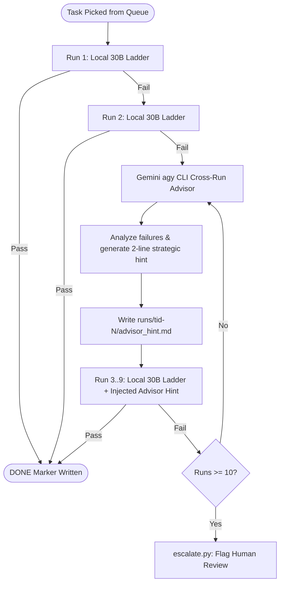

# Plan: Restructuring Agora Card Sizing, Cross-Run Advisory & Ladder Scalability

## [Goal Description]

The local 30B models (`qwen3-coder:30b`, supported by `gpt-oss:20b`) running in Agora are struggling with current card sizes. Tasks written to the legacy `max_impl_lines = 250` standard pack excessive symbol density and multiple mathematical concepts into single cards. This forces models into repetitive compilation/test failures, causing rapid escalations that burn through DeepSeek's daily budget cap.

Furthermore, each dispatcher tick currently runs models completely statelessly — discarding learnings from prior failed runs. Meanwhile, `MAX_TASK_RUNS` was raised from 2 to 30 only in `next.py`, leaving `burn.py`, `driver.py`, and `optimize.py` hardcoded at 2, creating dispatcher deadlocks on older cards.

This plan executes four stages:
1. **Stage 1 (Investigation & Empirical Baseline)**: Quantify the failure modes across all 30B runs to date, contrasting task size, symbol density, and complexity between clean first-try passes and chronic stalls.
2. **Stage 2 (Redefining Card Sizing & Cross-Run Intelligence)**: Formulate a new multi-dimensional card-sizing standard for `PLAN.md` (anchoring on symbol count and algorithm family rather than line count alone) and design a cross-run advisory mechanism powered by Gemini via `agy` CLI after run 2.
3. **Stage 3 (Implementation & Queue Restructuring)**: Update `PLAN.md`, synchronize `MAX_TASK_RUNS = 10` across all Agora scripts, wire the Gemini cross-run advisor into `build.py`, and decompose pending E-05 and E-04 cards and tests into modular micro-cards.
4. **Stage 4 (Re-queue & Benchmark)**: Re-queue decomposed cards (e.g. 202a) and compare speed to green, candidate pass rate, and escalation frequency between old and new methods.

---

## User Review Required

> [!IMPORTANT]
> **1. Rule-Set Compliance (`AGENTS.md`)**:
> `AGENTS.md` states: *"Never edit `docs/bible/**`, `docs/northstar/**`, `CLAUDE.md`, or any test threshold. Never decide what gets tested."*
> Modifying `docs/northstar/PLAN.md` and restructuring test files in `tests/csim/` requires your explicit authorization to proceed with these edits as part of this plan.

> [!WARNING]
> **2. Context Bloat vs. Cross-Run Memory (`lessons-inbox.md`)**:
> Empirical logging in `agora/memory/lessons-inbox.md` warns:
> *"More context is not better for small models... SWE-bench scores went monotonically to 0.00% as the context cap rose 13K->50K... a related-but-wrong distractor (failed attempt) costs up to -25%... Carry one line of lesson, not the failed transcript."*
> Therefore, we **must not** pass full prior transcripts or large code snippets into 30B models. Instead, we propose passing only a concise (2–3 bullet point) diagnostic advisory generated by Gemini agy CLI, focusing on the root error (e.g. syntax, static linkage, missing edge case).

> [!NOTE]
> **3. Unified Run Cap Policy**:
> We propose standardizing `MAX_TASK_RUNS = 10` uniformly across `next.py`, `burn.py`, `driver.py`, and `optimize.py`.
> - **Runs 1–2**: Pure local ladder (`qwen3-coder:30b`, `gpt-oss:20b`), completely free of external API calls.
> - **Runs 3–9**: Gemini agy CLI inspects prior failed candidate logs and injects a 2-line strategic hint before each run.
> - **Run 10**: Final attempt; if still failing, task parks and triggers `escalate.py` human review.

---

## Open Questions

> [!IMPORTANT]
> - **Q1: Model backend for `agy_client.py`**:
>   `agy_client.py` currently hardcodes `claude-sonnet-4-6`. Should we configure `agy_client.py` to route to `gemini-2.5-pro` (or use the default AGY profile), preserving your DeepSeek and Claude quotas?
> - **Q2: Test refactoring boundaries**:
>   When decomposing cards like 202a into micro-cards (e.g., 202a1, 202a2), should we split the test file `tests/csim/test_E05_S032_every_faction_is_a_person.py` into separate test modules, or run targeted `-k <test_name>` pytest acceptance filters in each card's `acceptance:` section?

---

## Stage 1: Empirical Analysis of 30B Model Struggles

### Current Status of All Cards in Agora

| Card | Loc / Format | Runs | Status | Best Auto Result | Exp Lines | Symbols | Failure Mode / Notes |
|---|---|---|---|---|---|---|---|
| **002-switchboard-mcp-skip** | parked (OLD) | 2 | INCOMPLETE | — | — | 0 | Jammed by old `burn.py` cap=2 |
| **003-agora-spec-parser-tests** | parked (OLD) | 2 | INCOMPLETE | — | — | 0 | Jammed by old `burn.py` cap=2 |
| **004-digest-limit-flag** | parked (OLD) | 2 | **DONE** | pass | — | 0 | Passed under old burner |
| **006-best-salesmen-test-skip** | parked (OLD) | 2 | SPEC-INVALID | — | — | 0 | Spec invalid, parked |
| **101-probe-a-toy-drift** | parked (NEW) | 2 | HARNESS-BUG | — | — | 0 | Harness bug, not model fault |
| **103-probe-a-toy-drift-r2** | parked (NEW) | 1 | INCOMPLETE | 0 | — | 0 | Planner stall |
| **104-probe-a-toy-drift-r3** | parked (NEW) | 1 | INCOMPLETE | 0 | — | 0 | Hallucinated helper fn |
| **107-probe-a-build** | parked (NEW) | 1 | **DONE** | **17/17** | 45 | 0 | Clean 1st-try pass (Rung 1, single algorithm) |
| **108-probe-b-build** | parked (NEW) | 3 | INCOMPLETE | **4/11** | 30 | 0 | Double-counting neighbor logic bug |
| **109-probe-e-build** | parked (NEW) | 3 | ESCALATED | 1/2 | 4 | 0 | Contradiction probe (escalated by design) |
| **110-probe-f-build** | parked (NEW) | 1 | **DONE** | **18/18** | 45 | 0 | Clean 1st-try pass (Rung 1) |
| **111-probe-e-abort** | parked (NEW) | 1 | ESCALATED | 1/2 | 4 | 0 | Unsatisfiable probe (aborted by design) |
| **112-probe-h-gd-build** | parked (NEW) | 3 | **DONE** | **1/1** | 6 | 0 | Clean GDScript pass |
| **200-e02-region-state** | queue (NEW) | 2 | **DONE** | **7/7** | 110 | 14 | Run 1 failed on bad brief; Run 2 passed 7/7 |
| **201a-e02-drift-core** | queue (NEW) | 31 | **DONE (manual)** | **28/40** | 150 | 16 | 30 auto runs failed; manually written by Westley (commit `9bc9b9e`) |
| **201b-e02-drift-trace** | queue (NEW) | 12 | **DONE (manual)** | **5/7** | 80 | 13 | 11 auto runs plateaued; manually written |
| **202a-e05-faction-identity** | queue (NEW) | 5 (live) | INCOMPLETE | **0/2** | 150 | 27 | Stuck in `static` fn compile warnings & linking failures |
| **202b-e05-faction-budget** | parked (NEW) | 0 | NOT RELEASED | — | 130 | 6 | Awaiting 202a DONE |
| **203a-e05-candidate-scoring** | parked (NEW) | 0 | NOT RELEASED | — | 150 | 7 | Awaiting 202b DONE |
| **203b-e05-decision-arbitration** | parked (NEW) | 0 | NOT RELEASED | — | 130 | 10 | Awaiting 203a DONE |
| **204a-e05-resolution-attack** | parked (NEW) | 2 | INCOMPLETE | 0/6 | 200 | 8 | Parked by old cap=2 |
| **204b-e05-conquest-colonize** | parked (NEW) | 2 | INCOMPLETE | 0/6 | 150 | 5 | Parked by old cap=2 |
| **205a-e05-collision-lottery** | parked (NEW) | 0 | NOT RELEASED | — | 150 | 11 | Awaiting 204b DONE |
| **205b-e05-collision-combat** | parked (NEW) | 0 | NOT RELEASED | — | 110 | 3 | Awaiting 205a DONE |
| **206-e05-friction-admin** | parked (NEW) | 2 | INCOMPLETE | 0/4 | 185 | 11 | Parked by old cap=2 |
| **207-e05-fault-injection** | parked (NEW) | 2 | INCOMPLETE | — | 85 | 20 | Parked by old cap=2 |
| **208a-e04-library** | parked (NEW) | 2 | INCOMPLETE | 0/3 | 170 | 7 | Parked by old cap=2 |
| **208b-e04-triggers** | parked (NEW) | 2 | INCOMPLETE | 0/7 | 200 | 25 | Parked by old cap=2 |
| **209-e04-queue-chains** | parked (NEW) | 2 | INCOMPLETE | 0/7 | 230 | 11 | Parked by old cap=2 |
| **210-e04-fault-injection** | parked (NEW) | 2 | INCOMPLETE | 0/1 | 120 | 9 | Parked by old cap=2 |
| **900-boot-smoke** | queue (OLD) | 2 | **DONE** | pass | — | 0 | Passed |

### Root Cause Analysis
1. **Symbol Overload Beats Line Count**:
   - `107`, `110`, `112` succeeded on Run 1 with ≤45 lines and ≤5 symbols.
   - `201a` failed all 30 automated runs because it bundled 16 symbols, 5 formulas, and 8 test files into one prompt.
   - `202a` has 150 lines but **27 symbols** and **15 C function prototypes**! The 30B model cannot track 15 prototypes simultaneously, repeatedly declaring helper functions as `static`, which breaks library compilation under `-Werror`.
2. **Desynchronized Run Caps**:
   - `next.py` checked `len(run_dirs) < 30`, but `burn.py` and `driver.py` checked `len(run_dirs) < 2`.
   - Older cards (002, 003, 006) stalled `next.py` because `burn.py` refused to run them after run 2.
3. **Absence of Cross-Run Diagnostics**:
   - In 202a, runs 1, 2, 3, 4, and 5 failed with the exact same 2 test failures and static linking errors because run N+1 has zero insight into what failed in run N.

---

## Stage 2: Proposed Card Sizing Standard & Cross-Run Advisory Architecture

### 1. The New Card Sizing Standard ("The 30B Contract")
In `docs/northstar/PLAN.md` line 213, replace the simplistic 250-line rule with:

```markdown
- **Sizing rule (The 30B Sizing Contract)**:
  1. **Public API / Symbol Cap**: A single task must implement no more than 3 to 5 public C functions/symbols.
  2. **Algorithm Family Isolation**: Exactly ONE mathematical formula or behavioral algorithm per card. Never mix state mutations, RNG draws, and multi-entity matrix updates in one card.
  3. **Implementation Line Budget**: `expected_lines` must not exceed 40–80 lines. Any story requiring >80 lines MUST be split in the epic file into sub-stories (e.g., S-032a, S-032b).
  4. **Acceptance Test Scope**: 5 to 15 focused test assertions directly covering the card's single behavior. Gating tests must not span unrelated modules.
```

### 2. Multi-Run Escalation & Cross-Run Advisor Architecture



### 3. Cross-Run Memory Design (Protecting the 30B Context Window)
To avoid the SWE-bench degradation observed in `lessons-inbox.md`:
- **Do not** pass raw past source code or multi-page compiler outputs.
- **Do** have Gemini examine `candidates.jsonl`, `interventions.jsonl`, and pytest output to produce a terse 2–3 line directive:
  ```markdown
  ### Advisor Guidance:
  - Do NOT declare exported API functions static (e.g. om_rng_force must have external linkage).
  - When initializing stances, ensure stance[fid][j] is set for all j != fid.
  ```
- Inject this guidance directly into `worker-build-c.md` as a clean, high-priority instruction.

---

## Stage 3: Proposed Implementation Changes

### Component 1: Documentation Updates (`ouroboros-manifold`)

#### [MODIFY] `docs/northstar/PLAN.md`
- Update line 213 with the new 30B Sizing Contract (3-5 symbols, 1 formula, 40-80 expected lines, focused tests).

---

### Component 2: Agora Dispatcher & Runner Synchronizations (`agora`)

#### [MODIFY] `~/Projects/agora/scripts/next.py`
- Change `MAX_TASK_RUNS = 30` to `MAX_TASK_RUNS = 10`.
- Trigger the Gemini cross-run advisor hook after run 2.

#### [MODIFY] `~/Projects/agora/scripts/burn.py`
- Update `MAX_TASK_RUNS = 2` to `MAX_TASK_RUNS = 10` so old and new runners agree.

#### [MODIFY] `~/Projects/agora/scripts/optimize.py`
- Update `MAX_TASK_RUNS = 2` to `MAX_TASK_RUNS = 10`.

#### [MODIFY] `~/Projects/agora/scripts/driver.py`
- Update `MAX_TASK_RUNS = 2` to `MAX_TASK_RUNS = 10`.

---

### Component 3: Gemini agy Cross-Run Advisor (`agora/scripts/`)

#### [MODIFY] `~/Projects/agora/scripts/agy_client.py`
- Add support for Gemini CLI invocations (`gemini-2.5-pro` or default `agy` mode).
- Add `generate_cross_run_hint(task_id, run_dirs, brief_text)` function:
  - Extracts the last failing test IDs and compiler errors.
  - Queries Gemini to produce a terse Markdown hint.

#### [MODIFY] `~/Projects/agora/scripts/build.py`
- Read `advisor_hint.md` if present from previous runs of the same task ID and append it to `worker_user_c` prompt.

---

### Component 4: Card Decompositions (`agora/queue/` & `tests/csim/`)

#### [MODIFY/SPLIT] `202a-e05-faction-identity.md` (27 symbols -> 5 micro-cards)
1. **`202a1-e05-faction-basics.md`**:
   - Symbols: `om_faction_set`, `om_faction_count`, `om_faction_archetype`, `om_faction_budget`, `om_faction_tech`.
   - Expected lines: ~35.
2. **`202a2-e05-faction-stance.md`**:
   - Symbols: `om_faction_set_stance`, `om_faction_stance`.
   - Expected lines: ~25.
3. **`202a3-e05-faction-confidence-rng.md`**:
   - Symbols: `om_faction_confidence`, `om_rng_force`, `om_rng_forced_remaining`.
   - Expected lines: ~45.
4. **`202a4-e05-region-ownership.md`**:
   - Symbols: `om_region_set_owner`, `om_region_owner`, `om_region_held_since`.
   - Expected lines: ~30.
5. **`202a5-e05-region-edges.md`**:
   - Symbols: `om_region_set_edge`, `om_region_edge`.
   - Expected lines: ~25.

#### [MODIFY/SPLIT] `tests/csim/test_E05_S032_every_faction_is_a_person.py`
- Split test file into modular fixtures matching each micro-card acceptance criteria so models test only their specific scope.

---

## Stage 4: Verification & Benchmarking Plan

### Automated Tests
1. **Run Cap Parity Verification**:
   ```bash
   python3 -c "
   import sys; sys.path.insert(0, '/home/westopoli/Projects/agora/scripts')
   import next, burn, driver, optimize
   assert next.MAX_TASK_RUNS == burn.MAX_TASK_RUNS == driver.MAX_TASK_RUNS == optimize.MAX_TASK_RUNS == 10
   print('MAX_TASK_RUNS synchronized at 10 across all runners.')
   "
   ```
2. **Advisor Unit Test**:
   - Create mock failed run directories for a toy card.
   - Run `agy_client.generate_cross_run_hint()` and assert that a valid non-empty hint string is generated under 50 words.

### Manual Verification & A/B Comparison
1. Re-queue the decomposed `202a1` card into `~/Projects/agora/queue/`.
2. Monitor Agora dispatching via `cron.log`.
3. Compare:
   - **Old Method (202a)**: 5 runs, 0/2 passing, multiple DeepSeek resets, linking failure.
   - **New Method (202a1-202a5)**: Runs to green, candidates per rung, zero API token waste.
