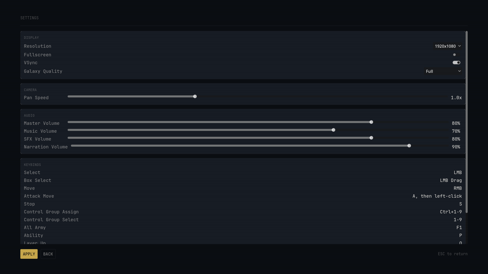
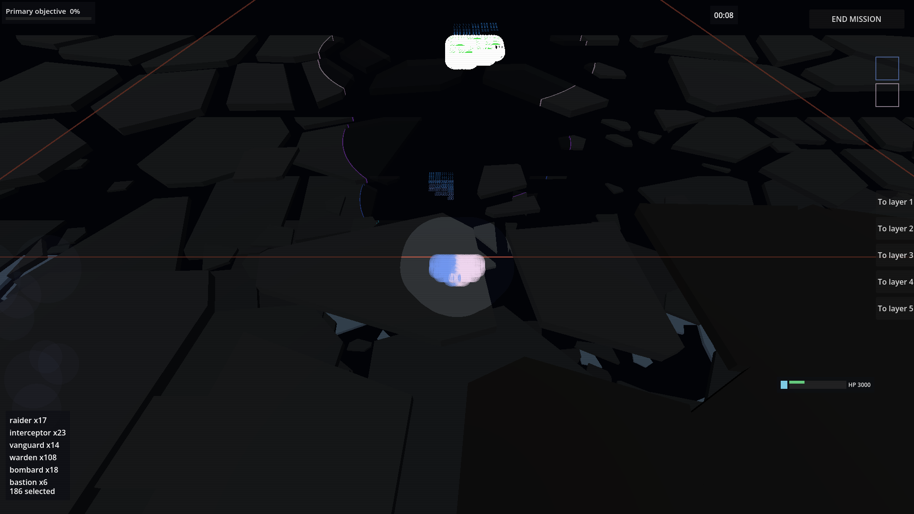
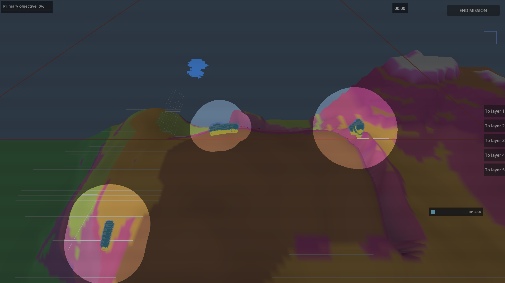
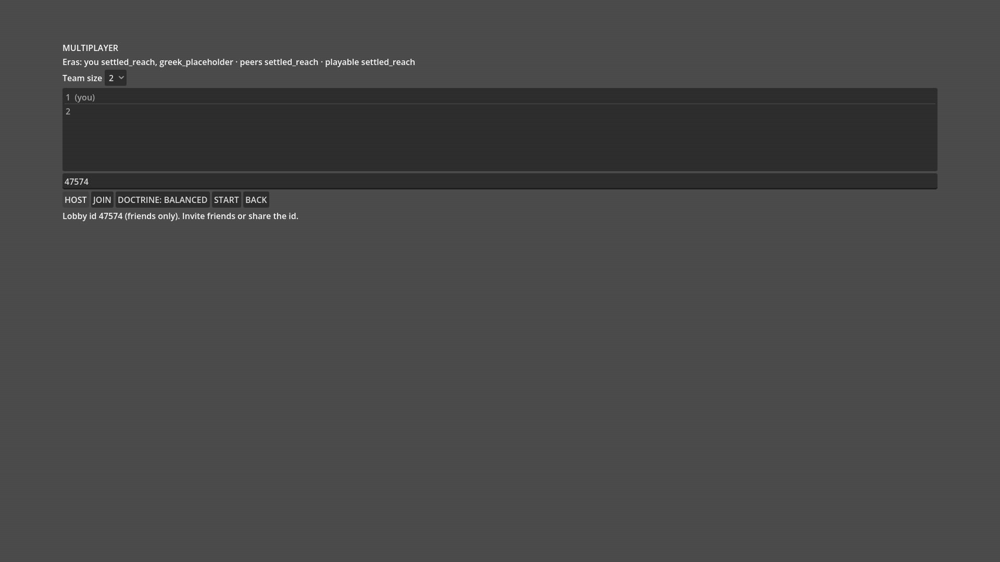
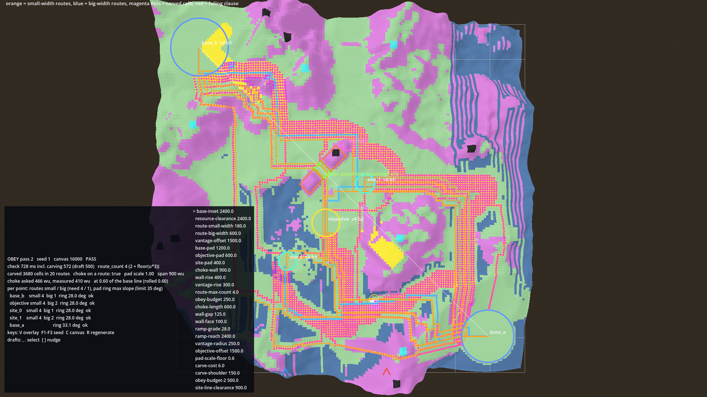
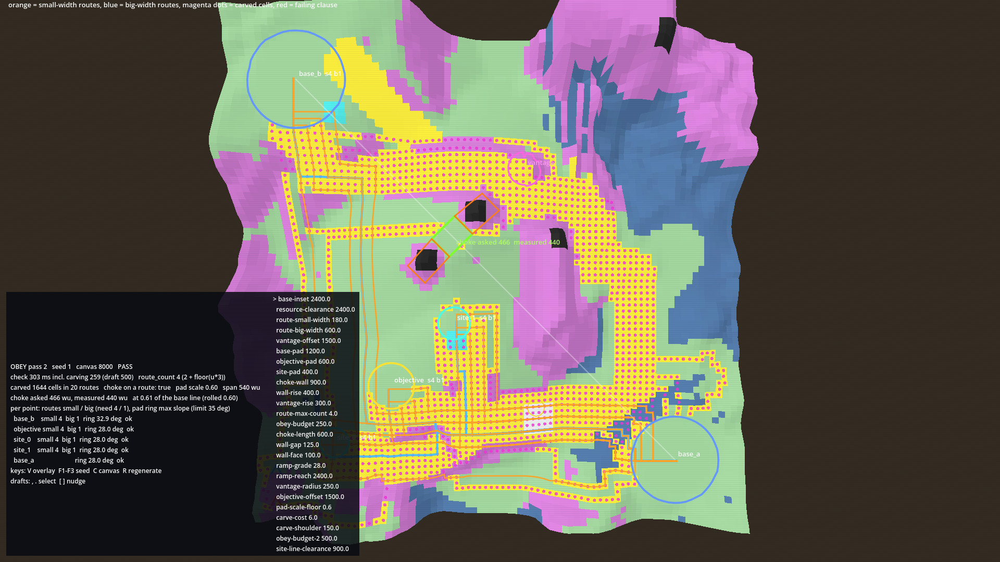

# What Westley decides, 2026-10-21

Answer in answers.md, one line per key: `<key>: <approve | reject | a | b | c | note>`. Anything not listed here is already decided or is the Architect's.

## 1. Pictures

### P1 Star map with glowing territory (S-106)

**What you see:** The galaxy map close up: coloured discs for regions, soft glows for territory, thin curved links between neighbours, a haze of yellow dust. Linked regions now sit next to each other and same-owner regions cluster.
**Judge:** Does this layout read as one connected galaxy of neighbours, as the prototype you approved did?
**Beta status of what is shown:**
- Star map with glowing territory (S-106): Seen (approved 2026-10-13 on the earlier dot-colour frame); this new layout is built and awaiting your verdict.
- Faction names on the map: built but not yet shown (the labels exist, none is readable at this distance).
- War flash: built but not yet shown (none fired in this frame).

### P2 Galaxy Quality choice in Settings (S-110)

**What you see:** The Settings screen. The Display card has a fourth row, Galaxy Quality, set to Full, lined up under Resolution, Fullscreen and VSync; Camera, Audio and Keybinds cards sit below.
**Judge:** Is the Galaxy Quality row where and how you want it?
**Beta status of what is shown:**
- Galaxy Quality choice (Full, Stand-in, Fewer particles): built and awaiting your verdict.
- Rest of the Settings screen (display, camera pan speed, audio sliders, keybind list): built and awaiting your verdict (S-110 is not yet Seen).

### P3 Five layer sheets in space (S-246)

**What you see:** A dark 3D space battlefield seen from above at a slant: flat slabs of rock scattered across layered sheets, your fleet as a small cluster of blue and pink blobs in the middle, and a pale see-through disc around the cursor where the upper sheets fade.
**Judge:** Do the five sheets read as separate layers, with a ring on each unit and a see-through tube around the cursor, or is it still a dark blur?
**Beta status of what is shown:**
- Five layer sheets with asteroid slabs, unit rings, vision tube (S-246): built and awaiting your verdict (opt-in with OM_SPACE_VIEW=1, not yet the default view; the switch to default is planned, no piece scheduled).
- To-layer buttons on the right edge: stub, being replaced by the Alt plus number keybind (queued, not built).

### P4 Smaller starting force (S-126)

**What you see:** The opening frame of a ground mission in 3D: a rocky ridge under a grey sky, three tinted discs each holding a stack of your units, and one lone blue blob top left.
**Judge:** Does the battle open with most of your force still to come, as your S-126 words say? The count (176 of 330) cannot be read by eye.
**Beta status of what is shown:**
- Smaller starting force (S-126): approved but not integrated (the sim gives 176 of 330; the unit count in the HUD and briefing still reads 330).
- Ground-era 3D opening view: built but not yet shown (your last word on it was "too zoomed out to judge"; a zoomed-in re-shot is owed).

### P5 Host lobby: common era and team size (S-143, S-241)

**What you see:** The multiplayer host lobby on a plain grey screen: an Eras line naming the one era both players share, a Team size drop-down showing 2, a member list of two, the lobby number, and Host, Join, Doctrine, Start and Back buttons.
**Judge:** Does the Eras line tell two players with different packs which era they will play, and is the Team size choice where you expect it?
**Beta status of what is shown:**
- Common era line (S-143): built and awaiting your verdict.
- Team size 2 or 4 (S-241): stub (the choice is offered but does nothing to map or enemy size until the scaling rule is built).
- Lobby with member list and lobby number (S-141): Seen (approved 2026-10-13), placeholder look.

### P6 Land that fits a layout: carved routes (S-191, S-189)

**What you see:** A top-down prototype of a land map with flat base circles, an objective, a choke bar in the middle, and orange and blue route lines; pink dots mark the cells the generator carved to make routes. Every point now has its narrow and wide routes.
**Judge:** The carved routes run as parallel lanes side by side, like a rail yard; is carving the right direction with a better path rule, or should routes come from the landforms?
**Beta status of what is shown:**
- Land that fits a requested layout, with routes (S-191, S-189): built as a prototype only, awaiting your verdict; in the game it is queued (not built), not scheduled (you said the layout engine comes first).
- The layout engine that asks for those places: stub (built, not yet called by the game).

### P7 Land that fits a layout: small map (S-191, S-189)

**What you see:** The same prototype on a small map: base circles kept apart by scaling the pads down, steep ring slopes under the walking limit, and the same carved lanes in yellow and pink.
**Judge:** Do the pads and routes still read on the small map, or does the carving swamp it?
**Beta status of what is shown:**
- Small-map pads and routes (S-191, S-189): built as a prototype only, awaiting your verdict; in the game queued (not built), not scheduled.

## 2. Questions

### Q-B23b-01 Which renderer is the look?

Under the richer lighting the 3D ground wants, the see-through faction shells wash out the system dots (our pixel check reads 6 of 18); under the simpler lighting the checks use, the dots read fine. See P1.

(a) Ship the richer lighting, and the pixel check gains a run on it.  
(b) The wash is the approved look.  
(c) A small fix makes the shells fainter over the dots (the Architect's lean, shipping the richer path).

unblocks: the galaxy pixel test and fix piece.

### Q-C2-5-01 Owner colour at the dot

In the galaxy frame (P1), 14 of the 38 owned systems do not show their owner's colour at the dot: a neighbouring region's glow covers them or the additive light whitens the hue.

(a) That is the look you want; the colour test samples the wrong thing for those dots.  
(b) A glow must not cover a neighbour's dot.  
(c) The dot's core keeps its hue under the light.

unblocks: the galaxy pixel test's margin (it passes by one dot today).

### Q-156-02 Lab pass marks

The lab's ten draft pass marks (mirror tolerance, skill beating the noise, rank agreement, stacking, dominance, dead skills, counters) are unconfirmed.

(a) The draft marks as written.  
(b) You set each of the ten (opens ten per-mark questions).  
(c) Report only, no pass or fail, until you confirm them.

unblocks: lab rev 2 runs with real marks instead of drafts.

### Q-246-02 Who sets asteroid density?

A space mission needs an asteroid-field density; the mockup uses one value (35). You asked on 2026-10-13 to see a prototype of the options first. See P3 (the prototype shot is the one owed for this).

(a) One default for every mission.  
(b) The region decides, tight in some and open in others, within a range.  
(c) The mission type decides.

unblocks: the asteroid density work.

### Q-082-03 How does a big roster keep its shape?

With 20 to 40 unit types per era, how do the three categories and six roles stretch?

(a) Every unit belongs to one of the three categories and one of the six roles; the orderings hold within each category (recommended).  
(b) Categories only, roles free.  
(c) A free roster, balanced by the scoring check alone.

unblocks: the spec for the 20-to-40 type roster.

### Q-147-01 Name the land era and the roster

The land era is "The Marble Reach" as a placeholder; its name, setting, tone and scale, and the order of eras after the first two, are unwritten. Give your words, or ask the Architect to draft candidates; also write the roster in order and mark each era earnable or purchase-only.

unblocks: the era pack form, the land era's identity and the roster the store sells.

### Q-100-01 Firing arc

You ruled on 2026-10-13 that a unit fires only inside an arc about its facing. Width, and whether it varies by type, are yours after the lab shows the effect (so this one comes after the lab chart).

(a) One arc for every type, 120 degrees as a draft the lab sweeps.  
(b) Width per category: Strike wide, Line medium, Siege narrow.  
(c) An arc for Siege only; the others fire all round.

unblocks: the final arc rule.

### Q-208-01 Can a force hold fire?

A guard steps up to engage and returns to its post. Nothing lets you order a force to wait unseen and not shoot.

(a) A hold-fire setting on the guard stance.  
(b) A separate hold-fire order.  
(c) No hold fire; an ambush is made by going silent alone.

unblocks: the movement lane, after the lab data.

### Q-228-01 Who gets a ledger character in a team?

A chapter has one commander today; how the economy seat of a pair and each sub-commander enter the chapter record and the ledger is unsettled.

(a) Only the commanding seat has a ledger character; the economy seat has none.  
(b) Every player has a ledger character and a lineage.  
(c) Other: your words.

unblocks: pairs reaching the chronicle.

### Q-149-01 How is an era earned?

Eras can be earned by play as well as bought; the condition is not set.

(a) Complete a 10-chapter campaign in the preceding era.  
(b) Reach Tier 3 in any campaign.  
(c) Other: your words.

unblocks: store work, after the beta.

### Q-149-02 Which eras are purchase-only?

Which eras are exclusive to purchase and which earnable, and the naming of the base three on the store. Give your words.

unblocks: store work, after the beta.

### B22 part 1 Show the internal figures on the website?

The website refresh draft (built, not deployed) has a page on how the game is made. Does it publish the programme's internal figures?

(a) Yes: publish the real figures.  
(b) No: keep them out.

unblocks: nothing in the queue; decide with the next three.

### B22 part 2 Your name and quotes on the site?

May the same draft name you and quote you?

(a) Yes: name and quotes appear.  
(b) No: the site speaks anonymously.

unblocks: nothing in the queue.

### B22 publish Publish the site at all?

The draft shows the galaxy view, both landscape engines, the walking prototype and the method page. Nothing deploys until you say.

(a) Yes: publish after your read.  
(b) No: hold it.

unblocks: nothing in the queue.

### doc branch method ask 1 Is the method page the public face?

A branch holds an outsider-readable page on how the game is built (tests first, prototypes approved before planning, a fight-measuring lab, ten draft pass marks). The branch verdict is "land after named edits".

(a) Yes, it stays an outsider page.  
(b) It becomes an internal page.  
(c) Not wanted.

unblocks: how openly the project explains itself; nothing in the queue waits on it. Decide with the three site questions.

## 3. Asked in chat, still open

### C1 Lab fight length
The lab's "attackers break a held line" fight runs 229 s against your 150 to 200 s window.
(a) widen the window to 230 s; (b) keep the window, the lab landing waits for a faster fight; (c) replace the fight.
unblocks: the whole lab rev 2 landing.

### C2 Lab speed
The rev 2 lab runs about 82 s per run in its Python against your 30 s mark (3.9 times slower than rev 1).
(a) accept 82 s now and speed it up after; (b) hold the landing until under 30 s; (c) a new mark.
unblocks: the same landing.

### C3 Known-red list for the gate
Let the merge gate carry a short list of tests known red for a named, recorded reason, so a landing is not rejected by a red that is already on record. yes / no.
unblocks: two Lane T landings and the lab landing.

### C4 Lab positive control
The lab's "a planted bad fight trips the detector" control reads green on main when it should trip.
(a) no lab landing until it trips; (b) land with it listed red and fix it next.
unblocks: the lab landing order.

### C5 Strongpoint damage (register Q-218-08)
A strongpoint is captured or destroyed, but nothing says units shoot it and take away its hp. Do units damage strongpoints?
(a) yes, by fire; rubble at zero hp; capture works as it does now; (b) capture only, never shot, and the unused damage code is deleted; (c) only the Siege category damages them.
unblocks: the strongpoint-damage piece.

### C6 Onboarding weights (register Q-074-05)
Your onboarding answers carry a weight for each mission kind and a mark for rare kinds, but mission selection does not read them yet (preference and difficulty are being wired regardless). How should they weigh the pool of candidate missions?
(a) the weights multiply each mission kind's score and the rare marks add the rare kinds to the pool; (b) they only feed the briefing's foreshadowing; (c) dropped from the design.
unblocks: the weights part of the onboarding work.

### C7 Housekeeping
Three yes/no, answer each as `C7i`, `C7ii`, `C7iii`:
(i) the clerks' scratch space: raise the /tmp quota, or keep all scratch under ~/Projects/om-push/tmp-*;
(ii) discard the dirty lab diagnostic worktree labdiag (29 files of uncommitted edits on an old lab base, believed throwaway, unreviewed), or have an engineer read its diff first;
(iii) widen the worktree-removal rule to treat Godot .import sidecars and dist/ as build outputs and to remove unmarked worktrees that are clean, on origin and older than three days.

### C8 Failed-play frames
Four ground-era story plays the reviewer judged "no", still pending with you, with no picture in your folder (all lane C, one run):
- S-236 (fully zoomed-in ground map): the zoom never reached the close-up band, so the shot shows the whole island from far away as colour-banded patches with tiny hexagon units; no up-close land detail.
- S-001 (slopes and blocked ground): no slope or blocked-ground marking exists; the opening frame shows coloured terrain bands but nothing marking blocked layers.
- S-004 (crossing layers): no unit entered a layer transit within 1000 ticks of a cross-map move, so no transit or halfway line was ever shown.
- S-132 (unit types readable): the force is collapsed or partly undrawn; four clusters of stacked identical hexagons with big cyan rings, types not distinguishable by shape.

## 4. Drafts in force unless you veto

- DRAFT-b25-star-ref: 1080 px, 45 degree fov (Architect, 2026-10-21)
- DRAFT-startforce-pocket 400 wu, DRAFT-startforce-clamp 0.15, DRAFT-startforce-offset 200 wu (Architect, 2026-10-20)
- DRAFT-c25-patch-radius: 3 (Architect, 2026-10-21)
- Places lane drafts of rev 6a: DRAFT-shape-harm 0.5, DRAFT-first-ring-spread 2, DRAFT-field-cost-share 15 to 55 percent (Architect, 2026-10-21)
- Age-10 lots scope narrowing (Architect, 2026-10-21)

Parked by you (8): see batch_closed.md.
