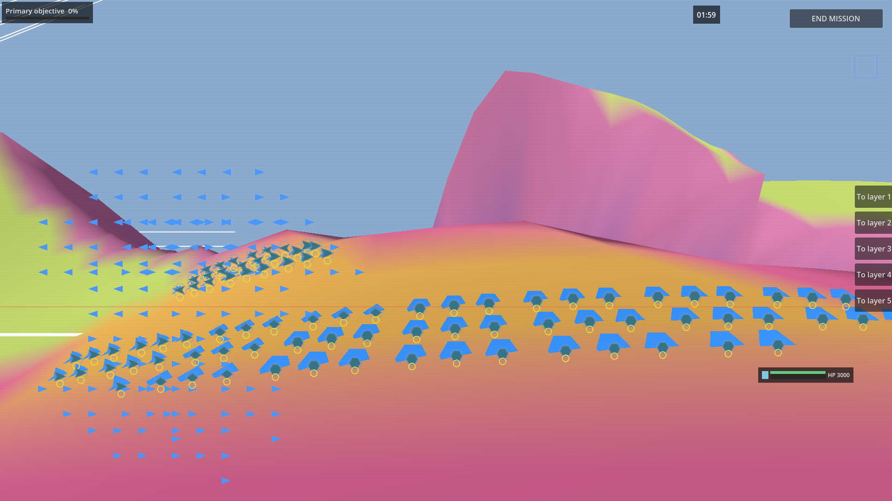
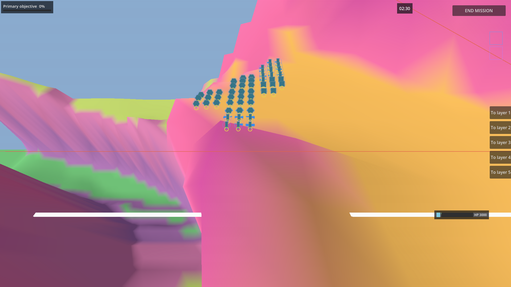
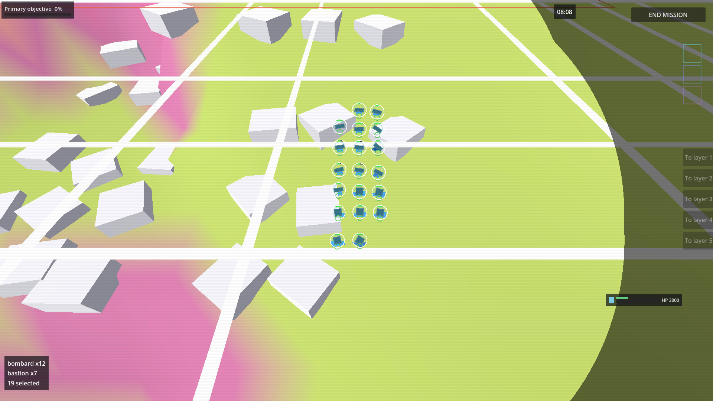
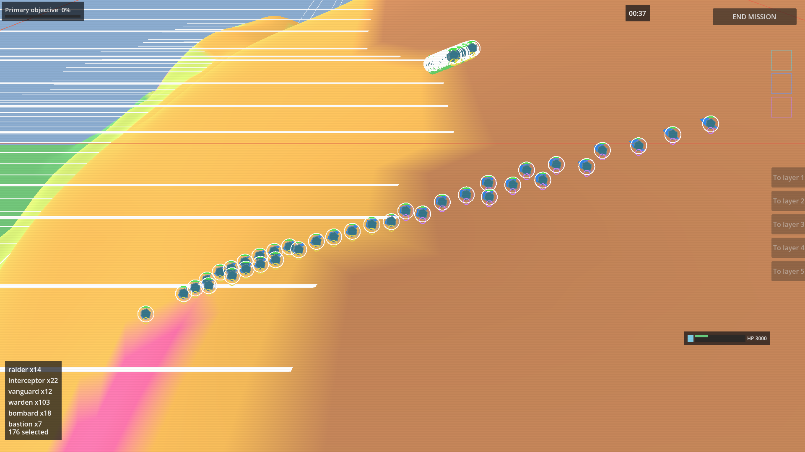

# What Westley decides, 2026-10-21

Answer in answers.md, one line per key: `<key>: <approve | reject | a | b | c | note>`. Anything not listed here is already decided or is the Architect's.

## 1. Pictures

P12 landscape lake-fill re-shot: coming with PROTO-landscape-lakefill

### P8 Units close on the ground (S-132)

**What you see:** Your force from 300 wu up, standing on an orange ridge under a pink steep wall: darts and arrowheads on the left, kites and wide hexagons on the right, each flat blue body 45 to 80 px across with a small dark icon and a yellow layer ring on top. Rows of loose blue arrowheads float above and below the force, away from any unit (the squad markers of the dart and arrowhead types, drawn in a flat map projection, so they do not sit on the 3D ground).
**Judge:** Can you tell the unit types apart by shape at a glance, at this size (S-132: "Every unit type has a shape I can read at a glance in any era")?
**Camera:** height 300 wu (the nearest wheel step to the ground; 1.80 px per wu at the centre), 1920x1080, seed 1, tick 2399. Body size measured on 71 blue shapes in the frame: median 55 px wide, 20 to 80 px, median 27 px tall (flat shapes seen at 50 degrees); the dark icon on top is 24 px. Your scaling question (FINDING-s246-unit-scale, land view) is still open: at the old height 3000 the same body is 4 px.
**Beta status of what is shown:**
- Unit shapes on the 3D ground (S-132): built and wired (lane C ground 3D, C6; scale fix VG-C-unitscale at 53ede72), the lane C plays pass; not Seen (your verdict pending).
- Squad markers for the dart and arrowhead types: built, but drawn in the flat map projection so they float off the units in the ground view (finding, no piece yet).

### P9 Slope with midline and blocked ground (S-001)

**What you see:** A steep pink wall (ground that blocks the layer) rising behind your force, a flat orange band your units stand on, green terraces dropping away at the left, and two long white bars across the ground where a slope joining two layers is marked at its midline; the bar disappears where the ground rises in front of it. Your units stand at the foot of the wall as small round icons, because their flat blue bodies lie nearly edge-on and half buried in the steep ground.
**Judge:** Can you see where terrain blocks a layer and where a slope joins two layers, so you can choose to go over, go around or hide (S-001)?
**Camera:** height 300 wu (1.80 px per wu at the centre), 1920x1080, seed 1, tick 3006. Unit bodies are not readable here (edge-on on the steep face); only the 24 px icons read. Body size on level ground is in the S-132 frame (median 55 px wide).
**Beta status of what is shown:**
- Slopes drawn with a midline and blocked ground tinted pink (S-001, R-001-06): built and wired (lane C ground 3D, C7), the S-001 play passes; not Seen (your verdict pending).
- Flat unit bodies on steep ground: built, they lie edge-on and half buried there (finding, no piece yet).

### P10 Sight and the dimmed outside (S-005)

**What you see:** Nineteen selected bombards and bastions (white rings) standing on open green ground beside the settlement's white blocks, with a bright lit area around them and a dimmed, darker region beyond a curved edge at the right of the frame, where the white slope bars show through grey. The edge is a circle on the screen centred on the group, not an ellipse on the ground, and the 24 px icons sit on top of the flat bodies.
**Judge:** Do you see less outside your units' sight, with a clear edge between what they see and what they do not (S-005: "I see less on other layers than on my own, and nothing three layers away, unless I hold a vantage")?
**Camera:** height 300 wu (1.80 px per wu at the centre), 1920x1080, seed 1, tick 9774; the lit edge is about 720 px from the group centre. Unit bodies are hidden under the 24 px icons and white selection rings. At this height the dim vanishes whenever an own unit stands far south of the camera (the sight circle of a unit near or behind the camera comes out huge), so the group was first sent south of every other unit to get this edge (finding, no piece yet). No separate darker band for a neighbouring layer is drawn: the dim is one overlay outside the sight circles (R-089-03), so this frame shows the edge but not the layer rule.
**Beta status of what is shown:**
- Sight circles and the dim outside them (S-005, R-089-03): built and wired (lane A fog layer, A1 to A21), the lane A plays pass; not Seen (your verdict pending).
- The dim at close zoom: built, missing in most close positions (finding, no piece yet).

### P11 Crossing toward another layer (S-004)

**What you see:** All 176 units selected (white rings) walking up a ridge in a long column, from the orange band at lower left to the brown band at upper right; the small ring under each unit changes from yellow to purple as it passes onto the upper layer, and the white midline bars of other slopes lie across the ground at the left. The column is thin and the units are single icons on the 3D ground, so the halfway line itself is not marked for the crossing.
**Judge:** Is a layer change on a slope visible, with the halfway line a place you can see and hold (S-004)?
**Camera:** height 300 wu (1.80 px per wu at the centre), 1920x1080, seed 1, tick 751 (the play's own order: every own unit sent to the top edge of the nearest slope, stepped in 25-tick chunks; these units crossed a ridge slope on the way, not the slope the play aimed at). No unit is in the timed transfer state, because walkers cross by position (R-004-06). Unit bodies are under the 24 px icons; body size in the S-132 frame.
**Beta status of what is shown:**
- Layer change on a slope (S-004, R-004-06): built and wired (lane C ground 3D, C7; S-004 play fix at bfd7f1c), the S-004 play passes; not Seen (your verdict pending).
- The halfway line as a marked place for one crossing: stub in this view (only the long midline bars are drawn, none picked out for the crossing).

## 3. Decided by the Architect 2026-10-22 (veto with a word)

- C11 (a): the overlap refusal stays; the lot table size is a memory bound, not a rule. DEC-C11-2026-10-22.
- C12 (a): the five September mockups are approved as built; re-shot inside their lanes' story plays. DEC-C12-2026-10-22.
- C13 (c): the 55-degree lens is restored first; the pitch stays 50 degrees (DRAFT-a18-pitch) and is judged on the next S-103 shot. DEC-C13-2026-10-22.
- C14 (c): the opening camera faces toward the objective and the home anchor moves inboard 1200 wu (DRAFT-home-anchor-inboard, piece VG-E-anchor-inboard). DEC-C14-2026-10-22.
- C15 (a): the economy multiplier scales a faction's budget income; R-033-01 is rewritten. DEC-C15-2026-10-22.
- Q-156-02 (c): the lab reports its ten conditions against the draft marks with no pass or fail until you confirm them. DEC-Q156-2026-10-22.
- C16: the single-process 30 s lab speed mark is retired; the lab landing waits on the fight-window change only. DEC-C16-2026-10-22.

## Answered 2026-10-22

- Q-147-01: the land era is named Greek (Westley 2026-10-22, "3rd time I'm ruling on it"); the Architect's three-name pick withdrawn.

## Answered 2026-10-21 (chat)

- C1 "A": lab fight window widened to 230 s. DEC-C1-2026-10-21.
- C2 "B", improvable, investigate the convo: lab landing waits for under 30 s. DEC-C2-2026-10-21.
- C3 "yes": known-red list for the sim suites. DEC-C3-2026-10-21.
- C4 "Fix the issue before moving on": fix the G3 control first. DEC-C4-2026-10-21.
- C5 strongpoints can be shot, must be rebuilt; zones are captured. DEC-C5-2026-10-21.
- C6 "C": onboarding weights dropped. DEC-C6-2026-10-21.
- C7 "yes on all 3": housekeeping, widened removal rule. DEC-C7-2026-10-21.
- C8 "I believe I ruled on these already": Batch A 11 covers them. DEC-C8-2026-10-21.
- C9 "C": a quarter at a half share. DEC-C9-2026-10-21.
- C10 "A": two routes to every vantage and strategic point. DEC-C10-2026-10-21.

## 4. Drafts in force unless you veto

- DRAFT-b25-star-ref: 1080 px, 45 degree fov (Architect, 2026-10-21)
- DRAFT-startforce-pocket 400 wu, DRAFT-startforce-clamp 0.15, DRAFT-startforce-offset 200 wu (Architect, 2026-10-20)
- DRAFT-c25-patch-radius: 3 (Architect, 2026-10-21)
- Places lane drafts of rev 6a: DRAFT-shape-harm 0.5, DRAFT-first-ring-spread 2, DRAFT-field-cost-share 15 to 55 percent (Architect, 2026-10-21)
- Age-10 lots scope narrowing (Architect, 2026-10-21)
- DRAFT-a18-pitch 50 degrees; DRAFT-home-anchor-inboard 1200 wu (Architect, 2026-10-22)
- DRAFT-lab-speed-ratio-1 0.75, DRAFT-lab-speed-ratio-1b 0.68 (Architect, 2026-10-21)

Parked by you (11): see batch_closed.md; added 2026-10-21: Q-082-03, Q-208-01, Q-149-01.

## Answered 2026-10-21

- Q-B23b-01: It's fine as it is for now (recorded: docs/northstar/ambiguity_register.md)
- Q-C2-5-01: A, that is the look; the test samples wrong (recorded: docs/northstar/ambiguity_register.md)
- Q-246-02: Layout engine sets it, landscape engine conforms (recorded: docs/northstar/ambiguity_register.md)
- Q-082-03: defer to after beta (recorded: docs/northstar/ambiguity_register.md, parked)
- Q-100-01: B, arc width per category (Strike wide, Line medium, Siege narrow), widths still lab drafts (recorded: docs/northstar/ambiguity_register.md)
- Q-208-01: defer to after beta (recorded: docs/northstar/ambiguity_register.md, parked)
- Q-228-01: A, only the commanding seat has a ledger character (recorded: docs/northstar/ambiguity_register.md)
- Q-149-01: defer to post beta (recorded: docs/northstar/ambiguity_register.md, parked)
- B22 part 1: A, publish the real internal figures (recorded: docs/northstar/plans/push_ledger_2026-09-22.md, DEC-B22-part-1-2026-10-21)
- B22 part 2: A, name and quotes appear (recorded: docs/northstar/plans/push_ledger_2026-09-22.md, DEC-B22-part-2-2026-10-21)
- B22 publish: A, publish after his read (recorded: docs/northstar/plans/push_ledger_2026-09-22.md, DEC-B22-publish-2026-10-21)
- doc branch method ask 1: B, the method page becomes an internal page (recorded: docs/northstar/plans/push_ledger_2026-09-22.md, DEC-doc-branch-method-ask-1-2026-10-21)
