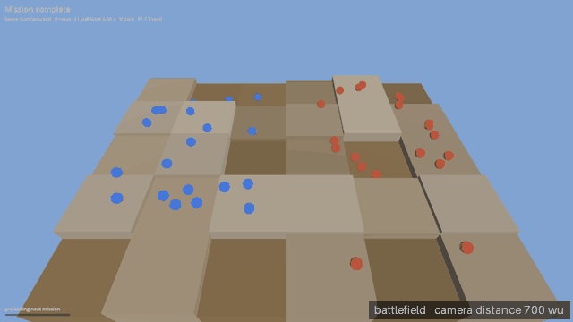

# Batch A follow-up 1 and 2: the transition prototype, how it works, and how No Man's Sky does it

Written 2026-10-21 for Westley. It answers two asks from Batch A (2026-10-18) that nobody had answered:

1. "I'd like to see the transition itself, not just a screenshot of the final product. Not approved yet, hand me the command to run the prototype."
2. "I can tell by the screenshot that the battlefield is still too large compared to the galaxy. What is the manner that we're currently accomplishing the transition? I'd like it explained to me on a high level the architecture behind the current method. (note to self, research may need be done on how No Mans Sky accomplished what we're attempting)"

Short version. To run it, section 1; to just watch it move, the GIF in section 4. The method is one scene and one camera: the battlefield and the galaxy sit in the same space at fixed sizes and only the camera flies out and back. The size rule in the code (the glowing dot's) is not what you see at the halfway frame you judged; there you see the real battlefield mesh, and it is about the same size as the stars beside it. Hello Games has published very little about its own version of this, so section 3 keeps what is documented apart from what is guesswork.

## 1. Run it

The prototype is not on main. It lives on the branch `push/proto-transition` (latest pass: 1c, stars drawn as dots), so it needs its own folder. First time only (the import took 11 seconds here):

```
git -C ~/Projects/ouroboros-manifold fetch -q origin
git -C ~/Projects/ouroboros-manifold worktree add --detach ~/Projects/om-push/wt/proto-transition origin/push/proto-transition
cd ~/Projects/om-push/wt/proto-transition
~/.local/bin/godot.real --headless --path . --import
```

Every time you want to watch it:

```
cd ~/Projects/om-push/wt/proto-transition
~/.local/bin/godot.real --path . --display-driver x11 --rendering-driver opengl3 res://scenes/mockups/transition/transition_mockup.tscn
```

If the folder already exists and you want the newest pass: `cd ~/Projects/om-push/wt/proto-transition && git fetch -q origin && git checkout -q --detach origin/push/proto-transition`.

What you see: a sky-blue field of tan blocks with blue and red unit markers and a "Mission complete" label. The keys are printed top-left.

| Key | Does |
|---|---|
| Space | starts the move; pressed again after the three chronicle lines have printed (or click Proceed) it starts the push-in |
| R | back to the start |
| [ and ] | halve or double the pull-back time (6 s default, 0.75 s to 48 s); press ] twice for a slow 24 s look |
| V | draws the camera's path as a yellow line |
| F1, F2, F3 | three different star fields |

Things worth knowing:
- It opens full screen (the project's setting). For a window, add `-w --resolution 1920x1080` after `--path .`.
- There is no quit key. Alt+F4, or Ctrl+C in the terminal.
- A few red lines about `godotsteam` appear at start. The Steam add-on is not built in a fresh folder; they do nothing here.
- The import changes about 50 tracked `.import` files and adds about 170 untracked `.uid` files, so `git status` in that folder looks dirty. It is a throwaway folder; ignore it.

What I ran to check the command (all in a private virtual display, never on your screen). There is no headless verify script for this mockup (a headless run draws nothing), so I used the prototype's own test file, which launches the real scene in a window, and then the exact launch line above with the prototype's built-in `--shot` flag added. The test file's decisive line:

```
PASS: 26  FAIL: 1
  - T2 [R-108-03] shot 04_pushin_mid.png is near-uniform: busyness 0.5020 (min 0.02), luminance stddev 7.85 (min 8.0)
```

The launch line exited 0 and wrote all five shots. The one failure is a brightness-spread check on the push-in midpoint frame (7.85 against a draft limit of 8.0) that the review queue recorded as passing, 27 and 0, for this same commit. Most likely a rendering difference on this box; it is not a launch problem. I touched no threshold.

Other prototypes you may want. Prototypes on main need a folder at main; the `view-main` folder the roadmap names does not exist on this box right now, so make it once:

```
git -C ~/Projects/ouroboros-manifold worktree add --detach ~/Projects/om-push/wt/view-main origin/main
cd ~/Projects/om-push/wt/view-main && ~/.local/bin/godot.real --headless --path . --import
```

Then, from `~/Projects/om-push/wt/view-main`, each of these is `~/.local/bin/godot.real --path . --display-driver x11 --rendering-driver opengl3 <scene>`:

| Prototype | Scene |
|---|---|
| Landscape (passes 4 and 5, as on main) | `res://scenes/mockups/landscape/landscape_mockup.tscn` |
| Layers (September ladder, pass 2) | `res://scenes/mockups/layers/layers_mockup.tscn` |
| Units (September ladder, pass 2) | `res://scenes/mockups/units/units_mockup.tscn` |
| Settlement, a base that builds itself | `res://scenes/mockups/settlement/settlement_mockup.tscn` |
| Galaxy (September ladder, pass 2) | `res://scenes/mockups/galaxy/galaxy_mockup.tscn` |

Two more live on their own branches. The approved landscape pass 6b is already in `~/Projects/om-push/wt/proto-land-iter` (same landscape scene, run from that folder). Terrain-obeys pass 2, route carving, is branch `push/proto-terrain-obeys-2`: make a folder with `git -C ~/Projects/ouroboros-manifold worktree add --detach ~/Projects/om-push/wt/proto-terrain-obeys-2 origin/push/proto-terrain-obeys-2`, import it as above, and open the same landscape scene from there; its layout overlay and a panel of named draft numbers sit inside it.

## 2. How the transition works today

**The method in one breath.** One 3D scene, one camera. The battlefield and the galaxy are both in that scene the whole time, at fixed sizes, centred on the same point. Only the camera moves: it starts 700 units from the battlefield and flies straight out to 10,000,000 units, then flies the same path back in. Nothing is swapped, cut, or faded between scenes. Everything that makes it feel like a transition is perspective plus a few dressings keyed to how far along the camera is. (Source: `scenes/mockups/transition/transition_mockup.gd` on the branch.)

**What is in the space.** The battlefield is 30 tiles in a 6 by 5 grid, 900 by 700 units, with 40 unit markers (23 units across, the game's unit scale). The galaxy is 4,000 star sprites in three spiral arms, between 60,000 and 4,000,000 units from that same middle, so about 8,000,000 across. The battlefield is the centre of the spiral. In this model the battlefield is 1 part in 8,900 of the galaxy.

**What moves.** The camera, and only the camera. Its distance multiplies by the same factor every instant (steady in orders of magnitude, not in units) and is eased, slow at both ends. Over the default 6 seconds: 700 units at the start, 1,500 at 1 s, 9,000 at 2 s, 98,000 at 3 s, 960,000 at 4 s, 8,700,000 at 5.6 s, 10,000,000 at 6 s. It also tilts from 48 to 62 degrees and swings about 29 degrees while it keeps looking at the battlefield.

**The five moments.** Battlefield with "Mission complete"; the pull-back; the galaxy hold, where the view squeezes to 62 percent, a 38 percent chronicle panel slides in over 0.4 s, three lines type out at 45 characters a second (about 5.4 s), and Proceed appears; the push-in, where the panel slides out, a new battlefield (new layout and tint) is built at the middle, hidden by distance, and the camera runs the same curve backwards; and "Briefing". The "preloading next mission" bar is a stand-in; nothing loads.

**What is scaled, and by what rule.** Almost nothing; the shrinking you see is distance. Three dressings ride on the same 0-to-1 progress number: the sky fades blue to black with a haze veil rising and falling (0.08 to 0.55); stars fade in (0.05 to 0.4); a glowing dot fades in at the battlefield (0.3 to 0.7), and the real battlefield mesh is hidden past 5,000,000 units. The dot is the one thing with a size rule, and it is `_dot.scale = d * 0.0015` (line 303). That ties its size to camera distance: it is always 0.0015 of the distance across, so it covers the same patch of screen at every distance, about 1.4 pixels on a 1,080-pixel-tall window (1.9 at 1,440, 2.8 at 2,160). It knows nothing about the galaxy's size or the battlefield's.

**Why the battlefield still reads as too large.** Two reasons, and the first is not the dot.

First, at mid pull-back what you are looking at is not the dot. It is the real battlefield, still 900 units wide, and it stays bigger than the dot until the camera is about 600,000 units out. At the halfway frame (camera 98,000 units, 3 s in) it is a rectangle about 9 pixels wide with the 1.4-pixel dot inside it. So shrinking the dot (the Batch A note says it became about 13 times smaller) cannot change that frame. I could not trace that change: all three commits on the branch carry the same 0.0015, so it was made in a version I cannot see, or the note counts something else.

Second, the stars it sits among are about its own size. The inner half of the stars are drawn 0.8 percent as wide as their distance from the centre: 480 units across at the inner edge, 1,600 at 200,000 out, 8,000 at 1,000,000 out, against the battlefield's 900. The outer half are 30,000 to 80,000 across. So in this model a star is a battlefield or up to about 90 battlefields, and the stars begin fading in at 0.05, when the battlefield is still hundreds of pixels wide. For most of the pull-back you compare them side by side, and a small brown rectangle among dots reads as one more dot that happens to be bigger. In the final galaxy frame the dot is smaller than a star dot, as the Batch A note says; the trouble is the middle.

**The numbers that set the apparent size.** Three hand-set numbers that do not know about each other: the battlefield's 900 units (6 tiles of 150), the star widths (0.004 times distance, doubled, for the inner stars; 15,000 to 40,000 half-widths for the outer), and the dot's 0.0015. At mid-flight the pair that counts is 900 against the star widths. At the galaxy frame the one that counts is 0.0015. Battlefield width on a 1,080-pixel window, straight on: about 570 px at 1,500 units, 94 px at 9,000, 30 px at 27,650, 9 px at 98,000, 2.6 px at 320,000, under 1 px past 840,000.

**What it would take to make it a ratio (options, no decision).** Nothing is a ratio today. Make it one by picking a single number, such as how many battlefields wide a star is, and deriving the rest from it. The ways I can see:

1. Resize the world. Shrink the battlefield, or grow the stars, the galaxy and the camera's end distance by one factor. With a named draft DRAFT-battlefield-over-star = 0.02, a star is 50 battlefields wide, 45,000 units, inside today's outer-star range. Cost: big stars bring back the blobs of pass 1b unless they are drawn as fixed-pixel sprites, and the end distance grows with the galaxy.
2. Shrink only the battlefield as the camera pulls back: an extra scale on its mesh that falls from 1 to DRAFT-battlefield-end-scale (0.05 would be twenty times smaller, your 10 to 20). Cheapest way to change the mid-flight frame. Cost: it bends the spec's line that it reads as the same space at different scales; slow enough, the eye reads it as distance.
3. Pixel floors with one ratio between them: a battlefield is drawn at its true size or DRAFT-dot-floor-px (1.0), a star at its true size or DRAFT-star-floor-px (3.0), so a battlefield dot is never bigger than a star dot once both are small. This replaces the 0.0015 rule. Alone it does not touch the 9-pixel rectangle at mid-flight.
4. Re-time instead of resize: start the stars only when the battlefield is under about 3 pixels (progress about 0.64, 320,000 units), so the two are never side by side at similar size. This hides the comparison; it does not fix the ratio. No new assets.
5. Reference sizes between the ends: a world and a sun between the battlefield and the galaxy, turning one 14,300-to-1 jump into three smaller ones with an object of known size at each. The biggest change: new objects and a longer move.

## 3. How No Man's Sky does it

Hello Games has published very little about the one mechanism you are asking about, the camera and scale handling when you leave a planet. The main primary source is Innes McKendrick's GDC 2017 talk, "Continuous World Generation in No Man's Sky", which its summary describes as walking the pipeline "from voxel-based world generation, through polygonization and texturing, to eventual population and simulation" ([Game Developer](https://www.gamedeveloper.com/programming/video-how-continuous-world-generation-works-in-i-no-man-s-sky-i-)). I could not read the talk: the GDC Vault page was down for maintenance and the free video has no transcript I could fetch. So below, documented facts, community reading, and standard practice are marked apart.

What is documented. Planets are built as a cube projected onto a sphere (Polygon, 2017); terrain is voxels with procedurally generated textures (Digital Foundry, 2016); the universe grows from seeds so nothing is stored or streamed from a server (the New Yorker, 2015). All three are summarised on [Wikipedia's page on the game's development](https://en.wikipedia.org/wiki/Development_of_No_Man%27s_Sky), which also records that atmospheres are made denser at the top for a more dramatic takeoff and landing, and that moons orbit closer than physics allows. [Kill Screen](https://www.killscreen.com/greatest-technical-feats-no-mans-sky/) says the same of the moons, and that takeoff uses a short animation that sends the ship up into the clouds. The scale is composed, not simulated, and the seam is dressed on purpose.

Technique one, keeping numbers small near the camera. Single-precision floats lose precision with distance. [Godot's own documentation](https://docs.godotengine.org/en/stable/tutorials/physics/large_world_coordinates.html) recommends staying under about 4,096 units from the origin for third-person and 32,768 for top-down games, says integers are exact only up to 16,777,216, and says past that you need a double-precision build or origin shifting. A floating origin (Chris Thorne, Cyberworlds 2005, [bibliographic record](https://dblp.dagstuhl.de/rec/conf/cw/Thorne05.html); I saw the record, not the paper) keeps the camera at the origin and moves the world the other way; Kerbal Space Program is reported to do this ([ModDB developer blog](https://www.moddb.com/games/fragile-existence/news/connecting-the-dots-interplanetary-travel), secondhand). A modern variant, the Rust [big_space](https://docs.rs/big_space) library, stores each object as a whole-number cell plus a small offset within it, which gives 64 bits of position from two 32-bit values and leaves far-away objects imprecise only where they are too far to see. No Man's Sky's galactic address looks like a cell grid (planet, star system, then region coordinates, per community write-ups of the portal address, secondhand), but I found no Hello Games statement that its renderer uses a floating origin.

Technique two, a shrunken copy of the far world ("scaled space", or two-scale rendering). A second camera draws only the distant layer, copies the main camera's field of view and rotation, and moves more slowly by the scale factor, so very large far objects fit the depth range and still show parallax ([Unity forum thread](https://discussions.unity.com/t/managing-a-large-space-environment-with-planets/168459), secondhand). Kerbal Space Program is described by modders as using an ordered stack of cameras including a galaxy camera and a scaled-space camera ([KSP forum](https://forum.kerbalspaceprogram.com/topic/196230-render-texture-camera-and-ksp-culling-layers-masks), secondhand). The local scene is true size; everything big and far is a scaled stand-in. Our prototype uses neither: one scale, one scene, a camera far plane of 100,000,000 units.

Technique three, level-of-detail switching, and hiding the seam. Each thing is drawn in a form suited to its size on screen and changes form as it crosses a limit: voxel planet near, sphere and atmosphere further out, dot beyond. Players read No Man's Sky's landing pop-in as exactly that ([Steam discussion](https://steamcommunity.com/app/275850/discussions/0/361798516955288098/), a guess, not a developer statement). Starfield made the opposite choice on purpose: Todd Howard is reported to have said the surface is one reality and space another ([TechSpot](https://www.techspot.com/news/94963-starfield-players-cannot-actively-pilot-their-ships-planet.html); the page would not open for me, so this is from a search summary). A modder building No Man's Sky-style landings for it is reported to describe re-creating the planet in 3D from space and using clouds, light and exposure to hide the final switch (coverage in [PC Gamer](https://www.pcgamer.com/games/rpg/seamless-landing-mod-looks-set-to-bring-starfield-another-step-closer-to-no-mans-sky/) and [Wccftech](https://wccftech.com/starfield-seamless-landings-mod-no-mans-sky-singer-songwriter/); neither page would open for me, so this is from a search summary). The hyperspace warp is different again: one player, in a Starfield forum thread, calls it in effect a loading screen between star systems ([Steam discussion](https://steamcommunity.com/app/1716740/discussions/0/3815159923582053826), anecdotal). That is a mask, not continuity.

What it adds up to, my reading rather than a source's: the continuity in these games is a stack, not one clever camera. Numbers are kept small near the viewer, far things are drawn as scaled stand-ins or dots with a minimum size on screen, each thing swaps to a cheaper form as it shrinks, and the seams hide under atmosphere, cloud or a warp tunnel. The sense of scale comes less from true ratios than from objects of known size going past (a planet, a moon, a sun).

**What of that applies here (options, nothing decided).** Our prototype is already the one-continuous-space kind, and at today's sizes it needs none of the precision machinery: the galaxy view is at 10,000,000 units, under the 16,777,216 where single-precision positions are exact to a unit. That changes in two cases. If the galaxy is made much bigger to fix the ratio (option 1 above), each factor of ten costs a decade of precision. And if the next mission must sit at its own star rather than at the middle of the scene, which the prototype avoids by rebuilding the battlefield at the origin so the camera returns to where it left, then the choices are a floating origin (re-centre the scene on the target star as the camera falls toward it) or a double-precision Godot build, with the Godot page's warning about speed and memory. For the look, the games above compose scale rather than measure it: the ratio could become the control surface (named drafts DRAFT-battlefield-over-star, DRAFT-dot-floor-px, DRAFT-star-floor-px), and a reference object between the two ends (a world, then a sun) is the thing these games lean on that ours lacks between "a patch of ground" and "a spiral of dots". The seam itself is already hidden under haze and the sky fade; the one visible seam is the stars starting while the battlefield is still large.

## 4. Seeing the transition move



The GIF is the real prototype scene played once through: Space pressed to start and again after the chronicle lines, run in a private virtual display at 1,920 by 1,080 and 30 frames a second, a frame every 0.1 s of scene time, shown at 640 pixels wide with every other frame kept and the 5.4 s galaxy hold cut to seven frames. The corner caption gives the camera's distance in units. It loops. Twelve full-size stills of the same run are in `docs/northstar/story_reviews/shots/proto-transition-moves/`:

| # | File | Seconds in | Camera distance | Battlefield width on a 1,080 px window |
|---|---|---|---|---|
| 1 | `01_battlefield_d700.png` | 0 | 700 | fills it, about 1,200 px |
| 2 | `02_pullback_d1487.png` | 1.0 | 1,487 | about 570 px |
| 3 | `03_pullback_d8978.png` | 2.0 | 8,978 | about 94 px |
| 4 | `04_pullback_d27652.png` | 2.5 | 27,652 | about 30 px |
| 5 | `05_pullback_d98126.png` | 3.1 | 98,126 | about 9 px (the halfway frame you judged) |
| 6 | `06_pullback_d319271.png` | 3.6 | 319,271 | about 3 px |
| 7 | `07_pullback_d963458.png` | 4.1 | 963,458 | under 1 px, only the dot |
| 8 | `08_pullback_d2523202.png` | 4.6 | 2,523,202 | dot only |
| 9 | `09_pullback_d8671893.png` | 5.6 | 8,671,893 | dot only |
| 10 | `10_galaxy_with_chronicle_d10000000.png` | end of the hold | 10,000,000 | dot only; chronicle and Proceed showing |
| 11 | `11_pushin_d71336.png` | 3.1 into the push-in | 71,336 | about 12 px |
| 12 | `12_next_battlefield_d700.png` | the new battlefield | 700 | fills it |

Widths are straight-on estimates from the numbers above, not measured off the pictures. The shared QA driver (`scripts/mockup_qa.sh run`) refuses scenes that lack `qa_state` and `qa_plant`, which this mockup does not have, so the capture used a small throwaway driver that boots the scene the way the harness does, presses the keys and grabs the viewport. It is not committed; say the word and it can be.
