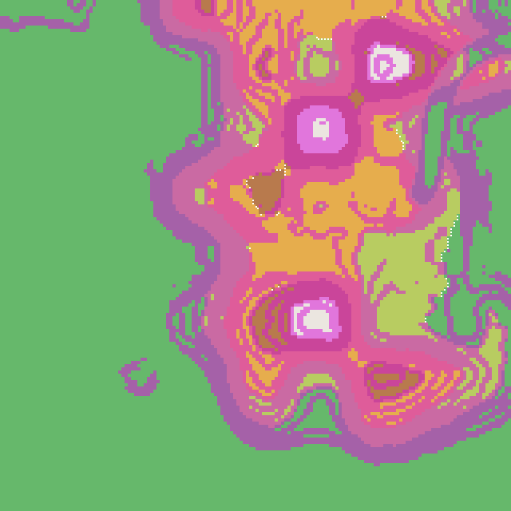
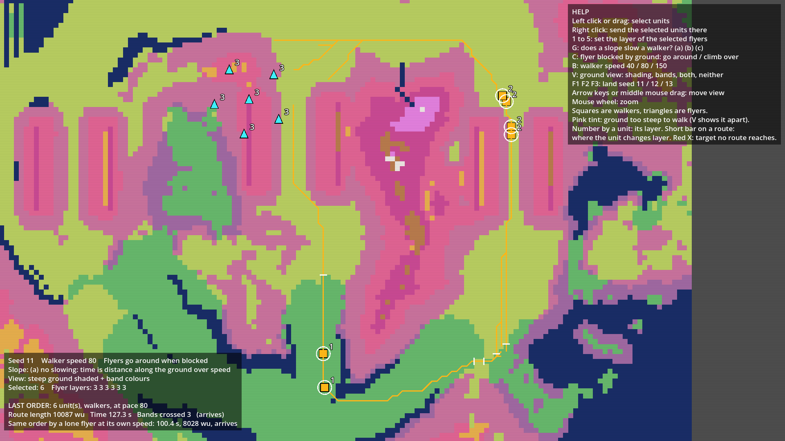
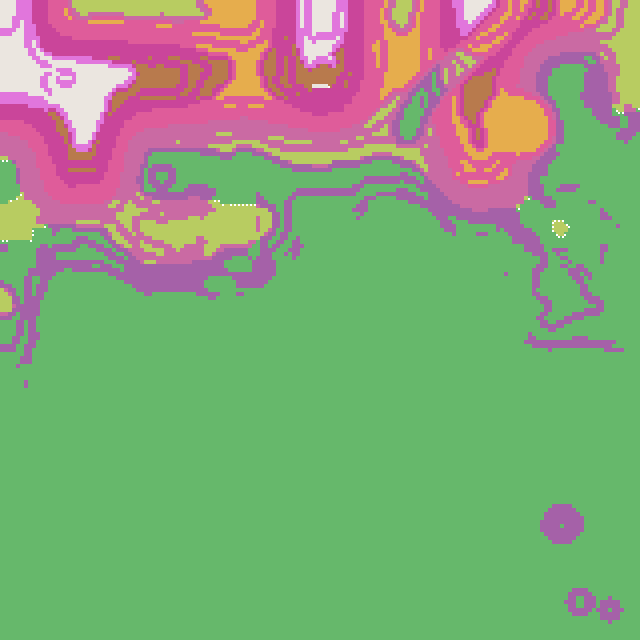
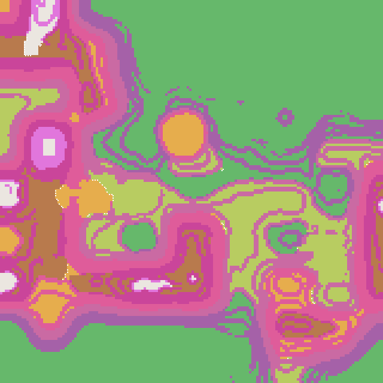

# The sim's ground against the approved mockup (terrain stage 1, look lane)

Left: the C sim's ported terrain (`scripts/terrain_look.py`, 16,000 canvas, 160 x 160 cells). Right: the walkers mockup. Band colours are the mockup's ramp (green, yellow-green, orange, brown, white for bands 1 to 5). On the sim pictures, cells shaded magenta are unwalkable (steep) and white dots mark slope midlines. The mockup picture shows its steep ground shaded the same way, plus walker routes drawn on top.

The mockup's screenshot mode cannot pick a seed from the command line (it always loads seed 11), so only seed 11 has a mockup picture (the committed `qa/walkers_pass.png`). Seeds 12 and 13 show the sim only; the mockup's numbers for them are computed from its grid and listed below. Mockup water (open water outside the land) is drawn dark blue in the mockup and has no counterpart in the sim.

## Seed 11

| Sim | Mockup |
|---|---|
|  |  |

## Seed 12

| Sim | Mockup |
|---|---|
|  | (no picture: seed not selectable from the command line) |

## Seed 13

| Sim | Mockup |
|---|---|
|  | (no picture: seed not selectable from the command line) |

## Numbers (share of all cells)

| Seed | | Walkable | Largest walkable region | Water | Band 1 | Band 2 | Band 3 | Band 4 | Band 5 | Slopes |
|---|---|---|---|---|---|---|---|---|---|---|
| 11 | sim | 62.1% | 42.6% | none | 59.3% | 14.3% | 18.3% | 6.0% | 2.1% | 60 |
| 11 | mockup | 38.6% | 28.7% | 19.1% | 15.4% | 44.9% | 16.0% | 4.3% | 0.3% | n/a |
| 12 | sim | 75.4% | 62.3% | none | 72.5% | 9.4% | 9.0% | 5.8% | 3.3% | 40 |
| 12 | mockup | 33.4% | 22.7% | 20.2% | 18.2% | 39.3% | 18.1% | 4.3% | 0.0% | n/a |
| 13 | sim | 57.3% | 22.4% | none | 46.3% | 22.0% | 15.3% | 13.9% | 2.6% | 61 |
| 13 | mockup | 45.8% | 37.5% | 30.9% | 5.1% | 30.3% | 22.6% | 10.2% | 0.9% | n/a |

Sim: walkable is read at cell centres; the largest region is 4-neighbour. Mockup: walkable share and the main walkable region are the mockup's own (`walkable_share`, `main_cells`); its band shares are of all 161 x 161 cells with water counted separately.

## What differs and why

The two grounds are not the same land and were never going to be. The sim uses its own integer-hash noise and a table sine and cosine, so even with the same seed the hills fall in different places. Stage 1 does not port the layout shaping of mockup passes 5 and 6 (pads, chokes, valleys and routes stamped into the height), because the layout is being redesigned; the sim ground is terrain without a layout, which is why the mockup has flatter shaped plateaus and the sim has bare landforms. Heights are clamped at 0 in the sim, so what the mockup draws as water becomes band 1 and the sim's band 1 share is much larger. The sim also has 160 cells a side (canvas / 100) where the mockup has 161, so cell edges differ slightly. The relief numbers are carried over as provisional settings and the steep limit is the same 35 degrees.

Question for Westley: does the sim's ground pass as the approved look, or what must change.
